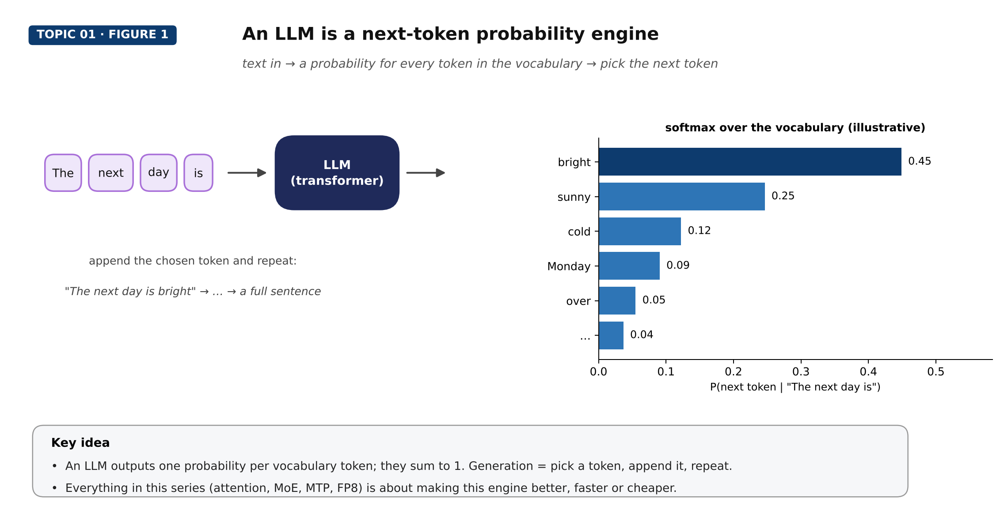
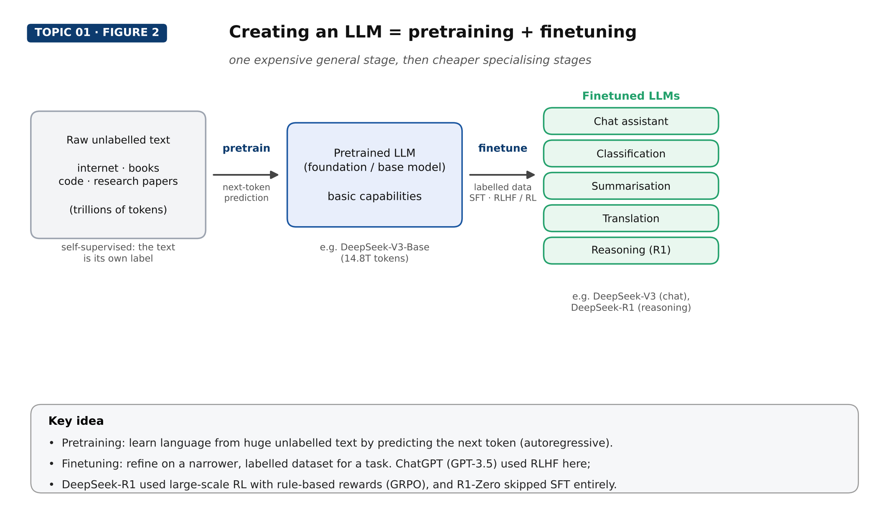
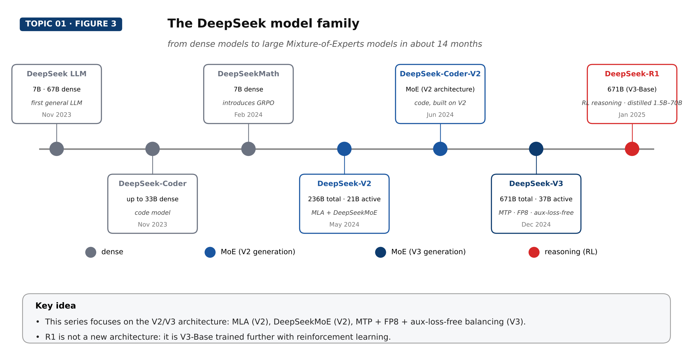
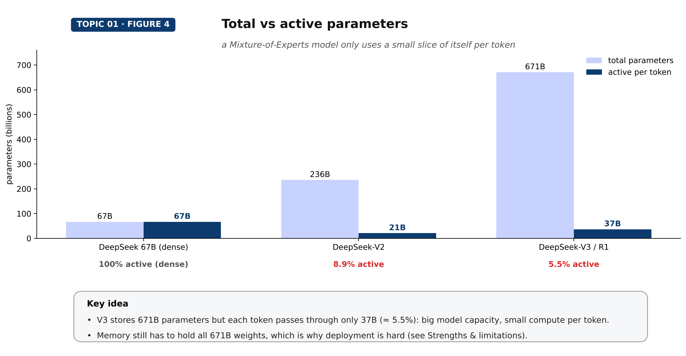
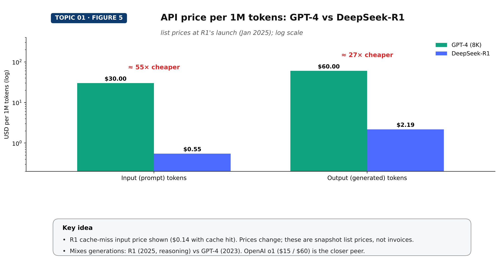
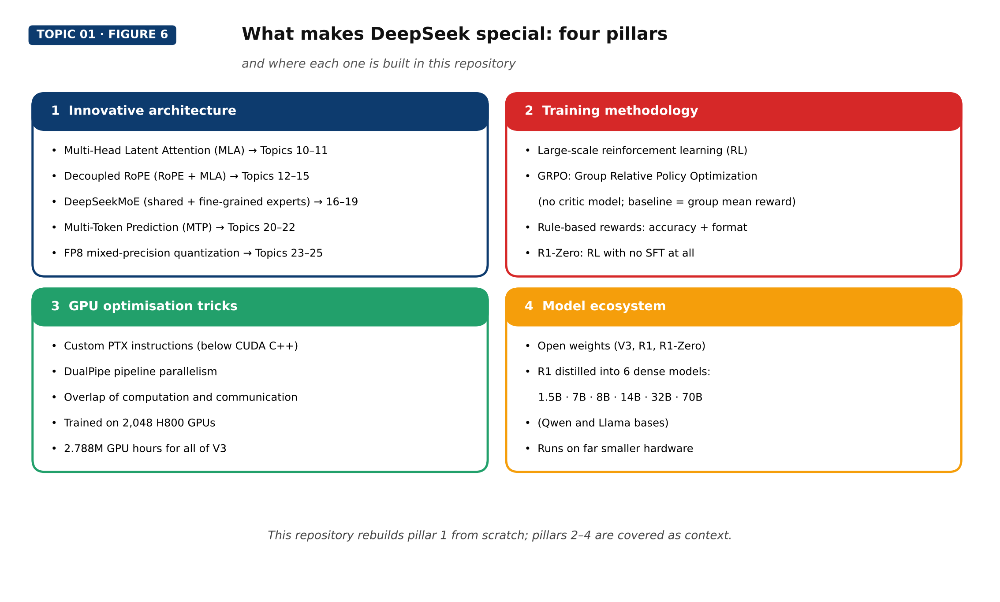
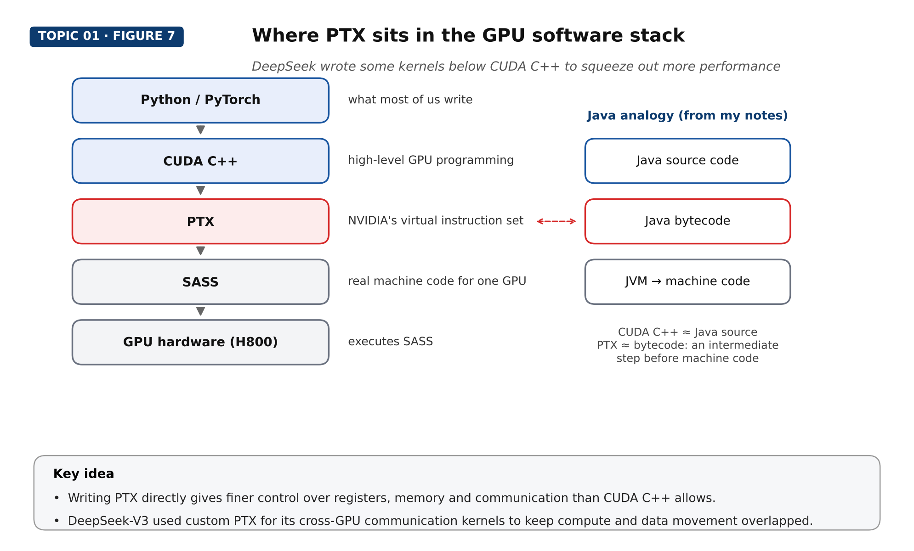

 

**[← Back to the DeepSeek from Scratch series](../README.md)**

---

## Abstract

This topic sets the stage for the series. It defines a large language model as a probabilistic next-token engine, reviews the three properties that separate LLMs from earlier NLP systems (scale, task generality, and emergent abilities), and describes the two-stage recipe — pretraining followed by finetuning — used to build them. It then surveys the DeepSeek model family from DeepSeek LLM (2023) to DeepSeek-V3 and DeepSeek-R1 (2024–2025), compares DeepSeek-R1 with GPT-4 on price and openness, and lays out the four pillars behind DeepSeek's efficiency: an innovative architecture (MLA, DeepSeekMoE, MTP, FP8), a reinforcement-learning-first training methodology (GRPO), low-level GPU optimisation (PTX), and an open model ecosystem with distilled variants. Every architectural pillar is mapped to the topic in this repository where it is rebuilt from scratch.

---

## At a Glance

| | |
|---|---|
| **Topic** | 01 of 26 — Stage 1 |
| **Document type** | Overview & context — no new code |
| **Core question** | What is DeepSeek, and which ideas made its models both strong and cheap? |
| **Builds on** | [`llm-from-scratch`](https://github.com/shivakiran-ai/llm-from-scratch) — a GPT-2 built from first principles |
| **Key numbers** | DeepSeek-V3: 671B total / 37B active parameters · 14.8T training tokens · 2.788M H800 GPU hours |
| **Main artifact** | `Topic1_DeepSeekBasics.docx` — technical report with 7 figures |
| **Version** | 1.0 · November 2026 |

---

## 1. What Is an LLM? — A Next-Token Probability Engine

DeepSeek is a Chinese AI company that builds large language models. Before looking at what it changed, it helps to be precise about what an LLM *is*.

An LLM takes a sequence of tokens and returns a probability for **every** token in its vocabulary being the next one. Generation is just: pick a token, append it, repeat.

Formally, given tokens $x_1, \dots, x_t$, the model produces a logit vector $\mathbf{z}_t \in \mathbb{R}^{|V|}$ and turns it into a distribution with softmax:

$$
P_\theta(x_{t+1} = i \mid x_{1:t}) \;=\; \mathrm{softmax}(\mathbf{z}_t)_i \;=\; \frac{e^{z_{t,i}}}{\sum_{j=1}^{|V|} e^{z_{t,j}}}
$$

Because each token is predicted from the ones before it, the probability of a whole sequence factorises **autoregressively**:

$$
P_\theta(x_1, \dots, x_T) \;=\; \prod_{t=1}^{T} P_\theta(x_t \mid x_{<t})
$$

---

## 2. Three Properties That Make LLMs Different

| Property | Earlier NLP models | Large language models |
|---|---|---|
| **Size** | Millions of parameters | Billions of parameters (DeepSeek-V3: 671B) |
| **Tasks** | One model per task — translation, sentiment, … | One model, many tasks. Earlier models could not write an email from custom instructions; for an LLM it is trivial. |
| **Emergent abilities** | — | Skills such as multi-step arithmetic or unscrambling words appear once models pass a certain scale, even though training is only next-token prediction [7] |

> **A caveat worth knowing.** Whether these abilities truly "switch on" at a threshold is debated: Schaeffer et al. [8] argue that much of the apparent jump comes from the choice of all-or-nothing evaluation metrics. The capabilities are real; how *sudden* they are is the open question.

The architecture behind all three properties — the "secret sauce" — is the **Transformer** [6]. Topics 02–06 rebuild it.

---

## 3. How an LLM Is Built — Pretraining + Finetuning

$$
\text{Creating an LLM} \;=\; \underbrace{\text{Pretraining}}_{\text{large, diverse, unlabelled data}} \;+\; \underbrace{\text{Finetuning}}_{\text{narrow, labelled, task-specific data}}
$$

**Pretraining** minimises the average negative log-likelihood of the next token over a huge corpus — the text is its own label, so no human annotation is needed:

$$
\mathcal{L}_{\text{pretrain}}(\theta) \;=\; -\frac{1}{T}\sum_{t=1}^{T} \log P_\theta(x_t \mid x_{<t})
$$

The result is a **foundation (base) model** with broad capabilities. DeepSeek-V3-Base was pretrained on 14.8 trillion tokens [4].

**Finetuning** specialises that model. ChatGPT (GPT-3.5) was finetuned with **RLHF** — human annotators ranked model outputs and the rankings were turned into a reward signal [9]. This finetuning stage is exactly where DeepSeek-R1 changed the game (Section 7, Pillar 2).

---

## 4. The DeepSeek Model Family

| Model | Released | Parameters | What it introduced |
|---|---|---|---|
| DeepSeek LLM | Nov 2023 | 7B, 67B (dense) | First general-purpose DeepSeek LLM [1] |
| DeepSeek-Coder | Nov 2023 | up to 33B (dense) | Code-specialised models |
| DeepSeekMath | Feb 2024 | 7B (dense) | **GRPO**, the RL algorithm later used for R1 [2] |
| DeepSeek-V2 | May 2024 | 236B total · 21B active (MoE) | **Multi-Head Latent Attention + DeepSeekMoE**; KV cache −93.3% vs DeepSeek 67B [3] |
| DeepSeek-Coder-V2 | Jun 2024 | MoE (V2 architecture) | Code model built on V2 |
| DeepSeek-V3 | Dec 2024 | 671B total · 37B active (MoE) | **Multi-Token Prediction, FP8 training, auxiliary-loss-free load balancing** [4] |
| DeepSeek-R1 | Jan 2025 | 671B (from V3-Base) | Large-scale RL for reasoning; open weights; distilled 1.5B–70B models [5] |

DeepSeek-R1 is a **reasoning model** reported to perform comparably to OpenAI-o1 on reasoning benchmarks, at a fraction of the cost and with open weights [5]. It is not a new architecture — it is DeepSeek-V3-Base trained further with reinforcement learning. That is why this series studies the **V2/V3 architecture**.

### Total vs. active parameters

DeepSeek-V2 and V3 are **Mixture-of-Experts** models: for each token a router activates only a few expert sub-networks.

$$
\text{active fraction (V3)} \;=\; \frac{37\,\text{B}}{671\,\text{B}} \;\approx\; 5.5\%
\qquad\qquad
\text{active fraction (V2)} \;=\; \frac{21\,\text{B}}{236\,\text{B}} \;\approx\; 8.9\%
$$

Compute per token scales with the **active** parameters; memory still has to hold **all** of them.

---

## 5. DeepSeek vs. GPT-4

| | GPT-4 | DeepSeek-R1 |
|---|---|---|
| **Performance** | Strong general model (2023) | Similar or better on many reasoning, math and coding tasks; comparable to OpenAI-o1 [5] |
| **Input price** (per 1M tokens) | \$30.00 (8K context) | \$0.55 (cache miss) · \$0.14 (cache hit) |
| **Output price** (per 1M tokens) | \$60.00 | \$2.19 |
| **Weights** | Closed source | Open weights — can be self-hosted |

The cost of a request is linear in the token counts:

$$
\text{Cost} \;=\; \frac{N_{\text{in}}}{10^6}\,p_{\text{in}} \;+\; \frac{N_{\text{out}}}{10^6}\,p_{\text{out}}
$$

For 1M input and 1M output tokens: GPT-4 costs $30 + 60 = 90$ USD, DeepSeek-R1 costs $0.55 + 2.19 = 2.74$ USD — about **33× cheaper**.

> **Fair comparison note.** Prices are list prices at R1's launch (January 2025) and change over time. GPT-4 is a 2023 model; the closer peer to R1 is OpenAI-o1, listed at \$15 / \$60 per 1M tokens — still roughly 27× more expensive than R1.

---

## 6. Strengths and Limitations

| Strengths | Limitations |
|---|---|
| **Open weights** — inspect, self-host, finetune | Newer and less battle-tested than the most established closed models |
| **Cost efficiency** — cheap API, cheap training (V3: \$5.576M at an assumed \$2/GPU-hour [4]) | Default safety behaviour is lighter; self-hosting teams must add their own safeguards |
| **Competitive performance**, especially in reasoning, math and coding | **Deploying 671B parameters is non-trivial** — all weights must fit in GPU memory even though only 37B are active per token |
| **Distilled variants** (1.5B–70B) run on far smaller hardware [5] | Smaller distilled models trade away some quality |

The training cost figure covers only the final training run, not prior research or ablations [4]:

$$
2{,}788\text{K GPU hours} \times \$2/\text{GPU hour} \;=\; \$5.576\text{M}
$$

---

## 7. What Makes DeepSeek Special — Four Pillars

### Pillar 1 — Innovative architecture *(rebuilt in this repository)*

| Innovation | Problem it solves | Topics |
|---|---|---|
| Multi-Head Latent Attention (MLA) | The KV cache grows huge at long context | [10](../10_multihead_latent_attention/README.md) – [11](../11_mla_code/README.md) |
| Decoupled RoPE | Standard RoPE is incompatible with MLA's compressed cache | [12](../12_integer_binary_positional_encoding/README.md) – [15](../15_deepseek_mla_rope/README.md) |
| DeepSeekMoE | Dense FFNs make every token pay for every parameter | [16](../16_moe_intro/README.md) – [19](../19_moe_code/README.md) |
| Multi-Token Prediction (MTP) | One next-token target gives a sparse training signal | [20](../20_mtp_intro/README.md) – [22](../22_mtp_code/README.md) |
| FP8 mixed-precision training | Training at this scale is memory- and compute-bound | [23](../23_quantization_intro/README.md) – [25](../25_deepseek_quantization_p2/README.md) |

> RoPE itself is not a DeepSeek invention (Su et al., 2021). DeepSeek's contribution is the **decoupled** variant that makes RoPE work with MLA.

### Pillar 2 — Training methodology: reinforcement learning first

Instead of relying mainly on human-labelled data, DeepSeek used **large-scale RL** to teach reasoning. **DeepSeek-R1-Zero** was trained with RL directly on the base model, with **no** supervised finetuning step, and still developed long chain-of-thought, self-verification and reflection [5].

The RL algorithm is **GRPO** (Group Relative Policy Optimization), introduced in DeepSeekMath [2]. PPO needs a separate critic (value) model about as large as the policy; GRPO removes it. For each question it samples a group of $G$ answers, scores them, and uses the **group itself as the baseline**:

$$
\hat{A}_i \;=\; \frac{r_i - \operatorname{mean}(r_1, \dots, r_G)}{\operatorname{std}(r_1, \dots, r_G)}
$$

Answers better than their group average are reinforced; worse ones are penalised. For R1 the rewards are largely **rule-based** — is the final answer correct, and is the output in the required format — rather than a learned reward model [5].

### Pillar 3 — GPU optimisation tricks

DeepSeek-V3 was trained on 2,048 NVIDIA H800 GPUs [4]. To keep them busy, DeepSeek went below CUDA C++ and wrote parts of its communication kernels in **PTX**, NVIDIA's intermediate instruction set.

A useful analogy: if CUDA C++ is like Java source code, PTX is like Java bytecode — an intermediate step before real machine code (SASS) runs on the GPU.

### Pillar 4 — Model ecosystem

DeepSeek open-sourced R1, R1-Zero and **six dense models distilled from R1** — 1.5B, 7B, 8B, 14B, 32B and 70B, built on Qwen and Llama bases [5]. Strong reasoning becomes usable on a single consumer GPU.

---

## Key Technical Observations

1. **An LLM is a conditional probability distribution over the next token.** Every topic in this series changes *how* $P_\theta(x_{t+1} \mid x_{1:t})$ is computed, never *what* it is.
2. **DeepSeek's architecture innovations are almost all about efficiency.** MLA cuts inference memory, MoE cuts compute per token, FP8 cuts training cost, MTP extracts more signal per token.
3. **Total parameters ≠ compute.** V3 has the capacity of a 671B model but the per-token compute of a ~37B one. Memory, not compute, becomes the deployment bottleneck.
4. **R1 is a training breakthrough, not an architecture one.** It reuses V3-Base and changes the finetuning stage: RL with rule-based rewards via GRPO.
5. **GRPO's key idea is removing the critic.** Normalising rewards within a group of samples gives a baseline for free and saves a model's worth of memory.
6. **Price comparisons need dates and peers.** A 2025 reasoning model against a 2023 general model overstates the gap; against o1 the gap is still about 27× on output tokens.

---

## References

References are listed in IEEE numeric format.

| # | Authors | Title | Venue | Year |
|:-:|---------|-------|-------|:-:|
| 1 | DeepSeek-AI | DeepSeek LLM: Scaling Open-Source Language Models with Longtermism | *arXiv:2401.02954* | 2024 |
| 2 | Z. Shao et al. | DeepSeekMath: Pushing the Limits of Mathematical Reasoning in Open Language Models | *arXiv:2402.03300* | 2024 |
| 3 | DeepSeek-AI | DeepSeek-V2: A Strong, Economical, and Efficient Mixture-of-Experts Language Model | *arXiv:2405.04434* | 2024 |
| 4 | DeepSeek-AI | DeepSeek-V3 Technical Report | *arXiv:2412.19437* | 2024 |
| 5 | DeepSeek-AI | DeepSeek-R1: Incentivizing Reasoning Capability in LLMs via Reinforcement Learning | *arXiv:2501.12948* | 2025 |
| 6 | A. Vaswani et al. | Attention Is All You Need | *NeurIPS* | 2017 |
| 7 | J. Wei et al. | Emergent Abilities of Large Language Models | *TMLR* | 2022 |
| 8 | R. Schaeffer, B. Miranda, S. Koyejo | Are Emergent Abilities of Large Language Models a Mirage? | *NeurIPS* | 2023 |
| 9 | L. Ouyang et al. | Training Language Models to Follow Instructions with Human Feedback | *NeurIPS* | 2022 |

*Pricing: DeepSeek API pricing page (R1 list prices, January 2025); OpenAI API pricing (GPT-4 8K and o1 list prices).*

---

## Files in This Directory

| File | Description |
|------|-------------|
| `README.md` | This document — conceptual summary and reader entry point |
| `Topic1_DeepSeekBasics.docx` | Primary artifact (v1.0) — technical report: title page, abstract, contents, 9 sections, 7 embedded figures, IEEE references |
| `images/` | The 7 figures used in this README and the report |

> **No notebook for this topic.** Topic 01 is conceptual. Code begins with the Transformer components from Topic 02 onward.

---

## Navigation

**Previous:** &nbsp; *Start of series*

**Next:** &nbsp; [Topic 02 — LLM Architecture Overview](../02_llm_architecture/README.md) &nbsp;·&nbsp; *The full GPT-style decoder in one pass: tokens → embeddings → transformer blocks → logits — the baseline every DeepSeek innovation modifies.*

---

**DeepSeek from Scratch**  
A technical report series rebuilding the key ideas behind DeepSeek-V2 / V3 from first principles.

**Shiva Kiran Dadishetty** &nbsp;·&nbsp; Independent Research &nbsp;·&nbsp; Texas, USA  
[github.com/shivakiran-ai/deepseek-from-scratch](https://github.com/shivakiran-ai/deepseek-from-scratch)

*Document version 1.0 &nbsp;·&nbsp; Last updated November 2026*

