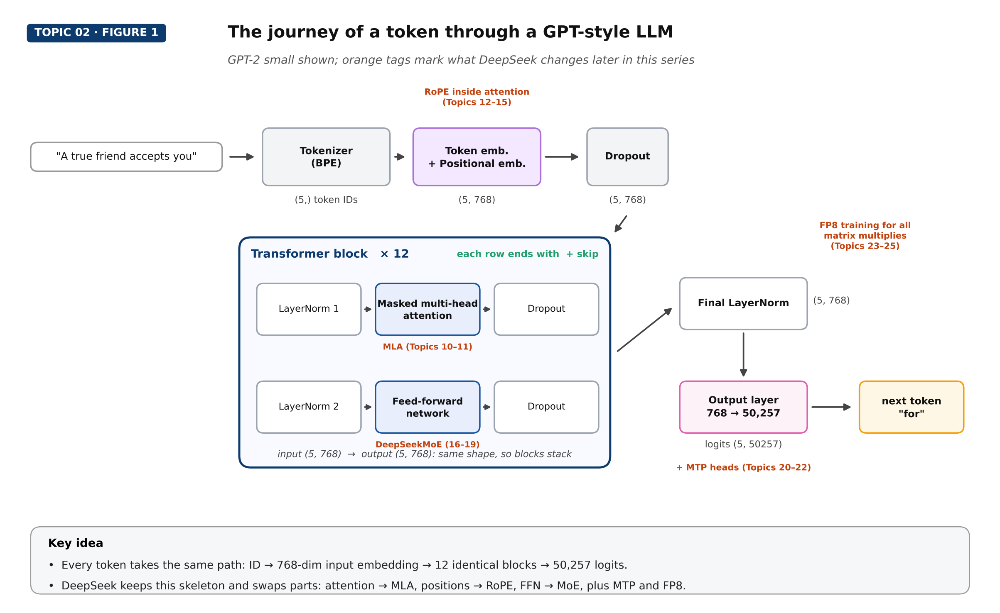
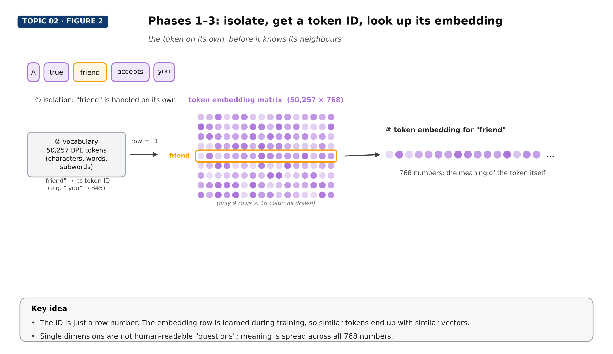
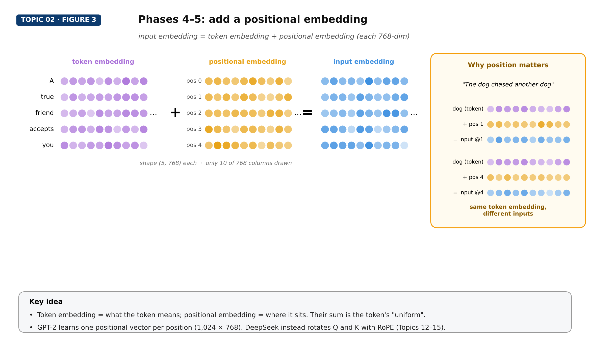
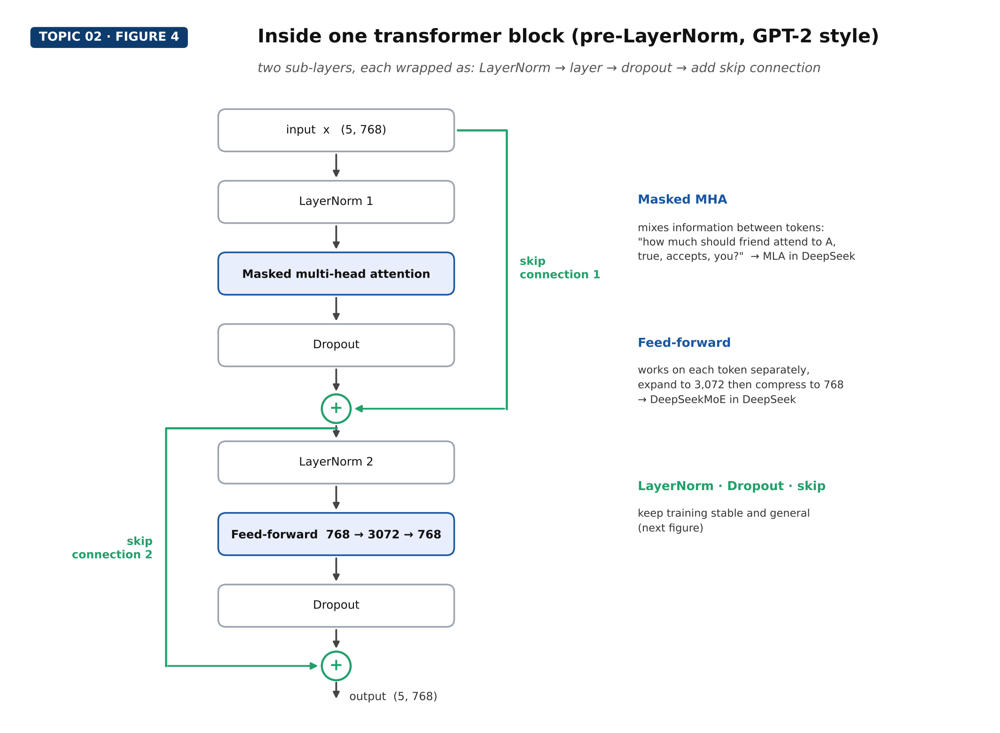
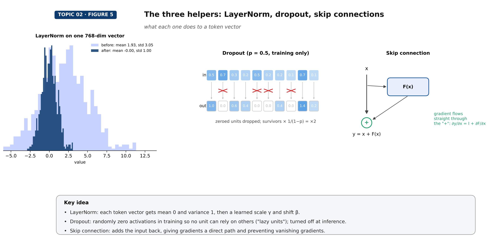
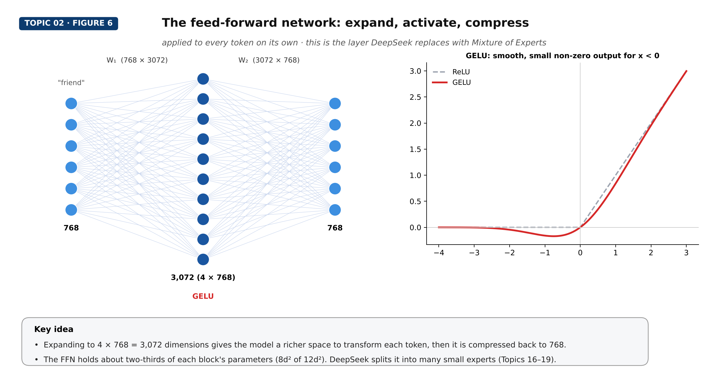
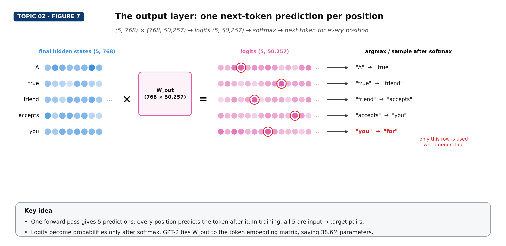

<div align="center">


<br/>

[](.)
[](.)
[](.)
[](.)
[](.)

**[← Back to the DeepSeek from Scratch series](../README.md)**

</div>

---

## Abstract

This topic follows a single token through a GPT-style decoder-only language model, from raw text to the next-token prediction. Using GPT-2 Small as the reference architecture and the sentence *"A true friend accepts you"* as the running example, it traces every stage: tokenization and token-ID lookup, the token embedding, the learned positional embedding, the stack of twelve pre-LayerNorm transformer blocks (masked multi-head attention, feed-forward network, layer normalization, dropout and skip connections), the final layer normalization, and the output projection to 50,257 vocabulary logits. Each component is given in equation form with its tensor shape, and the parameter count is derived in closed form — $`12d^2 + 13d`$ per block — and verified at 124,439,808 parameters for GPT-2 Small with weight tying. The topic closes by marking the four places where DeepSeek-V2/V3 depart from this baseline — Multi-Head Latent Attention, decoupled RoPE, DeepSeekMoE and Multi-Token Prediction — which the rest of the series rebuilds.

---

## At a Glance

| | |
|---|---|
| **Topic** | 02 of 26 — Stage 1 |
| **Document type** | Architecture & derivation — the baseline every later topic modifies |
| **Core question** | What happens to one token, step by step, between the input text and the predicted next token? |
| **Builds on** | Topic 01 — DeepSeek Basics · full implementation in [`llm-from-scratch`](https://github.com/shivakiran-ai/llm-from-scratch) Topics 13 – 19 |
| **Running example** | `"A true friend accepts you"` — 5 tokens, $`d_{\text{model}} = 768`$ |
| **Reference model** | GPT-2 Small — 12 blocks · 12 heads · 768 dims · 50,257 vocabulary · 1,024 context |
| **Key result** | 124,439,808 parameters (124,412,160 without Q/K/V biases, as in `llm-from-scratch`) |
| **Main artifact** | `Topic2_LLMArchitecture.docx` — technical report with 7 figures |
| **Version** | 1.0 · November 2026 |

---

## Why This Topic Comes Before MLA

Multi-Head Latent Attention — DeepSeek's signature idea — is a modification of one box inside one block of this architecture. To understand what it changes and why, four things must be clear first:

1. **The LLM architecture** — this topic
2. **Self-attention** — Topics 03 – 05
3. **Multi-head attention** — Topic 06
4. **The key-value (KV) cache** — Topic 07

---

## 1. The Big Picture — One Token's Journey

<p align="center"></p>

An LLM reads a sequence of words and predicts the next one. Inside, it has three parts: an **input stage** that turns text into vectors, a **processor** of identical transformer blocks, and an **output stage** that turns vectors back into a choice of token.

All GPT-2 Small design decisions follow from seven numbers:

```python
GPT_CONFIG_124M = {
    "vocab_size":     50257,   # BPE vocabulary
    "context_length": 1024,    # maximum tokens seen at once
    "emb_dim":        768,     # d_model — width of every token vector
    "n_heads":        12,      # attention heads per block (head_dim = 64)
    "n_layers":       12,      # transformer blocks
    "drop_rate":      0.1,     # dropout probability
    "qkv_bias":       True,    # OpenAI GPT-2 uses Q/K/V biases (llm-from-scratch sets False)
}
```

---

## 2. Phases 1 – 3 — Isolation, Token ID, Token Embedding

<p align="center"></p>

**Phase 1 — Isolation.** Take the word *friend* in *"A true friend accepts you"*. At the start it is processed on its own, with no knowledge of its neighbours.

**Phase 2 — Token ID ("getting your badge").** The tokenizer looks the token up in a fixed vocabulary — GPT-2's byte-pair-encoding (BPE) vocabulary of **50,257** characters, words and sub-words [6]. The vocabulary differs from model to model. The token ID is simply a row number (for example, `" you"` is ID 345 in GPT-2).

**Phase 3 — Token embedding ("the entrance exam").** The ID selects one row of the learned token-embedding matrix:

```math
\mathbf{e}_i \;=\; E[\,\mathrm{id}_i\,], \qquad E \in \mathbb{R}^{|V| \times d_{\text{model}}} = \mathbb{R}^{50257 \times 768}
```

The result is a 768-dimensional vector that represents the **meaning of the token itself**. A useful intuition is that each dimension "answers a question" about the token (is it a noun? an emotion?), but in practice meaning is distributed across all 768 numbers and individual dimensions are not human-interpretable.

---

## 3. Phases 4 – 5 — Positional Embedding and the Input Embedding

<p align="center"></p>

**Phase 4 — Position ("your position among neighbours matters").** In *"The dog chased another dog"* both *dog* tokens have the same token embedding, yet they play different roles. GPT-2 adds a **learned positional embedding** — one 768-dimensional vector per position, stored in a $`1024 \times 768`$ table.

**Phase 5 — The input embedding ("your uniform").** Token and position are added element-wise:

```math
X_0 \;=\; E[\,\mathrm{ids}\,] \;+\; P[\,0 : T\,], \qquad P \in \mathbb{R}^{1024 \times 768}, \quad X_0 \in \mathbb{R}^{T \times 768}
```

For our sentence $`T = 5`$, so $`X_0`$ has shape $`(5, 768)`$. Dropout ($`p = 0.1`$) is applied to $`X_0`$ during training, and the token is now ready to board the transformer blocks.

> **DeepSeek difference.** DeepSeek does not add a positional vector at the input. It uses rotary positional encoding (RoPE), which rotates the query and key vectors inside attention — and a *decoupled* variant to make RoPE compatible with MLA (Topics 12 – 15).

---

## 4. The Transformer Block — The Processor

<p align="center"></p>

Each block has two sub-layers. GPT-2 uses the **pre-LayerNorm** arrangement — normalize first, then apply the layer, then add the input back [9]:

```math
H \;=\; X \;+\; \mathrm{Dropout}\big(\mathrm{MHA}(\mathrm{LN}_1(X))\big)
```

```math
Y \;=\; H \;+\; \mathrm{Dropout}\big(\mathrm{FFN}(\mathrm{LN}_2(H))\big)
```

Input and output have the **same shape** $`(5, 768)`$, which is what allows twelve identical blocks to be stacked without any reshaping.

### 4.1 Masked multi-head attention — tokens talk to each other

Attention is the only place where tokens exchange information. Looking at *friend*, attention decides how much it should draw from *A*, *true*, *accepts* and *you*, encoding context into its vector. In each head:

```math
\mathrm{Attention}(Q, K, V) \;=\; \mathrm{softmax}\left(\frac{QK^{\top}}{\sqrt{d_k}} + M\right) V
```

where $`M`$ is the causal mask ($`0`$ on and below the diagonal, $`-\infty`$ above it) and $`d_k = 768 / 12 = 64`$. Topics 03 – 06 derive this in full; DeepSeek replaces it with MLA in Topics 10 – 11.

### 4.2 The three helpers — LayerNorm, dropout, skip connections

<p align="center"></p>

**Layer normalization** [3] rescales each token vector to mean 0 and variance 1, then applies a learned scale $`\gamma`$ and shift $`\beta`$:

```math
\mathrm{LN}(\mathbf{x}) \;=\; \gamma \odot \frac{\mathbf{x} - \mu}{\sqrt{\sigma^2 + \epsilon}} \;+\; \beta,
\qquad \mu = \frac{1}{d}\sum_{j=1}^{d} x_j, \quad \sigma^2 = \frac{1}{d}\sum_{j=1}^{d} (x_j - \mu)^2
```

**Dropout** [5] randomly zeroes **activations** (not weights) during training, with probability $`p`$, and scales the survivors so the expected value is unchanged:

```math
\tilde{\mathbf{a}} \;=\; \frac{\mathbf{m} \odot \mathbf{a}}{1 - p}, \qquad m_j \sim \mathrm{Bernoulli}(1 - p)
```

With $`p = 0.5`$ and 100 activations, about 50 are zeroed in each step. Units that were "lazy" — relying on others — are forced to learn useful features themselves. This improves generalization and reduces overfitting. Dropout is switched off at inference.

**Skip (shortcut) connections** [4] add the sub-layer's input to its output, $`\mathbf{y} = \mathbf{x} + F(\mathbf{x})`$. The gradient then always has a direct path back:

```math
\frac{\partial \mathbf{y}}{\partial \mathbf{x}} \;=\; I \;+\; \frac{\partial F}{\partial \mathbf{x}}
```

Even if $`\partial F / \partial \mathbf{x}`$ becomes very small, the identity term keeps gradients flowing through deep stacks — no vanishing gradient.

### 4.3 The feed-forward network — expand, activate, compress

<p align="center"></p>

The FFN is applied to every token **independently**. It expands each 768-dimensional vector to $`4 \times 768 = 3072`$ dimensions, applies GELU [7], and compresses back:

```math
\mathrm{FFN}(\mathbf{x}) \;=\; \mathrm{GELU}(\mathbf{x} W_1 + \mathbf{b}_1)\, W_2 + \mathbf{b}_2,
\qquad W_1 \in \mathbb{R}^{768 \times 3072}, \quad W_2 \in \mathbb{R}^{3072 \times 768}
```

```math
\mathrm{GELU}(x) \;\approx\; \tfrac{1}{2}\, x \left(1 + \tanh\left[\sqrt{2/\pi}\,\big(x + 0.044715\, x^3\big)\right]\right)
```

The expansion gives the model a richer space in which to transform each token. With $`8d^2`$ of the block's $`12d^2`$ weights, the FFN holds about **two-thirds** of each block's parameters — which is exactly why it is the layer **DeepSeek replaces with Mixture of Experts** (Topics 16 – 19).

---

## 5. Stacking Blocks — GPT-2 Model Sizes

The four GPT-2 models differ only in width, depth and number of heads [2]:

| Model | Parameters (paper) | Parameters (exact count) | Blocks | $`d_{\text{model}}`$ | Heads |
|---|---|---|:-:|:-:|:-:|
| GPT-2 Small | 117M | 124M | 12 | 768 | 12 |
| GPT-2 Medium | 345M | 355M | 24 | 1,024 | 16 |
| GPT-2 Large | 762M | 774M | 36 | 1,280 | 20 |
| GPT-2 XL | 1,542M | 1,558M | 48 | 1,600 | 25 |

> The GPT-2 paper's reported sizes are slightly lower than an exact count of the released weights. The exact counts above come from the parameter formula in Section 7.

---

## 6. The Output Stage — Final LayerNorm, Output Layer, Next Token

<p align="center"></p>

After the last block, a **final LayerNorm** is applied and the **output (projection) layer** maps every 768-dimensional vector to one score per vocabulary entry:

```math
Z \;=\; \mathrm{LN}_f(X_{12})\, W_{\text{out}}, \qquad W_{\text{out}} \in \mathbb{R}^{768 \times 50257}, \quad Z \in \mathbb{R}^{5 \times 50257}
```

These scores are **logits**, not probabilities. Softmax turns row $`t`$ into a distribution over the next token:

```math
P(x_{t+1} = i \mid x_{1:t}) \;=\; \frac{e^{Z_{t,i}}}{\sum_{j=1}^{50257} e^{Z_{t,j}}}
```

One forward pass therefore produces **five** predictions, one per position: *A → true*, *true → friend*, *friend → accepts*, *accepts → you*, *you → (next)*. During training all five are input–target pairs, and the loss averages over them:

```math
\mathcal{L} \;=\; -\frac{1}{T}\sum_{t=1}^{T} \log P(x_{t+1} \mid x_{1:t})
```

During generation only the **last row** is used to choose the next token. GPT-2 also **ties** $`W_{\text{out}}`$ to the token-embedding matrix $`E^{\top}`$ [8], so the same 38.6M weights serve both ends of the model.

---

## 7. Parameter Count — Derived and Verified

For one block with model width $`d`$ (biases included):

| Component | Parameters |
|---|---|
| Q, K, V projections | $`3d^2 + 3d`$ |
| Attention output projection | $`d^2 + d`$ |
| FFN ($`d \to 4d \to d`$) | $`8d^2 + 5d`$ |
| Two LayerNorms ($`\gamma, \beta`$) | $`4d`$ |
| **Block total** | $`12d^2 + 13d`$ |

```math
\text{Block} \;=\; 12(768)^2 + 13(768) \;=\; 7{,}087{,}872
```

```math
N_{\text{total}} \;=\; \underbrace{50257 \cdot 768}_{\text{token emb.}} \;+\; \underbrace{1024 \cdot 768}_{\text{pos. emb.}} \;+\; 12 \times 7{,}087{,}872 \;+\; \underbrace{2 \cdot 768}_{\text{final LN}} \;=\; 124{,}439{,}808
```

| Configuration | Parameters |
|---|---|
| OpenAI GPT-2 Small (Q/K/V bias, tied output) | **124,439,808** |
| Without Q/K/V bias, tied output (as in `llm-from-scratch` Topic 18) | 124,412,160 |
| Without Q/K/V bias, separate output layer | 163,009,536 |

The 27,648 difference between the first two rows is exactly the Q/K/V biases: $`3 \times 768 \times 12`$. Untying the output layer adds $`50257 \times 768 = 38{,}597{,}376`$ parameters.

---

## 8. Complete Shape Inventory

| Stage | Tensor | Shape |
|---|---|---|
| Input | token IDs | $`(5)`$ |
| Token embedding | $`E[\mathrm{ids}]`$ | $`(5, 768)`$ |
| Positional embedding | $`P[0{:}5]`$ | $`(5, 768)`$ |
| Input embedding | $`X_0`$ | $`(5, 768)`$ |
| Inside attention | $`Q, K, V`$ per head | $`(5, 64)`$ × 12 heads |
| Attention scores | per head | $`(5, 5)`$ |
| FFN hidden | after $`W_1`$ | $`(5, 3072)`$ |
| Block output | $`X_\ell`$, $`\ell = 1 \dots 12`$ | $`(5, 768)`$ |
| Logits | $`Z`$ | $`(5, 50257)`$ |

---

## 9. The Core Loop in Code

The full, tested implementation lives in [`llm-from-scratch`](https://github.com/shivakiran-ai/llm-from-scratch) Topics 13 – 18. The forward pass reduces to a few lines that mirror the equations above:

```python
class TransformerBlock(nn.Module):
    def forward(self, x):                       # x: (batch, T, 768)
        x = x + self.drop(self.att(self.norm1(x)))   # H = X + Dropout(MHA(LN1(X)))
        x = x + self.drop(self.ff(self.norm2(x)))    # Y = H + Dropout(FFN(LN2(H)))
        return x                                # same shape as input

class GPTModel(nn.Module):
    def forward(self, ids):                     # ids: (batch, T)
        T = ids.shape[1]
        x = self.tok_emb(ids) + self.pos_emb(torch.arange(T, device=ids.device))
        x = self.drop_emb(x)
        x = self.trf_blocks(x)                  # 12 × TransformerBlock
        x = self.final_norm(x)
        return self.out_head(x)                 # logits: (batch, T, 50257)
```

---

## 10. Where DeepSeek Changes This Architecture

DeepSeek-V2/V3 keep the decoder-only skeleton — embeddings, a stack of pre-normalized blocks, and an output head — and replace specific parts:

| GPT-2 component | DeepSeek replacement | Problem solved | Topics |
|---|---|---|---|
| Masked multi-head attention | **Multi-Head Latent Attention** | KV cache too large at long context | 07 – 11 |
| Learned absolute positional embedding | **RoPE, decoupled for MLA** | Relative positions; compatibility with the compressed cache | 12 – 15 |
| Dense feed-forward network | **DeepSeekMoE** — shared + fine-grained routed experts | Every token paying for every FFN parameter | 16 – 19 |
| Single next-token output head | **+ Multi-Token Prediction modules** | Sparse training signal | 20 – 22 |
| FP32/BF16 training | **FP8 mixed precision** | Training memory and compute cost | 23 – 25 |

---

## Key Technical Observations

1. **Attention is the only place where tokens interact.** Embeddings, LayerNorm, the FFN and the output layer all act on each token independently.
2. **Shape preservation is what makes depth possible.** Every block maps $`(T, 768) \to (T, 768)`$, so blocks stack without any glue.
3. **The FFN, not attention, holds most of the weights.** $`8d^2`$ of $`12d^2`$ per block — the reason MoE targets the FFN.
4. **Pre-LayerNorm plus skip connections give an unbroken identity path** from the output back to the embeddings, which keeps deep stacks trainable.
5. **One forward pass yields $`T`$ training examples.** Every position predicts its successor; generation uses only the last.
6. **Logits are not probabilities.** Softmax converts them, and dividing logits by a temperature before softmax controls sampling.
7. **Parameter counts depend on small choices.** Q/K/V biases (27,648 parameters) and weight tying (38.6M) explain the gap between 124.4M and 163.0M.

---

## References

References are listed in IEEE numeric format.

| # | Authors | Title | Venue | Year |
|:-:|---------|-------|-------|:-:|
| 1 | A. Vaswani et al. | Attention Is All You Need | *NeurIPS* | 2017 |
| 2 | A. Radford et al. | Language Models are Unsupervised Multitask Learners | *OpenAI Tech. Report* | 2019 |
| 3 | J. L. Ba, J. R. Kiros, G. E. Hinton | Layer Normalization | *arXiv:1607.06450* | 2016 |
| 4 | K. He, X. Zhang, S. Ren, J. Sun | Deep Residual Learning for Image Recognition | *CVPR* | 2016 |
| 5 | N. Srivastava et al. | Dropout: A Simple Way to Prevent Neural Networks from Overfitting | *JMLR* | 2014 |
| 6 | R. Sennrich, B. Haddow, A. Birch | Neural Machine Translation of Rare Words with Subword Units | *ACL* | 2016 |
| 7 | D. Hendrycks, K. Gimpel | Gaussian Error Linear Units (GELUs) | *arXiv:1606.08415* | 2016 |
| 8 | O. Press, L. Wolf | Using the Output Embedding to Improve Language Models | *EACL* | 2017 |
| 9 | R. Xiong et al. | On Layer Normalization in the Transformer Architecture | *ICML* | 2020 |

---

## Files in This Directory

| File | Description |
|------|-------------|
| `README.md` | This document — conceptual summary and reader entry point |
| `Topic2_LLMArchitecture.docx` | Primary artifact (v1.0) — technical report: title page, abstract, contents, 11 sections, 7 embedded figures, IEEE references |
| `images/` | The 7 figures used in this README and the report |

> **No notebook for this topic.** The complete, runnable GPT-2 implementation is in [`llm-from-scratch`](https://github.com/shivakiran-ai/llm-from-scratch) Topics 13 – 19. New code in this series begins where DeepSeek departs from GPT-2.

---

## Navigation

**Previous:** &nbsp; [Topic 01 — DeepSeek Basics](../01_deepseek_basics/README.md) &nbsp;·&nbsp; *What DeepSeek is and the four pillars behind its efficiency*

**Next:** &nbsp; [Topic 03 — Introduction to Attention](../03_attention_intro/README.md) &nbsp;·&nbsp; *Why attention was needed — from RNNs and LSTMs to the Transformer — and the idea of a context vector.*

---

<div align="center">

**DeepSeek from Scratch**  
A technical report series rebuilding the key ideas behind DeepSeek-V2 / V3 from first principles.

**Shiva Kiran Dadishetty** &nbsp;·&nbsp; Independent Research &nbsp;·&nbsp; Texas, USA  
[github.com/shivakiran-ai/deepseek-from-scratch](https://github.com/shivakiran-ai/deepseek-from-scratch)

*Document version 1.0 &nbsp;·&nbsp; Last updated November 2026*


</div>
