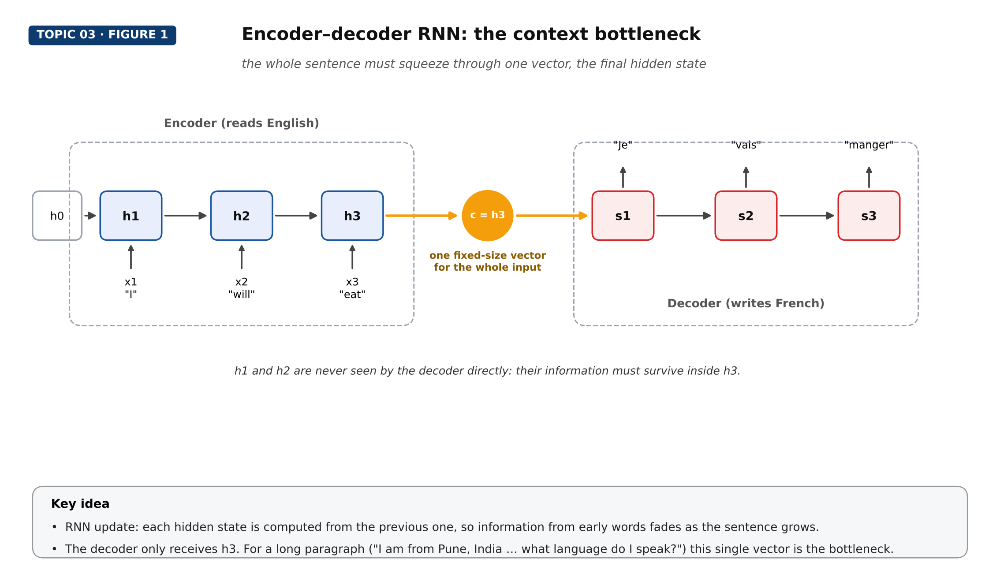
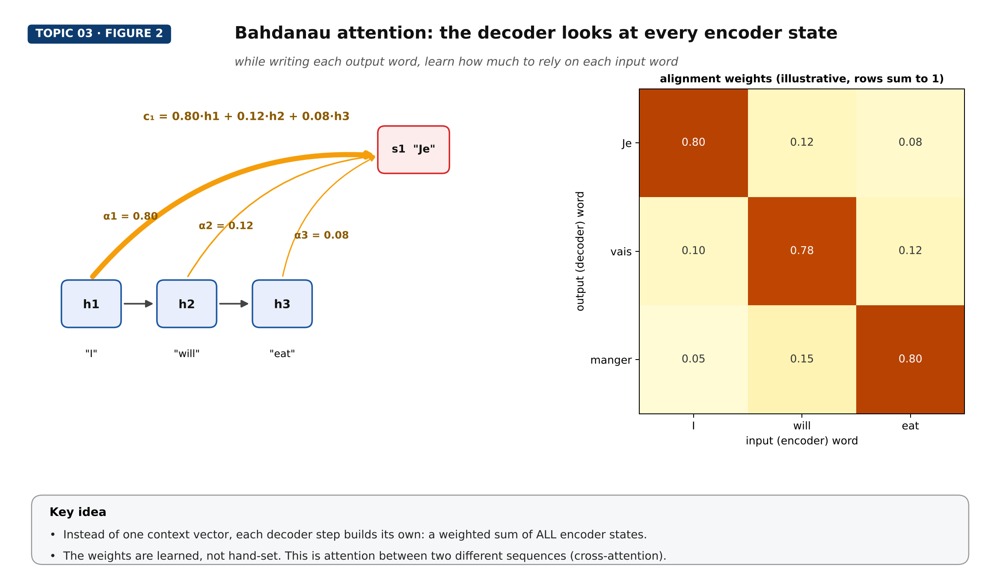
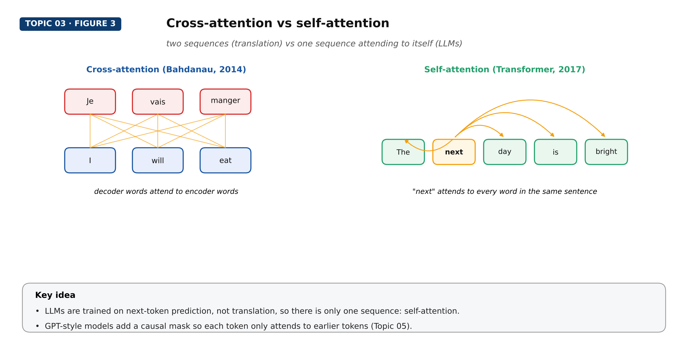
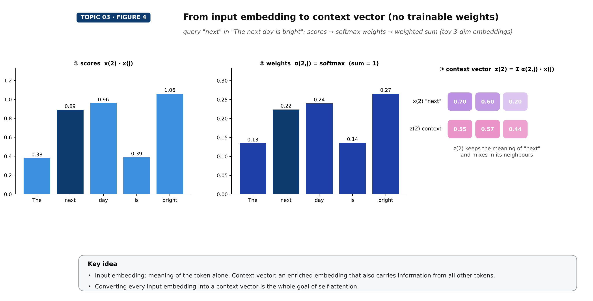
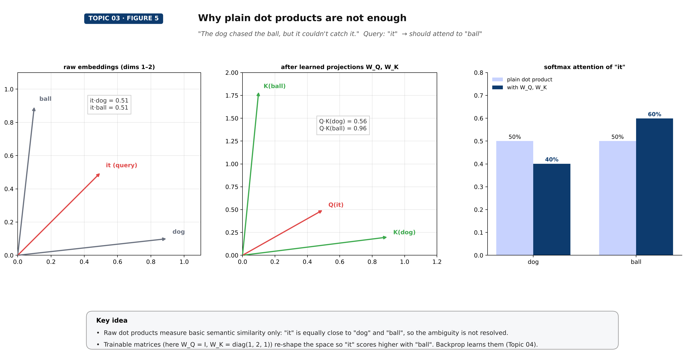

<div align="center">


<br/>

[](.)
[](.)
[](.)
[](.)
[](.)

**[← Back to the DeepSeek from Scratch series](../README.md)**

</div>

---

## Abstract

This topic explains why the attention mechanism exists and what it computes. It begins with the encoder–decoder recurrent neural network and its central failure — the **context bottleneck**, in which an entire input sequence must be compressed into a single fixed-size hidden state. It then derives Bahdanau attention, in which every decoder step forms its own context vector as a learned weighted sum of all encoder states, and contrasts this **cross-attention** between two sequences with the **self-attention** used by language models, in which every token attends to every token of the same sequence. The goal of self-attention is stated precisely — to turn each input embedding into a context vector — and the simplest version, with no trainable weights, is computed on the running example *"The next day is bright"*: dot-product scores, softmax weights and a weighted sum. Finally, a worked example (*"The dog chased the ball, but it couldn't catch it"*) shows why raw dot products cannot resolve contextual ambiguity (0.51 vs. 0.51) and how trainable query and key matrices can (0.56 vs. 0.96, or 40 % vs. 60 % after softmax) — the motivation for Topic 04.

---

## At a Glance

| | |
|---|---|
| **Topic** | 03 of 26 — Stage 1 |
| **Document type** | Concept & derivation — from the RNN bottleneck to simplified self-attention |
| **Core question** | What problem does attention solve, and how does it turn an input embedding into a context vector? |
| **Builds on** | Topic 02 — LLM Architecture Overview · [`llm-from-scratch`](https://github.com/shivakiran-ai/llm-from-scratch) Topics 07 – 08 |
| **Historical arc** | RNNs (1980s) → LSTMs (1997) → Bahdanau attention (2014) → Transformer (2017) |
| **Running examples** | `"I will eat"` → `"Je vais manger"` · `"The next day is bright"` · `"The dog chased the ball, but it couldn't catch it"` |
| **Main artifact** | `Topic3_AttentionIntro.docx` — technical report with 5 figures |
| **Version** | 1.0 · November 2026 |

---

## 1. The Motivating Problem — Long-Range Context

Language is full of dependencies that span many words:

> *"The cat that was sitting on the mat, which was next to the dog, **jumped**."*

To process *jumped* correctly, a model needs direct access to its subject *cat*, eight tokens earlier. Or in a longer paragraph — *"I am from Pune, India. … What language do I speak?"* — the answer depends on words that appeared long before the question. Attention was invented to give a model this direct access.

| Year | Architecture | What it added | What it still could not do |
|:-:|---|---|---|
| **1980s** | Recurrent neural network (RNN) | A hidden state that carries memory from step to step | Vanishing gradients; one context vector for the whole input |
| **1997** | LSTM [1] | Gated cell state — gradients survive across long sequences | Still sequential; the single-vector bottleneck remains |
| **2014** | Bahdanau attention [2] | The decoder looks back at **every** encoder state with learned weights | Still built on an RNN backbone |
| **2017** | Transformer [3] | Self-attention replaces recurrence entirely; fully parallel | Basis of every modern LLM, including DeepSeek |

---

## 2. The RNN Encoder–Decoder and Its Context Bottleneck

<p align="center"></p>

An RNN reads one token at a time. Each hidden state is computed from the previous hidden state and the current input:

```math
\mathbf{h}_t \;=\; \tanh\big(W_h\, \mathbf{h}_{t-1} \;+\; W_x\, \mathbf{x}_t \;+\; \mathbf{b}\big)
```

In translation, an **encoder** RNN reads *"I will eat"*. Its final hidden state $`\mathbf{h}_3`$ — which must somehow contain everything about $`\mathbf{h}_1`$ and $`\mathbf{h}_2`$ — is the only thing passed to the **decoder**, which then writes *"Je vais manger"*:

```math
\mathbf{c} \;=\; \mathbf{h}_T \qquad \text{(one fixed-size context vector for the entire input)}
```

**Why this fails for long-range context.** To translate well, the decoder needs to look at each input word, but it only ever sees one vector. However long the input, its information has to fit into the same number of dimensions. This is the **context bottleneck**: an RNN encoder–decoder is not good at retaining long-range context.

> **Two separate failures.** LSTMs [1] fixed the *vanishing-gradient* problem with a gated, additive cell state. They did **not** fix the *bottleneck* — the decoder still receives a single vector. Attention fixes the bottleneck.

---

## 3. Bahdanau Attention — Selective Access to Every Encoder State

<p align="center"></p>

The fix is to give the decoder access to **all** encoder hidden states, not just the last one, and to let it **quantify how much importance to give each one** at every decoding step. When writing the first word *Je*, it should rely mostly on $`\mathbf{h}_1`$ (*I*); when writing *manger*, mostly on $`\mathbf{h}_3`$ (*eat*).

For decoder step $`i`$ and encoder position $`j`$, Bahdanau et al. [2] compute an alignment score, normalize the scores with softmax, and build a step-specific context vector:

```math
e_{ij} \;=\; \mathbf{v}^{\top} \tanh\big(W\, \mathbf{s}_{i-1} \;+\; U\, \mathbf{h}_j\big)
```

```math
\alpha_{ij} \;=\; \frac{\exp(e_{ij})}{\sum_{k=1}^{T} \exp(e_{ik})}
\qquad\qquad
\mathbf{c}_i \;=\; \sum_{j=1}^{T} \alpha_{ij}\, \mathbf{h}_j
```

Instead of relying on one hidden state $`\mathbf{h}_3`$, the decoder now relies on all of them, with learned weights $`\alpha_{ij}`$ that sum to 1. The weights are **learned from data**, not designed by hand.

---

## 4. Cross-Attention vs. Self-Attention

<p align="center"></p>

| Property | Cross-attention *(Bahdanau, 2014)* | Self-attention *(Transformer, 2017)* |
|---|---|---|
| Sequences involved | Two — source and target | One — the sequence attends to itself |
| Typical task | Machine translation | Next-token prediction (GPT, DeepSeek) |
| Who attends to whom | Decoder states attend to encoder states | Every position attends to every position of the same sequence |
| Used in GPT-2 / DeepSeek | No | Yes — with a causal mask (Topic 05) |

**Self-attention** is a mechanism that allows each position in the input sequence to attend to all positions in the same sequence. LLMs are trained on next-token prediction, not translation, so there are no "two languages": there is only one sequence. In *"The next day is bright"*, self-attention asks how important each neighbouring word is to *next*.

This matters because predicting the next token requires knowing how the words of the sequence relate to each other.

---

## 5. The Goal of Self-Attention — From Input Embedding to Context Vector

Each token enters attention as an **input embedding** $`\mathbf{x}^{(i)}`$ (768 numbers in GPT-2, Topic 02). It knows what the token means, but nothing about its neighbours. Self-attention produces a **context vector** $`\mathbf{z}^{(i)}`$:

```math
\mathbf{z}^{(i)} \;=\; \sum_{j=1}^{T} \alpha_{ij}\, \mathbf{x}^{(j)}, \qquad \alpha_{ij} \ge 0, \quad \sum_{j=1}^{T} \alpha_{ij} = 1
```

> **The whole goal of self-attention is to convert every input embedding into a context vector.** A context vector is an enriched embedding: it keeps the meaning of the token and adds information from all other tokens in the sequence, weighted by relevance.

---

## 6. Simplified Self-Attention — No Trainable Weights

<p align="center"></p>

The simplest way to obtain the weights $`\alpha_{ij}`$ uses the embeddings directly. Take *next* as the query, $`\mathbf{x}^{(2)}`$, in *"The next day is bright"* (toy 3-dimensional embeddings):

**Step 1 — Attention scores** by dot product, which measures alignment in embedding space:

```math
\omega_{2j} \;=\; \mathbf{x}^{(2)} \cdot \mathbf{x}^{(j)}
```

**Step 2 — Attention weights** by softmax, so the weights are positive and sum to 1:

```math
\alpha_{2j} \;=\; \frac{\exp(\omega_{2j})}{\sum_{k=1}^{T} \exp(\omega_{2k})}
```

**Step 3 — Context vector** as the weighted sum of all input embeddings:

```math
\mathbf{z}^{(2)} \;=\; \sum_{j=1}^{T} \alpha_{2j}\, \mathbf{x}^{(j)}
```

| | The | next | day | is | bright |
|---|:-:|:-:|:-:|:-:|:-:|
| Score $`\omega_{2j}`$ | 0.38 | 0.89 | 0.96 | 0.39 | 1.06 |
| Weight $`\alpha_{2j}`$ | 0.13 | 0.22 | 0.24 | 0.14 | 0.27 |

For the input $`\mathbf{x}^{(2)} = [0.70, 0.60, 0.20]`$, the result is $`\mathbf{z}^{(2)} = [0.55, 0.57, 0.44]`$ — still close to *next*, but now mixed with its neighbours.

**Why softmax, not simple division?** Dividing each score by the sum also gives weights that sum to 1, but it breaks for negative scores and does not sharpen the distribution. Softmax is always positive, emphasizes the largest scores, and has well-behaved gradients [6].

For all tokens at once, the three steps collapse into matrix form — this is the skeleton every later attention variant keeps:

```python
scores  = X @ X.T                         # (T, T)  all dot products
weights = torch.softmax(scores, dim=-1)   # (T, T)  each row sums to 1
Z       = weights @ X                     # (T, d)  all context vectors
```

---

## 7. Why Plain Dot Products Are Not Enough

<p align="center"></p>

Consider *"The dog chased the ball, but **it** couldn't catch it."* Here *it* refers to the ball. With toy embeddings:

| Word | Embedding $`\mathbf{x}`$ |
|---|---|
| dog | $`[0.9,\; 0.1,\; 0.1]`$ |
| ball | $`[0.1,\; 0.9,\; 0.1]`$ |
| it | $`[0.5,\; 0.5,\; 0.1]`$ |

```math
\mathbf{x}_{\text{it}} \cdot \mathbf{x}_{\text{dog}} \;=\; 0.45 + 0.05 + 0.01 \;=\; 0.51
\qquad\qquad
\mathbf{x}_{\text{it}} \cdot \mathbf{x}_{\text{ball}} \;=\; 0.05 + 0.45 + 0.01 \;=\; 0.51
```

Both scores are **identical**. A plain dot product only measures basic semantic similarity; it cannot resolve the contextual question of what *it* refers to.

**The trick: trainable matrices.** When we do not know the underlying relationship, we replace it with a set of trainable weight matrices and let backpropagation figure it out. Each embedding is projected first — the query with $`W_Q`$, the keys with $`W_K`$:

```math
\mathbf{q}_{\text{it}} \;=\; \mathbf{x}_{\text{it}}\, W_Q, \qquad \mathbf{k}_j \;=\; \mathbf{x}_j\, W_K,
\qquad
W_Q = \begin{bmatrix} 1 & 0 & 0 \\ 0 & 1 & 0 \\ 0 & 0 & 1 \end{bmatrix},
\quad
W_K = \begin{bmatrix} 1 & 0 & 0 \\ 0 & 2 & 0 \\ 0 & 0 & 1 \end{bmatrix}
```

| Word | Query $`\mathbf{q} = \mathbf{x} W_Q`$ | Key $`\mathbf{k} = \mathbf{x} W_K`$ |
|---|---|---|
| dog | $`[0.9,\; 0.1,\; 0.1]`$ | $`[0.9,\; 0.2,\; 0.1]`$ |
| ball | $`[0.1,\; 0.9,\; 0.1]`$ | $`[0.1,\; 1.8,\; 0.1]`$ |
| it | $`[0.5,\; 0.5,\; 0.1]`$ | $`[0.5,\; 1.0,\; 0.1]`$ |

```math
\mathbf{q}_{\text{it}} \cdot \mathbf{k}_{\text{dog}} \;=\; 0.45 + 0.10 + 0.01 \;=\; 0.56
\qquad\qquad
\mathbf{q}_{\text{it}} \cdot \mathbf{k}_{\text{ball}} \;=\; 0.05 + 0.90 + 0.01 \;=\; 0.96
```

| Method | *it* → *dog* | *it* → *ball* | Ambiguity resolved? |
|---|:-:|:-:|:-:|
| Plain dot product | 0.51 (50 %) | 0.51 (50 %) | ✗ No |
| With learned $`W_Q, W_K`$ | 0.56 (40 %) | 0.96 (60 %) | ✓ Yes |

*Percentages are softmax weights over the two candidates dog and ball.*

Trainable matrices give the model parameters to tune, so it can encode complex relationships between tokens that are not visible in raw embedding similarity. In real models $`W_Q`$ and $`W_K`$ are learned, not hand-picked, and a third matrix $`W_V`$ produces the **values** that are averaged. That is the full mechanism of Topic 04.

---

## Key Technical Observations

1. **The RNN bottleneck is architectural, not statistical.** More data cannot widen a single fixed-size context vector; only a change in architecture can.
2. **LSTMs and attention fix different problems.** LSTMs address vanishing gradients; attention addresses the bottleneck by giving direct access to every position.
3. **Attention weights are learned, not designed.** The alignment emerges from training; nothing is hand-coded.
4. **"Self" means one sequence.** Cross-attention works between two sequences; LLMs need only self-attention, plus a causal mask.
5. **A context vector is an enrichment, not a replacement.** It keeps the token's meaning and adds a relevance-weighted summary of every other token.
6. **Semantic similarity is not contextual relevance.** Two tokens can be equally similar in embedding space yet differently relevant in a sentence — the reason for trainable $`W_Q`$, $`W_K`$, $`W_V`$.
7. **Attention is parallel.** RNNs must process tokens one after another; attention computes all scores with one matrix multiplication, which is why Transformers train so much faster on GPUs.

---

## References

References are listed in IEEE numeric format.

| # | Authors | Title | Venue | Year |
|:-:|---------|-------|-------|:-:|
| 1 | S. Hochreiter, J. Schmidhuber | Long Short-Term Memory | *Neural Computation* | 1997 |
| 2 | D. Bahdanau, K. Cho, Y. Bengio | Neural Machine Translation by Jointly Learning to Align and Translate | *ICLR* | 2015 |
| 3 | A. Vaswani et al. | Attention Is All You Need | *NeurIPS* | 2017 |
| 4 | I. Sutskever, O. Vinyals, Q. V. Le | Sequence to Sequence Learning with Neural Networks | *NeurIPS* | 2014 |
| 5 | Y. Bengio, P. Simard, P. Frasconi | Learning Long-Term Dependencies with Gradient Descent is Difficult | *IEEE Trans. Neural Networks* | 1994 |
| 6 | I. Goodfellow, Y. Bengio, A. Courville | Deep Learning (Ch. 6.2.2.3, Softmax Units) | *MIT Press* | 2016 |
| 7 | J. L. Elman | Finding Structure in Time | *Cognitive Science* | 1990 |

---

## Files in This Directory

| File | Description |
|------|-------------|
| `README.md` | This document — conceptual summary and reader entry point |
| `Topic3_AttentionIntro.docx` | Primary artifact (v1.0) — technical report: title page, abstract, contents, 7 sections, 5 embedded figures, worked examples, IEEE references |
| `images/` | The 5 figures used in this README and the report |

> **No notebook for this topic.** The runnable simplified-attention code is in [`llm-from-scratch`](https://github.com/shivakiran-ai/llm-from-scratch) Topic 08. Trainable self-attention follows in Topic 04.

---

## Navigation

**Previous:** &nbsp; [Topic 02 — LLM Architecture Overview](../02_llm_architecture/README.md) &nbsp;·&nbsp; *The journey of a token through a GPT-style model*

**Next:** &nbsp; [Topic 04 — Self-Attention Mechanism](../04_self_attention/README.md) &nbsp;·&nbsp; *Trainable query, key and value matrices, scaled dot-product attention, and the full computation from input embeddings to context vectors.*

---

<div align="center">

**DeepSeek from Scratch**  
A technical report series rebuilding the key ideas behind DeepSeek-V2 / V3 from first principles.

**Shiva Kiran Dadishetty** &nbsp;·&nbsp; Independent Research &nbsp;·&nbsp; Texas, USA  
[github.com/shivakiran-ai/deepseek-from-scratch](https://github.com/shivakiran-ai/deepseek-from-scratch)

*Document version 1.0 &nbsp;·&nbsp; Last updated November 2026*


</div>
