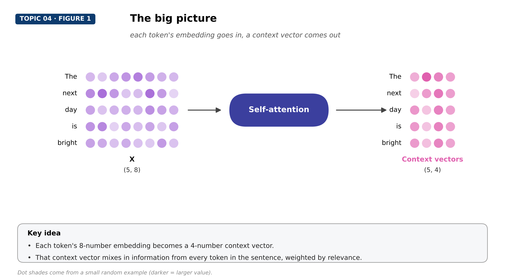
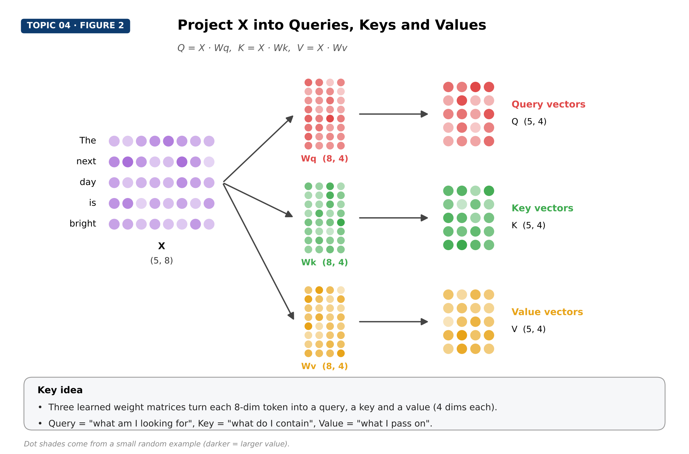
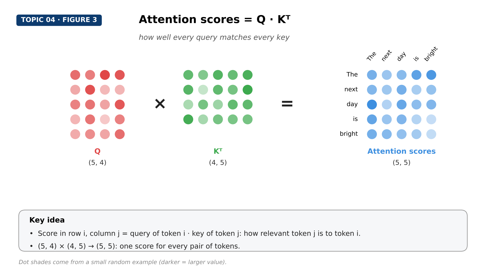
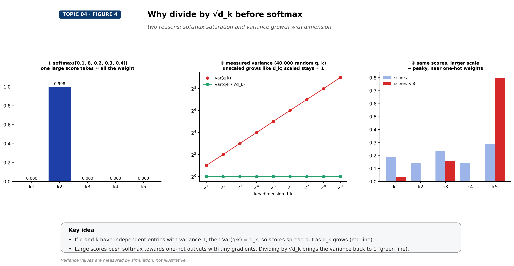
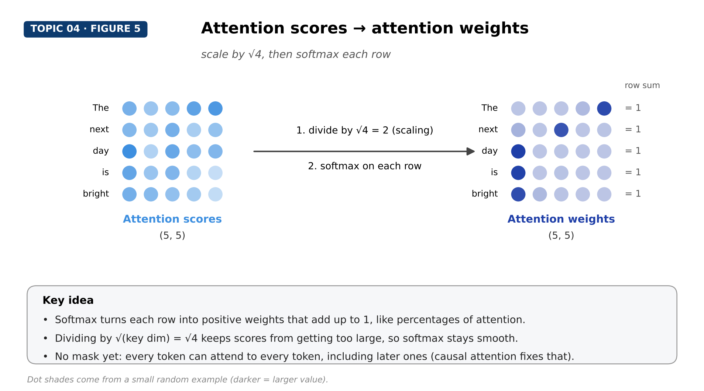
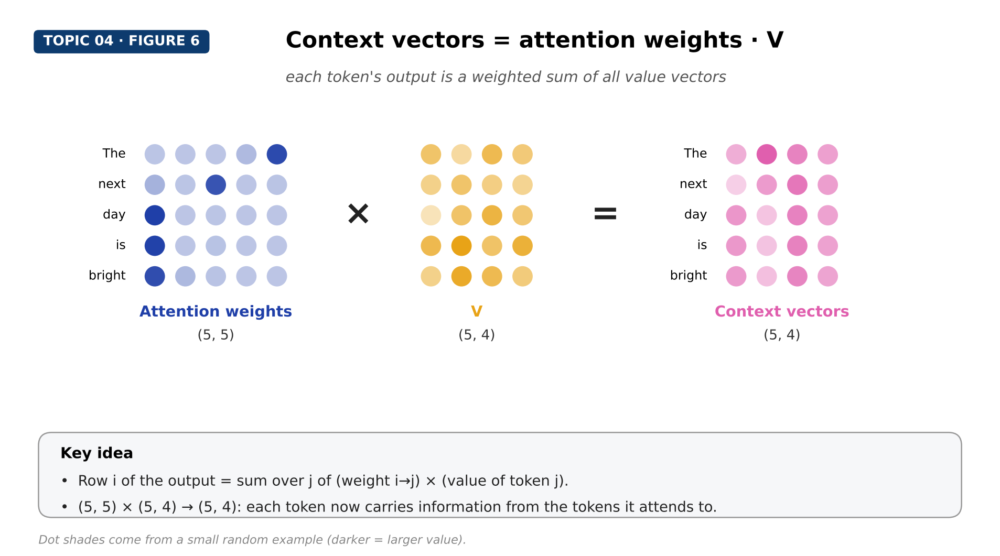
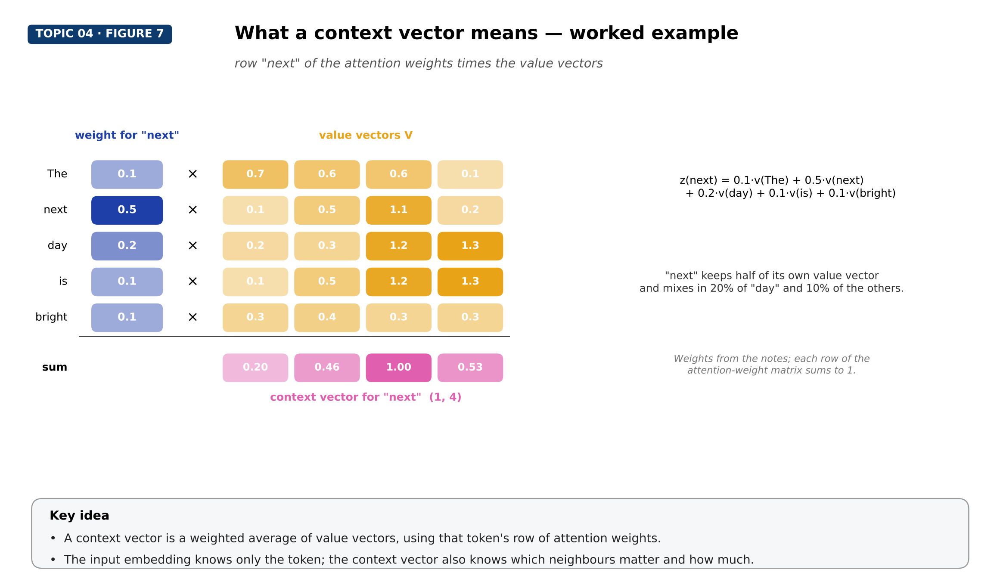

<div align="center">


<br/>

[](.)
[](.)
[](.)
[](.)
[](.)

**[← Back to the DeepSeek from Scratch series](../README.md)**

</div>

---

## Abstract

This topic derives scaled dot-product self-attention with trainable weights — the mechanism at the core of GPT-2, GPT-3 and every DeepSeek model. Building on the simplified attention of Topic 03, three learned projection matrices $`W_Q`$, $`W_K`$ and $`W_V`$ map each input embedding into a query, a key and a value. The computation is traced on the running example *"The next day is bright"* (5 tokens, $`d_{\text{in}} = 8`$, $`d_{\text{out}} = 4`$) in four steps: projection, attention scores $`QK^{\top}`$, scaling by $`1/\sqrt{d_k}`$ and softmax, and the weighted sum of values. The scaling factor is derived from the variance of a dot product — $`\mathrm{Var}(\mathbf{q}\cdot\mathbf{k}) = d_k`$ under unit-variance assumptions — and verified by simulation for $`d_k`$ from 2 to 512, together with the softmax-saturation argument. A worked numerical example shows exactly what a context vector contains. The topic closes with the two standard PyTorch implementations (`nn.Parameter` and `nn.Linear`) and a complete shape inventory.

---

## At a Glance

| | |
|---|---|
| **Topic** | 04 of 26 — Stage 2 |
| **Document type** | Implementation & derivation — the first trainable attention |
| **Also known as** | Scaled dot-product attention |
| **Core question** | How do three trainable matrices turn simple dot-product attention into a learning system — and why divide by $`\sqrt{d_k}`$? |
| **Builds on** | Topic 03 — Introduction to Attention · [`llm-from-scratch`](https://github.com/shivakiran-ai/llm-from-scratch) Topic 09 |
| **Running example** | `"The next day is bright"` — 5 tokens, $`d_{\text{in}} = 8`$, $`d_{\text{out}} = 4`$ |
| **Trainable parameters** | $`3\, d_{\text{in}}\, d_{\text{out}} = 96`$ here · 1,769,472 per attention layer in GPT-2 Small (without biases) |
| **Main artifact** | `Topic4_SelfAttention.docx` — technical report with 7 figures |
| **Version** | 1.0 · November 2026 |

---

## 1. From Simplified Attention to Trainable Weights

<p align="center"></p>

Topic 03 showed that raw dot products between embeddings cannot resolve contextual relationships (*it* scored 0.51 against both *dog* and *ball*). The fix is to **offload the hard part to trainable weight matrices**: project the input embeddings into new spaces — of the same or a different dimension — and let backpropagation learn projections that produce good attention.

The input to attention is the matrix of input embeddings (token + positional embeddings, Topic 02):

```math
X \in \mathbb{R}^{T \times d_{\text{in}}}, \qquad T = 5 \text{ tokens}, \quad d_{\text{in}} = 8
```

Each row is one token. The output is one **context vector** per token, $`Z \in \mathbb{R}^{T \times d_{\text{out}}}`$.

---

## 2. Step 1 — Project Inputs into Queries, Keys and Values

<p align="center"></p>

Three learned matrices, each of shape $`d_{\text{in}} \times d_{\text{out}}`$ (rows = input dimension, columns = output dimension):

```math
Q = X W_Q, \qquad K = X W_K, \qquad V = X W_V,
\qquad W_Q, W_K, W_V \in \mathbb{R}^{8 \times 4}, \quad Q, K, V \in \mathbb{R}^{5 \times 4}
```

| Role | Matrix | Question it answers |
|---|---|---|
| **Query** | $`W_Q`$ | *What am I looking for?* — the current token's perspective |
| **Key** | $`W_K`$ | *What do I contain?* — what each token offers to be matched against |
| **Value** | $`W_V`$ | *What do I pass on?* — the information each token contributes |

Every row of $`Q`$, $`K`$ and $`V`$ still corresponds to one token, but the vectors now live in a **4-dimensional output space** instead of the 8-dimensional input space. $`d_{\text{out}}`$ may equal $`d_{\text{in}}`$ or differ; in GPT-2 and GPT-3 they are equal ($`d_{\text{in}} = d_{\text{out}} = d_{\text{model}}`$).

The three matrices are the **only trainable part** of the mechanism — everything after this is fixed arithmetic:

```math
\#\text{params} \;=\; 3\, d_{\text{in}}\, d_{\text{out}} \;=\; 3 \times 8 \times 4 \;=\; 96
\qquad\qquad
\text{GPT-2 Small: } 3 \times 768 \times 768 \;=\; 1{,}769{,}472
```

---

## 3. Step 2 — Attention Scores

<p align="center"></p>

The score between token $`i`$ and token $`j`$ is the dot product of $`i`$'s query with $`j`$'s key. For the query *next* ($`i = 2`$):

```math
\omega_{2j} \;=\; \mathbf{q}^{(2)} \cdot \mathbf{k}^{(j)}, \qquad j = 1, \dots, 5
```

For all tokens at once, one matrix multiplication gives every score:

```math
\Omega \;=\; Q K^{\top}, \qquad (5 \times 4)(4 \times 5) \;\to\; (5 \times 5)
```

Row $`i`$ holds how strongly token $`i`$ matches every token. The matrix is **not symmetric**: $`\mathbf{q}^{(i)} \cdot \mathbf{k}^{(j)} \ne \mathbf{q}^{(j)} \cdot \mathbf{k}^{(i)}`$ in general, because queries and keys come from different matrices.

---

## 4. Step 3 — Scale, Then Softmax

### 4.1 Why softmax

Raw scores are hard to interpret. We want statements like *"when looking at* next*, give 50 % attention to* The *and 20 % to* next*"* — weights that are positive and sum to 100 %. Softmax does this row by row:

```math
\alpha_{ij} \;=\; \frac{\exp(\omega_{ij})}{\sum_{k=1}^{T} \exp(\omega_{ik})}
```

Softmax gives high weight to high scores and low weight to low scores. **That is also its danger**: if one score is much larger than the rest, it takes almost all the weight.

### 4.2 Why divide by $`\sqrt{d_k}`$

<p align="center"></p>

**Reason 1 — softmax saturation.** For scores $`[0.1, 8, 0.2, 0.3, 0.4]`$, softmax gives $`[0.000, 0.998, 0.000, 0.000, 0.000]`$: one key takes 99.8 % of the attention. Near-one-hot outputs also kill learning, because the softmax gradient vanishes:

```math
\frac{\partial \alpha_i}{\partial \omega_j} \;=\; \alpha_i\,(\delta_{ij} - \alpha_j) \;\approx\; 0 \quad \text{when } \alpha \text{ is nearly one-hot}
```

**Reason 2 — variance grows with dimension.** Suppose the entries of $`\mathbf{q}`$ and $`\mathbf{k}`$ are independent with mean 0 and variance 1. Then each product term has variance 1, and the $`d_k`$ terms add up:

```math
\mathrm{Var}(\mathbf{q} \cdot \mathbf{k}) \;=\; \sum_{m=1}^{d_k} \mathrm{Var}(q_m k_m) \;=\; \sum_{m=1}^{d_k} \mathbb{E}[q_m^2]\, \mathbb{E}[k_m^2] \;=\; d_k
```

So the **standard deviation** of a score grows like $`\sqrt{d_k}`$: as dimensions grow, variance accumulates, and scores become extremely large or small, making the weights unstable. Dividing by $`\sqrt{d_k}`$ restores unit variance:

```math
\mathrm{Var}\left(\frac{\mathbf{q} \cdot \mathbf{k}}{\sqrt{d_k}}\right) \;=\; \frac{d_k}{d_k} \;=\; 1
```

The simulation in panel ② confirms this: unscaled variance tracks $`d_k`$ exactly (4.0, 16.0, 63.9, 128.4, 511.6 for $`d_k`$ = 4, 16, 64, 128, 512), while the scaled variance stays at 1.00 ± 0.01.

### 4.3 The attention weights

<p align="center"></p>

```math
A \;=\; \mathrm{softmax}\left(\frac{Q K^{\top}}{\sqrt{d_k}}\right), \qquad d_k = 4, \quad A \in \mathbb{R}^{5 \times 5}, \quad \sum_{j} A_{ij} = 1
```

There is no mask yet: every token can attend to every token, including later ones. Causal attention fixes that in Topic 05.

---

## 5. Step 4 — Context Vectors

<p align="center"></p>

Each context vector is the attention-weighted sum of the **value** vectors — not of the raw inputs, as in Topic 03:

```math
\mathbf{z}^{(i)} \;=\; \sum_{j=1}^{T} \alpha_{ij}\, \mathbf{v}^{(j)}
\qquad\Longleftrightarrow\qquad
Z \;=\; A V, \qquad (5 \times 5)(5 \times 4) \;\to\; (5 \times 4)
```

### What a context vector means — a worked example

<p align="center"></p>

Take the attention row for *next*, $`[0.1,\, 0.5,\, 0.2,\, 0.1,\, 0.1]`$, and these value vectors:

| Token | Weight $`\alpha_{2j}`$ | Value $`\mathbf{v}^{(j)}`$ |
|---|:-:|---|
| The | 0.1 | $`[0.7,\; 0.6,\; 0.6,\; 0.1]`$ |
| next | 0.5 | $`[0.1,\; 0.5,\; 1.1,\; 0.2]`$ |
| day | 0.2 | $`[0.2,\; 0.3,\; 1.2,\; 1.3]`$ |
| is | 0.1 | $`[0.1,\; 0.5,\; 1.2,\; 1.3]`$ |
| bright | 0.1 | $`[0.3,\; 0.4,\; 0.3,\; 0.3]`$ |

```math
\mathbf{z}^{(\text{next})} \;=\; 0.1\,\mathbf{v}^{(\text{The})} + 0.5\,\mathbf{v}^{(\text{next})} + 0.2\,\mathbf{v}^{(\text{day})} + 0.1\,\mathbf{v}^{(\text{is})} + 0.1\,\mathbf{v}^{(\text{bright})} \;=\; [0.20,\; 0.46,\; 1.00,\; 0.53]
```

*next* keeps half of its own value vector and mixes in 20 % of *day* and 10 % of each other token. The input embedding of *next* knew only the word; its context vector also knows which neighbours matter, and by how much.

---

## 6. The Complete Mechanism

All four steps combine into the scaled dot-product attention of Vaswani et al. [1, Sec. 3.2.1]:

```math
\mathrm{Attention}(Q, K, V) \;=\; \mathrm{softmax}\left(\frac{Q K^{\top}}{\sqrt{d_k}}\right) V
```

In code, the whole pipeline is six lines:

```python
Q = X @ W_q                                            # (T, d_out)
K = X @ W_k                                            # (T, d_out)
V = X @ W_v                                            # (T, d_out)
scores  = Q @ K.T                                      # (T, T)
weights = torch.softmax(scores / K.shape[-1]**0.5, dim=-1)   # (T, T), rows sum to 1
Z = weights @ V                                        # (T, d_out)
```

### Two class implementations

```python
class SelfAttention_v1(nn.Module):           # nn.Parameter — mirrors the maths
    def __init__(self, d_in, d_out):
        super().__init__()
        self.W_query = nn.Parameter(torch.rand(d_in, d_out))
        self.W_key   = nn.Parameter(torch.rand(d_in, d_out))
        self.W_value = nn.Parameter(torch.rand(d_in, d_out))

    def forward(self, x):
        q, k, v = x @ self.W_query, x @ self.W_key, x @ self.W_value
        w = torch.softmax(q @ k.T / k.shape[-1]**0.5, dim=-1)
        return w @ v


class SelfAttention_v2(nn.Module):           # nn.Linear — production form
    def __init__(self, d_in, d_out, qkv_bias=False):
        super().__init__()
        self.W_query = nn.Linear(d_in, d_out, bias=qkv_bias)
        self.W_key   = nn.Linear(d_in, d_out, bias=qkv_bias)
        self.W_value = nn.Linear(d_in, d_out, bias=qkv_bias)

    def forward(self, x):
        q, k, v = self.W_query(x), self.W_key(x), self.W_value(x)
        w = torch.softmax(q @ k.T / k.shape[-1]**0.5, dim=-1)
        return w @ v
```

The two are equivalent in what they compute. `nn.Linear` is preferred because its default initialization (Kaiming-uniform [5]) keeps activation variance stable across layers; `torch.rand` does not. Note that `nn.Linear` stores its weight as $`(d_{\text{out}}, d_{\text{in}})`$ and computes $`x W^{\top}`$. The runnable versions are in [`llm-from-scratch`](https://github.com/shivakiran-ai/llm-from-scratch) Topic 09.

---

## 7. Complete Shape Inventory

| Tensor | Running example | GPT-2 Small (one head) | Description |
|---|---|---|---|
| $`X`$ | $`(5, 8)`$ | $`(T, 768)`$ | Input embeddings |
| $`W_Q, W_K, W_V`$ | $`(8, 4)`$ | $`(768, 64)`$ per head | Trainable projections |
| $`Q, K, V`$ | $`(5, 4)`$ | $`(T, 64)`$ | Queries, keys, values |
| $`QK^{\top}`$ | $`(5, 5)`$ | $`(T, T)`$ | One score per pair of tokens |
| $`A`$ | $`(5, 5)`$ | $`(T, T)`$ | Softmax weights — rows sum to 1 |
| $`Z = AV`$ | $`(5, 4)`$ | $`(T, 64)`$ | Context vectors |

GPT-2 Small runs 12 such heads in parallel with $`d_k = 768/12 = 64`$, so its scale factor is $`\sqrt{64} = 8`$ (Topic 06).

---

## Key Technical Observations

1. **$`W_Q`$, $`W_K`$ and $`W_V`$ are the entire learned part of self-attention.** Dot products, scaling, softmax and the weighted sum are fixed arithmetic.
2. **Separate query and key spaces let the model learn relationships that raw similarity cannot express** — the *it* → *ball* case from Topic 03.
3. **Context vectors are built from values, not inputs.** What a token *contributes* ($`V`$) is learned separately from how it is *matched* ($`K`$).
4. **Scaling is about variance, not convenience.** $`\mathrm{Var}(\mathbf{q}\cdot\mathbf{k}) = d_k`$, so dividing by $`\sqrt{d_k}`$ — the standard deviation — keeps scores at unit variance and softmax out of saturation.
5. **The attention matrix is not symmetric.** How much *next* attends to *The* is independent of how much *The* attends to *next*.
6. **Only $`d_q = d_k`$ is required.** The dot product forces queries and keys to share a dimension; $`d_v`$ is free, although models usually set it equal.
7. **Attention is quadratic in sequence length.** $`QK^{\top}`$ is $`T \times T`$, which is why long contexts are expensive — and why later topics (KV cache, MLA) matter.

---

## References

References are listed in IEEE numeric format.

| # | Authors | Title | Venue | Year |
|:-:|---------|-------|-------|:-:|
| 1 | A. Vaswani et al. | Attention Is All You Need | *NeurIPS* | 2017 |
| 2 | A. Radford et al. | Language Models are Unsupervised Multitask Learners | *OpenAI Tech. Report* | 2019 |
| 3 | T. Brown et al. | Language Models are Few-Shot Learners | *NeurIPS* | 2020 |
| 4 | D. Bahdanau, K. Cho, Y. Bengio | Neural Machine Translation by Jointly Learning to Align and Translate | *ICLR* | 2015 |
| 5 | K. He, X. Zhang, S. Ren, J. Sun | Delving Deep into Rectifiers (Kaiming Initialization) | *ICCV* | 2015 |
| 6 | S. Raschka | Build a Large Language Model (From Scratch), Ch. 3 | *Manning* | 2024 |

---

## Files in This Directory

| File | Description |
|------|-------------|
| `README.md` | This document — conceptual summary and reader entry point |
| `Topic4_SelfAttention.docx` | Primary artifact (v1.0) — technical report: title page, abstract, contents, 8 sections, 7 embedded figures, variance derivation, worked example, IEEE references |
| `images/` | The 7 figures used in this README and the report |

> **Code.** Both class implementations above are runnable in [`llm-from-scratch`](https://github.com/shivakiran-ai/llm-from-scratch) Topic 09 (`Trainable_Self_Attention.ipynb`).

---

## Navigation

**Previous:** &nbsp; [Topic 03 — Introduction to Attention](../03_attention_intro/README.md) &nbsp;·&nbsp; *From the RNN bottleneck to simplified self-attention*

**Next:** &nbsp; [Topic 05 — Causal Attention](../05_causal_attention/README.md) &nbsp;·&nbsp; *Masking future tokens so the model cannot see the word it must predict — the −∞ trick before softmax, its equivalence to renormalization, and dropout on attention weights.*

---

<div align="center">

**DeepSeek from Scratch**  
A technical report series rebuilding the key ideas behind DeepSeek-V2 / V3 from first principles.

**Shiva Kiran Dadishetty** &nbsp;·&nbsp; Independent Research &nbsp;·&nbsp; Texas, USA  
[github.com/shivakiran-ai/deepseek-from-scratch](https://github.com/shivakiran-ai/deepseek-from-scratch)

*Document version 1.0 &nbsp;·&nbsp; Last updated November 2026*


</div>
