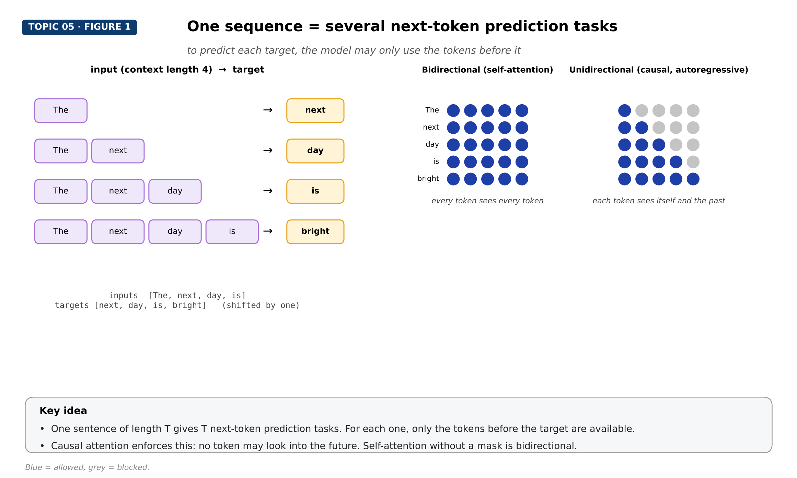
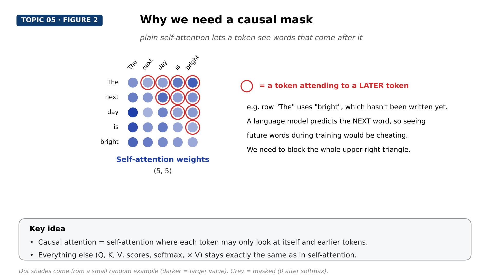
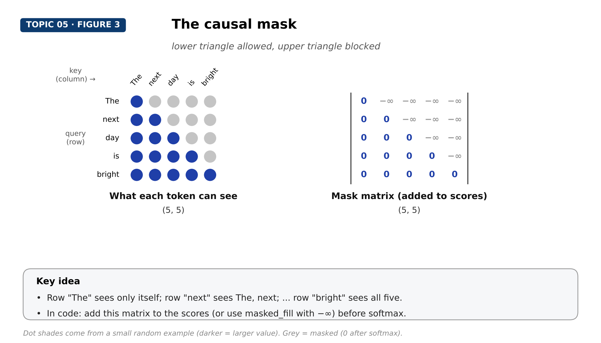
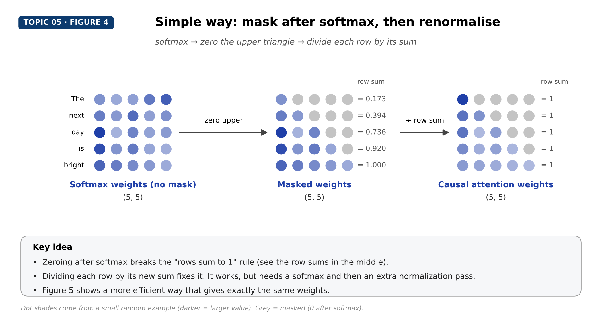
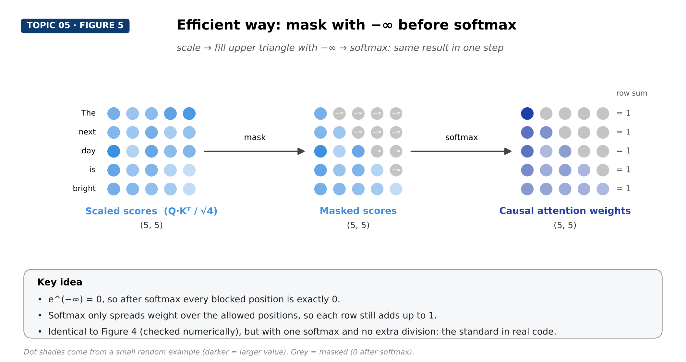
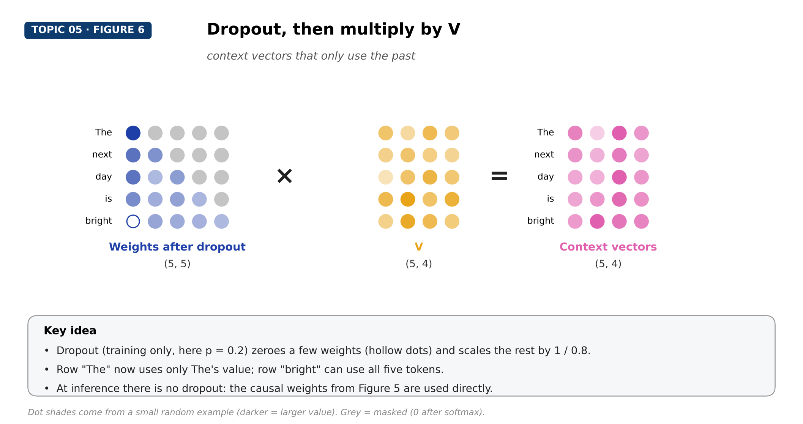

<div align="center">


<br/>

[](.)
[](.)
[](.)
[](.)
[](.)

**[← Back to the DeepSeek from Scratch series](../README.md)**

</div>

---

## Abstract

This topic adds the one constraint that turns self-attention into the attention used by GPT-style language models: **causality**. A language model learns by predicting each token from the tokens before it, so no token may attend to a later one. The topic shows how a single sequence becomes several next-token prediction tasks, why unmasked (bidirectional) self-attention would let the model "see the answer", and how a causal mask enforces unidirectional, autoregressive attention. Two masking strategies are derived and compared on the running example *"The next day is bright"*: masking after softmax followed by row renormalization, and the more efficient pre-softmax mask filled with $`-\infty`$. Their equivalence is proved and verified numerically. Dropout on the attention weights is then added for regularization, and the topic closes with the complete batched `CausalAttention` module and the three PyTorch patterns it relies on.

---

## At a Glance

| | |
|---|---|
| **Topic** | 05 of 26 — Stage 2 |
| **Document type** | Implementation & derivation |
| **Also known as** | Masked attention · unidirectional attention · autoregressive attention |
| **Core question** | How do we stop a token from attending to tokens that come after it — and do it efficiently? |
| **Builds on** | Topic 04 — Self-Attention Mechanism · [`llm-from-scratch`](https://github.com/shivakiran-ai/llm-from-scratch) Topic 10 |
| **Running example** | `"The next day is bright"` — 5 tokens, $`d_{\text{in}} = 8`$, $`d_{\text{out}} = 4`$ |
| **New parameters** | None — the mask is fixed, not trained |
| **Main artifact** | `Topic5_CausalAttention.docx` — technical report with 6 figures |
| **Version** | 1.0 · November 2026 |

---

## 1. Why Causality — One Sequence, Many Prediction Tasks

<p align="center"></p>

**Causal attention**, also known as **masked attention**, is a special form of self-attention. It restricts the model to consider only the **previous and current** tokens in a sequence when processing any given token.

To see why, look at how a language model is trained. With a context length of 4, the input and target batches are the same text shifted by one position:

```math
\text{inputs} = [\,\text{The},\ \text{next},\ \text{day},\ \text{is}\,]
\qquad\qquad
\text{targets} = [\,\text{next},\ \text{day},\ \text{is},\ \text{bright}\,]
```

This single row contains **four prediction tasks**: *The* → *next*, *The next* → *day*, *The next day* → *is*, *The next day is* → *bright*. For each task, the model may use only the tokens before the target — it cannot look into the future.

| | Self-attention (Topic 04) | Causal attention (this topic) |
|---|---|---|
| Direction | **Bidirectional** — every token sees every token | **Unidirectional** — each token sees itself and earlier tokens |
| Who uses it | Encoders, e.g. BERT | Decoder-only LLMs: GPT-2, GPT-3, DeepSeek |
| Generation style | — | Autoregressive: one token at a time, left to right |

---

## 2. The Problem with Unmasked Attention

<p align="center"></p>

In the self-attention weights of Topic 04, row *The* puts weight on *bright* — a word that, during generation, has not been written yet. If the model could see future tokens during training, predicting the next token would be trivial: it could simply copy it. It would then fail at inference, where those tokens do not exist.

So for every token we must remove access to every token that comes after it. In the $`T \times T`$ attention matrix, those are exactly the entries **above the diagonal**:

```math
\text{token } i \text{ may attend to token } j \quad \Longleftrightarrow \quad j \le i
```

---

## 3. The Causal Mask

<p align="center"></p>

The causal mask $`M \in \mathbb{R}^{T \times T}`$ keeps the lower triangle (including the diagonal) and blocks the upper triangle:

```math
M_{ij} \;=\; \begin{cases} 0 & \text{if } j \le i \quad \text{(allowed)} \\ -\infty & \text{if } j \gt i \quad \text{(future: blocked)} \end{cases}
```

Row *The* sees only itself; row *next* sees *The* and *next*; …; row *bright* sees all five tokens. The mask has no trainable parameters.

---

## 4. Strategy 1 — Mask After Softmax, Then Renormalize

<p align="center"></p>

The direct approach: compute the usual attention weights, zero out everything above the diagonal, and renormalize each row so it sums to 1 again.

```math
A \;=\; \mathrm{softmax}\left(\frac{QK^{\top}}{\sqrt{d_k}}\right),
\qquad
\tilde{A}_{ij} \;=\; A_{ij}\, \mathbf{1}[\,j \le i\,],
\qquad
A^{\text{causal}}_{ij} \;=\; \frac{\tilde{A}_{ij}}{\sum_{k \le i} \tilde{A}_{ik}}
```

Zeroing breaks the "rows sum to 1" rule — in our example the masked rows sum to 0.173, 0.394, 0.736, 0.920 and 1.000 — and the division repairs it. This works, but it needs a full softmax **and** a second normalization pass.

---

## 5. Strategy 2 — Mask with $`-\infty`$ Before Softmax (The Efficient Way)

<p align="center"></p>

Instead, add the mask to the scaled scores **before** softmax:

```math
A^{\text{causal}} \;=\; \mathrm{softmax}\left(\frac{QK^{\top}}{\sqrt{d_k}} + M\right)
```

Because $`e^{-\infty} = 0`$, every blocked position contributes nothing to either the numerator or the denominator, so softmax spreads all the weight over the allowed positions and each row already sums to 1.

**The two strategies give identical weights.** Write $`s_{ij}`$ for the scaled scores. Strategy 1 gives

```math
\frac{\dfrac{e^{s_{ij}}}{\sum_{k=1}^{T} e^{s_{ik}}}}{\sum_{m \le i} \dfrac{e^{s_{im}}}{\sum_{k=1}^{T} e^{s_{ik}}}}
\;=\; \frac{e^{s_{ij}}}{\sum_{m \le i} e^{s_{im}}}
\qquad (j \le i)
```

which is exactly the softmax over the allowed positions — Strategy 2. The full-row denominator cancels. This equality is verified numerically on our example (maximum difference below $`10^{-12}`$).

The resulting causal attention weights for *"The next day is bright"* (toy example):

| | The | next | day | is | bright | row sum |
|---|:-:|:-:|:-:|:-:|:-:|:-:|
| **The** | 1.000 | 0 | 0 | 0 | 0 | 1 |
| **next** | 0.615 | 0.385 | 0 | 0 | 0 | 1 |
| **day** | 0.608 | 0.089 | 0.302 | 0 | 0 | 1 |
| **is** | 0.434 | 0.180 | 0.272 | 0.114 | 0 | 1 |
| **bright** | 0.322 | 0.244 | 0.196 | 0.148 | 0.090 | 1 |

---

## 6. Dropout on the Attention Weights

<p align="center"></p>

**Dropout** is a deep-learning technique in which randomly selected units are ignored during training. It prevents overfitting and improves generalization [3]. In causal attention, dropout is applied to the attention weights **after** softmax, masking a few additional weights at random:

```math
\tilde{A} \;=\; \frac{\mathbf{m} \odot A^{\text{causal}}}{1 - p},
\qquad m_{ij} \sim \mathrm{Bernoulli}(1 - p),
\qquad Z \;=\; \tilde{A}\, V
```

The surviving weights are scaled by $`1/(1-p)`$ so the expected value is unchanged (with $`p = 0.5`$, survivors are doubled). Because of this, the rows no longer sum exactly to 1 during training. Dropout is switched **off** at inference (`model.eval()`). GPT-2 uses $`p = 0.1`$.

The complete causal attention computation is therefore:

```math
Z \;=\; \mathrm{Dropout}\left(\mathrm{softmax}\left(\frac{QK^{\top}}{\sqrt{d_k}} + M\right)\right) V
```

---

## 7. The Complete `CausalAttention` Module

Real training uses **batches**, so the inputs have shape $`(b, T, d_{\text{in}})`$:

```python
class CausalAttention(nn.Module):
    def __init__(self, d_in, d_out, context_length, dropout, qkv_bias=False):
        super().__init__()
        self.W_query = nn.Linear(d_in, d_out, bias=qkv_bias)
        self.W_key   = nn.Linear(d_in, d_out, bias=qkv_bias)
        self.W_value = nn.Linear(d_in, d_out, bias=qkv_bias)
        self.dropout = nn.Dropout(dropout)
        self.register_buffer(                                  # fixed, not trained
            "mask", torch.triu(torch.ones(context_length, context_length), diagonal=1))

    def forward(self, x):                                      # x: (b, T, d_in)
        b, T, _ = x.shape
        q, k, v = self.W_query(x), self.W_key(x), self.W_value(x)
        scores = q @ k.transpose(1, 2)                         # (b, T, T)
        scores.masked_fill_(self.mask.bool()[:T, :T], -torch.inf)
        weights = torch.softmax(scores / k.shape[-1] ** 0.5, dim=-1)
        weights = self.dropout(weights)
        return weights @ v                                     # (b, T, d_out)
```

| Pattern | Where | Why it matters |
|---|---|---|
| `register_buffer` | Stores the mask | Moves with `.to(device)` and is saved in the `state_dict`, but the optimizer never updates it |
| `k.transpose(1, 2)` | Score computation | Transposes only the last two dimensions; `.T` would also scramble the batch dimension |
| `masked_fill_` (in place) | Applying the mask | The trailing underscore avoids allocating a new tensor |
| `[:T, :T]` | Mask slicing | Lets one mask built for the maximum context length serve any shorter sequence |

The runnable version, tested on a batch of shape $`(2, 6, 3)`$, is in [`llm-from-scratch`](https://github.com/shivakiran-ai/llm-from-scratch) Topic 10.

---

## Key Technical Observations

1. **Causal masking is an architectural constraint, not a regularizer.** It makes training match generation: at both times, a token can use only the past.
2. **Every decoder-only LLM uses it.** GPT-2, GPT-3 and DeepSeek all apply a causal mask in every attention layer.
3. **One sequence of length $`T`$ trains $`T`$ predictions at once.** The mask is what makes all positions valid training examples in a single forward pass.
4. **The $`-\infty`$ mask is the production form.** It gives exactly the same weights as masking after softmax, in one pass and with no extra division.
5. **The mask has no parameters.** Causal attention has exactly the same trainable weights as self-attention: $`W_Q`$, $`W_K`$, $`W_V`$.
6. **Dropout acts on attention weights, after softmax.** Survivors are rescaled by $`1/(1-p)`$, and dropout is disabled at inference.
7. **Batches change the code, not the maths.** `transpose(1, 2)` and a sliced, registered mask are all that is needed to go from one sequence to many.

---

## References

References are listed in IEEE numeric format.

| # | Authors | Title | Venue | Year |
|:-:|---------|-------|-------|:-:|
| 1 | A. Vaswani et al. | Attention Is All You Need | *NeurIPS* | 2017 |
| 2 | A. Radford et al. | Language Models are Unsupervised Multitask Learners | *OpenAI Tech. Report* | 2019 |
| 3 | N. Srivastava et al. | Dropout: A Simple Way to Prevent Neural Networks from Overfitting | *JMLR* | 2014 |
| 4 | J. Devlin et al. | BERT: Pre-training of Deep Bidirectional Transformers for Language Understanding | *NAACL* | 2019 |
| 5 | S. Raschka | Build a Large Language Model (From Scratch), Ch. 3 | *Manning* | 2024 |

---

## Files in This Directory

| File | Description |
|------|-------------|
| `README.md` | This document — conceptual summary and reader entry point |
| `Topic5_CausalAttention.docx` | Primary artifact (v1.0) — technical report: title page, abstract, contents, 7 sections, 6 embedded figures, equivalence proof, IEEE references |
| `images/` | The 6 figures used in this README and the report |

> **Code.** The `CausalAttention` module above is runnable in [`llm-from-scratch`](https://github.com/shivakiran-ai/llm-from-scratch) Topic 10 (`Causal_Attention.ipynb`).

---

## Navigation

**Previous:** &nbsp; [Topic 04 — Self-Attention Mechanism](../04_self_attention/README.md) &nbsp;·&nbsp; *Scaled dot-product attention with trainable Q, K, V*

**Next:** &nbsp; [Topic 06 — Multi-Head Attention](../06_multihead_attention/README.md) &nbsp;·&nbsp; *Several causal attention heads in parallel, each with its own Q, K, V, combined into one output.*

---

<div align="center">

**DeepSeek from Scratch**  
A technical report series rebuilding the key ideas behind DeepSeek-V2 / V3 from first principles.

**Shiva Kiran Dadishetty** &nbsp;·&nbsp; Independent Research &nbsp;·&nbsp; Texas, USA  
[github.com/shivakiran-ai/deepseek-from-scratch](https://github.com/shivakiran-ai/deepseek-from-scratch)

*Document version 1.0 &nbsp;·&nbsp; Last updated November 2026*


</div>
