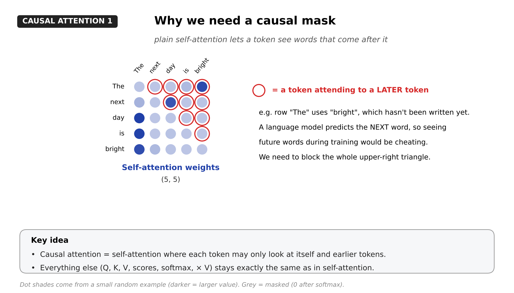
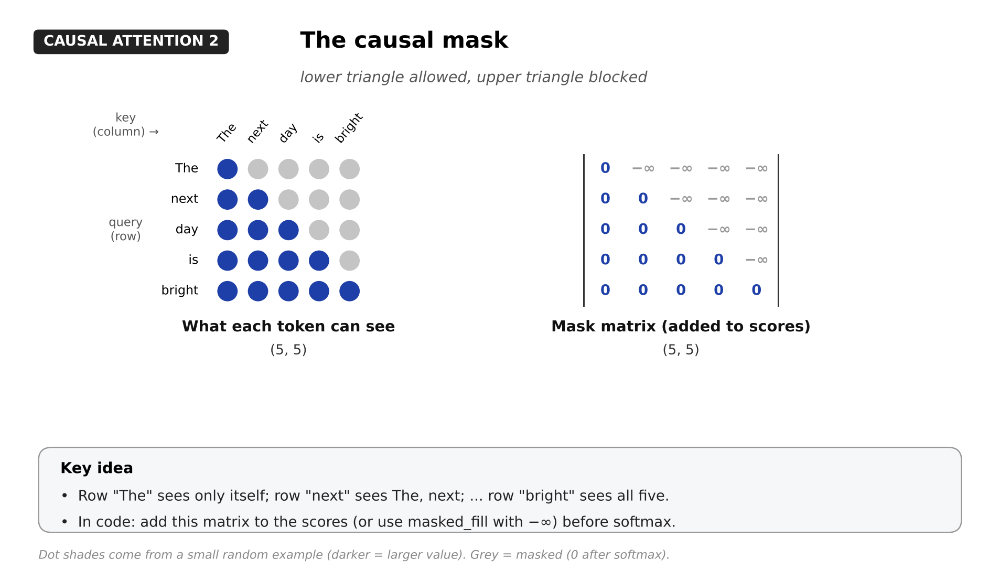
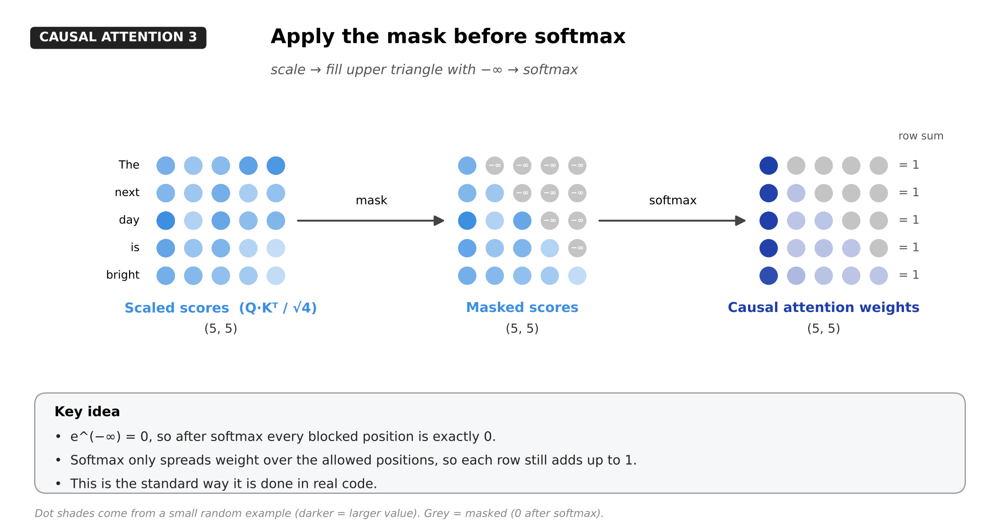
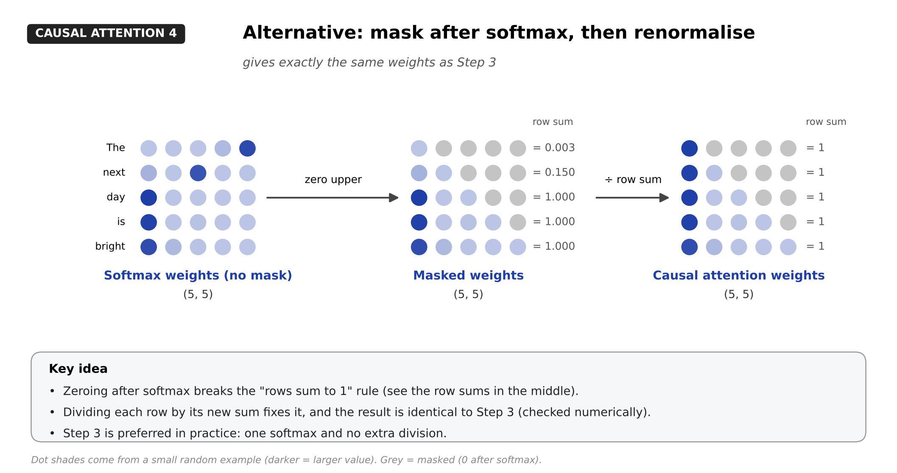
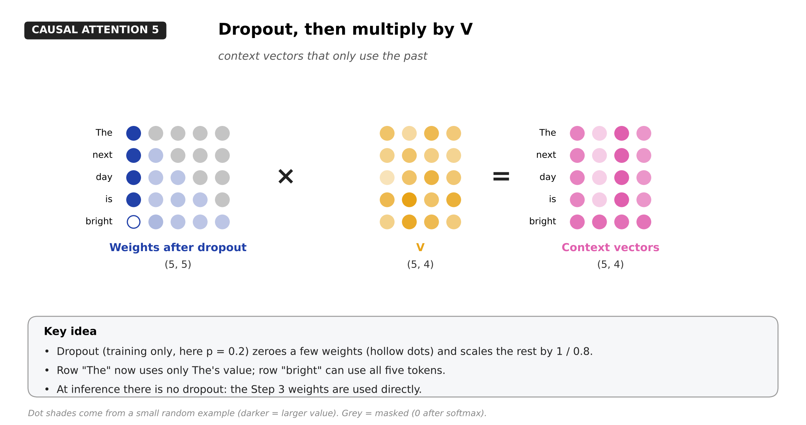

 

**[← Back to the DeepSeek from Scratch series](../README.md)**

---

## Abstract

> 🔲 *To be written from the handwritten notes for this topic.*

---

## At a Glance

| | |
|---|---|
| **Topic** | 05 of 26 — Stage 2 |
| **Core concept** | Causal mask · −∞ before softmax · renormalisation equivalence · dropout |
| **Status** | 🔄 Diagrams ready — write-up in progress |
| **Builds on** | Topic 04 — Self-Attention Mechanism |

---

## Figures

Every diagram uses one running example and colour scheme across the series. Shades come from a small computed example, not decoration.

**Figure 1 — Why mask**

**Figure 2 — Causal mask**

**Figure 3 — Mask before softmax**

**Figure 4 — Mask after softmax**

**Figure 5 — Dropout context**

---

## Files in This Directory

| File | Description |
|------|-------------|
| `README.md` | This document — conceptual summary and reader entry point |
| `Topic5_<Title>.docx` | 🔲 Deep-dive technical report (to be added) |
| `<Title>.ipynb` | 🔲 Annotated PyTorch implementation (to be added) |
| `images/` | Diagrams used in this README and the docx |

---

## Navigation

**Previous:** &nbsp; [Topic 04 — Self-Attention Mechanism](../04_self_attention/README.md)

**Next:** &nbsp; [Topic 06 — Multi-Head Attention](../06_multihead_attention/README.md)

---

**DeepSeek from Scratch**  
A technical report series rebuilding the key ideas behind DeepSeek-V2 / V3 from first principles.

**Shiva Kiran Dadishetty** &nbsp;·&nbsp; Independent Research &nbsp;·&nbsp; Texas, USA  
[github.com/shivakiran-ai/deepseek-from-scratch](https://github.com/shivakiran-ai/deepseek-from-scratch)

*Document version 0.1 &nbsp;·&nbsp; Last updated November 2026*

