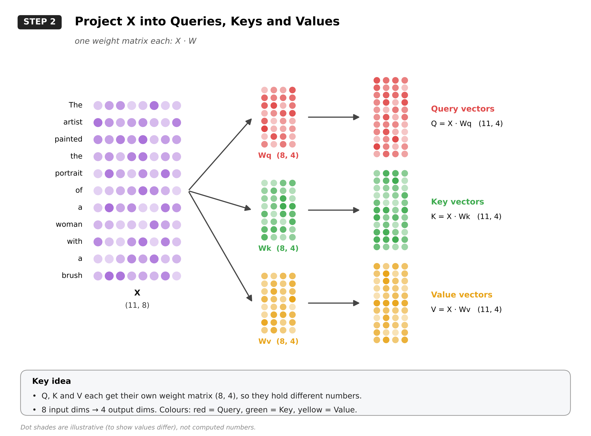
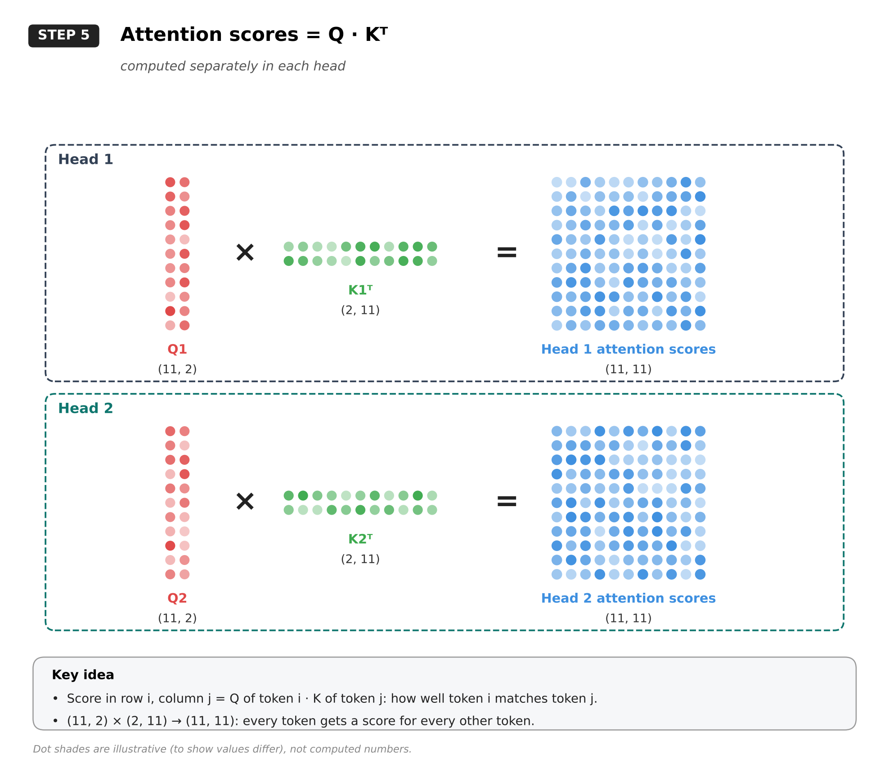
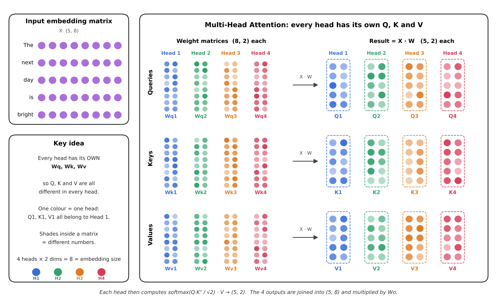

 

**[← Back to the DeepSeek from Scratch series](../README.md)**

---

## Abstract

> 🔲 *To be written from the handwritten notes for this topic.*

---

## At a Glance

| | |
|---|---|
| **Topic** | 06 of 26 — Stage 2 |
| **Core concept** | Split weights per head · per-head Q, K, V · concat · out_proj |
| **Status** | 🔄 Diagrams ready — write-up in progress |
| **Builds on** | Topic 05 — Causal Attention |

---

## Figures

Every diagram uses one running example and colour scheme across the series. Shades come from a small computed example, not decoration.

**Figure 1 — Input embeddings**

**Figure 2 — Qkv projection**

**Figure 3 — Split heads**

**Figure 4 — Per head qkv**

**Figure 5 — Attention scores**

**Figure 6 — Attention weights**

**Figure 7 — Context matrix**

**Figure 8 — Final context**

**Figure 9 — Multi head attention**

---

## Files in This Directory

| File | Description |
|------|-------------|
| `README.md` | This document — conceptual summary and reader entry point |
| `Topic6_<Title>.docx` | 🔲 Deep-dive technical report (to be added) |
| `<Title>.ipynb` | 🔲 Annotated PyTorch implementation (to be added) |
| `images/` | Diagrams used in this README and the docx |

---

## Navigation

**Previous:** &nbsp; [Topic 05 — Causal Attention](../05_causal_attention/README.md)

**Next:** &nbsp; [Topic 07 — Key-Value Cache](../07_kv_cache/README.md)

---

**DeepSeek from Scratch**  
A technical report series rebuilding the key ideas behind DeepSeek-V2 / V3 from first principles.

**Shiva Kiran Dadishetty** &nbsp;·&nbsp; Independent Research &nbsp;·&nbsp; Texas, USA  
[github.com/shivakiran-ai/deepseek-from-scratch](https://github.com/shivakiran-ai/deepseek-from-scratch)

*Document version 0.1 &nbsp;·&nbsp; Last updated November 2026*

