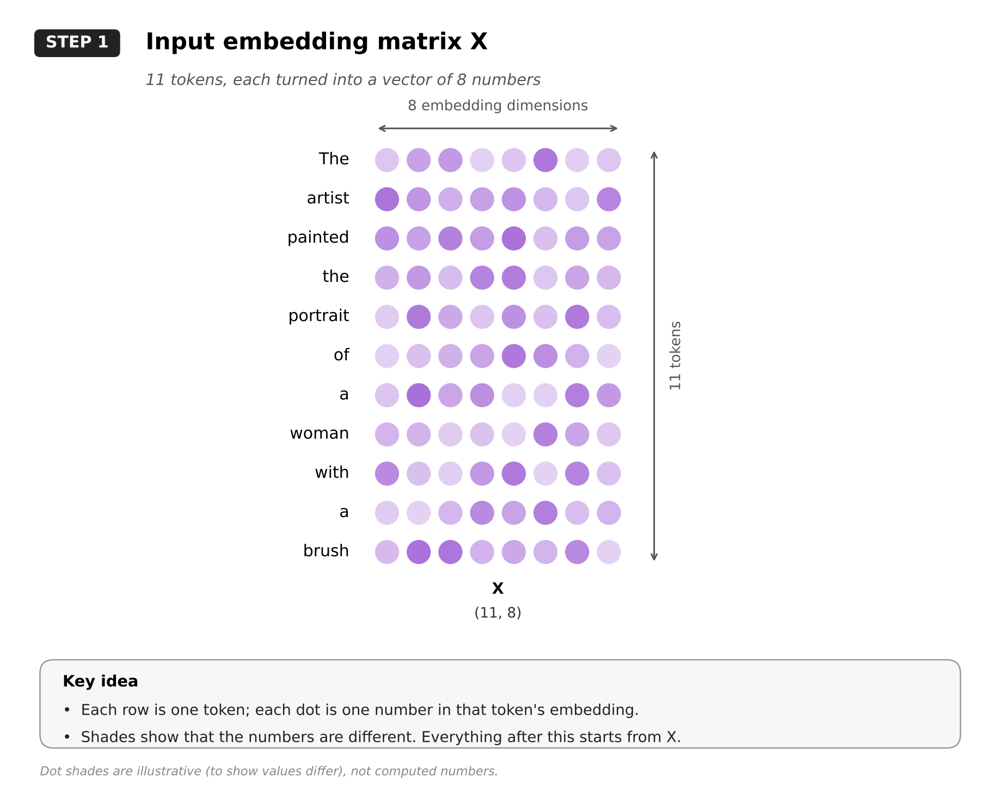
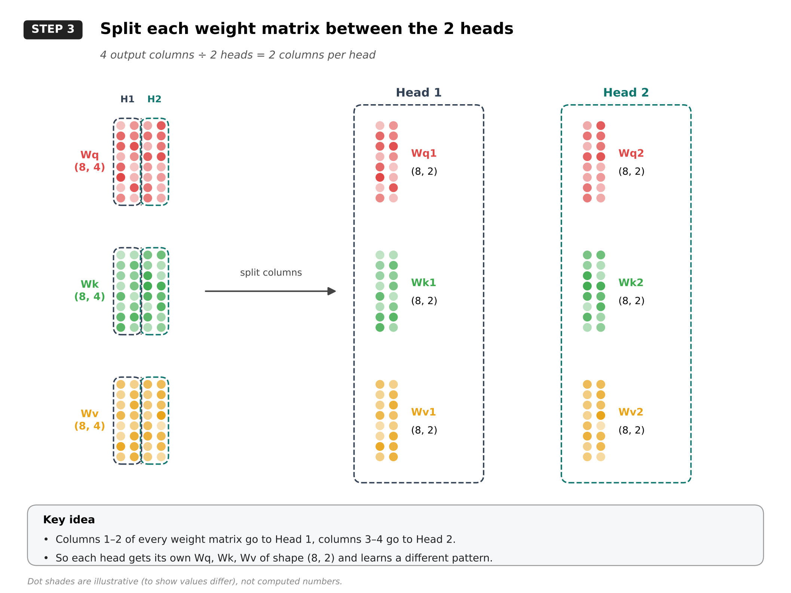
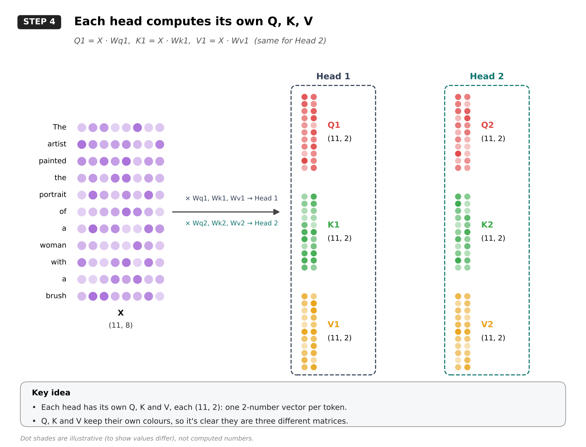
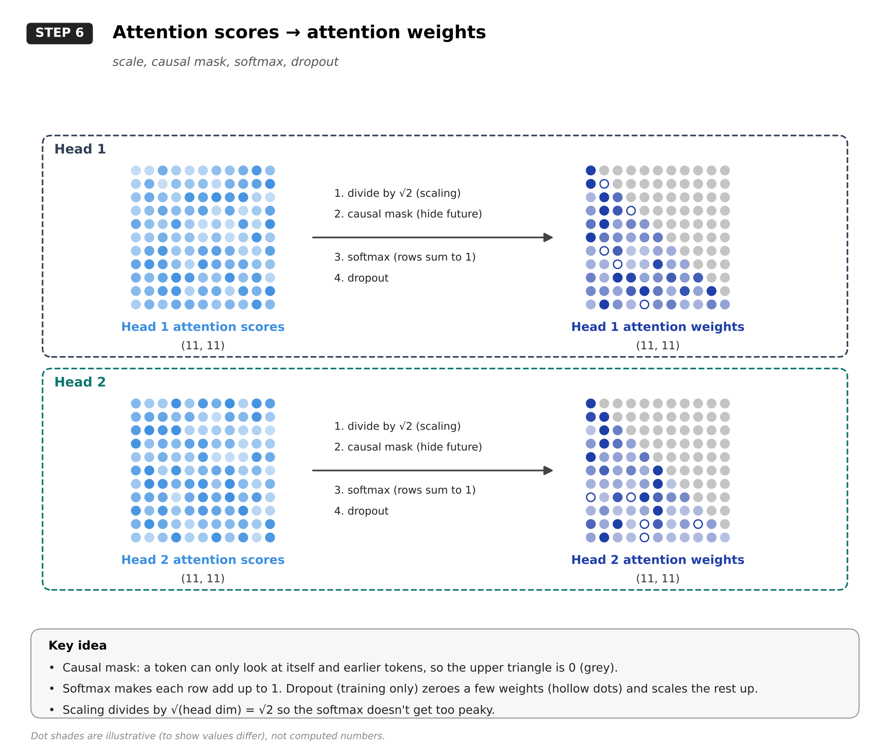
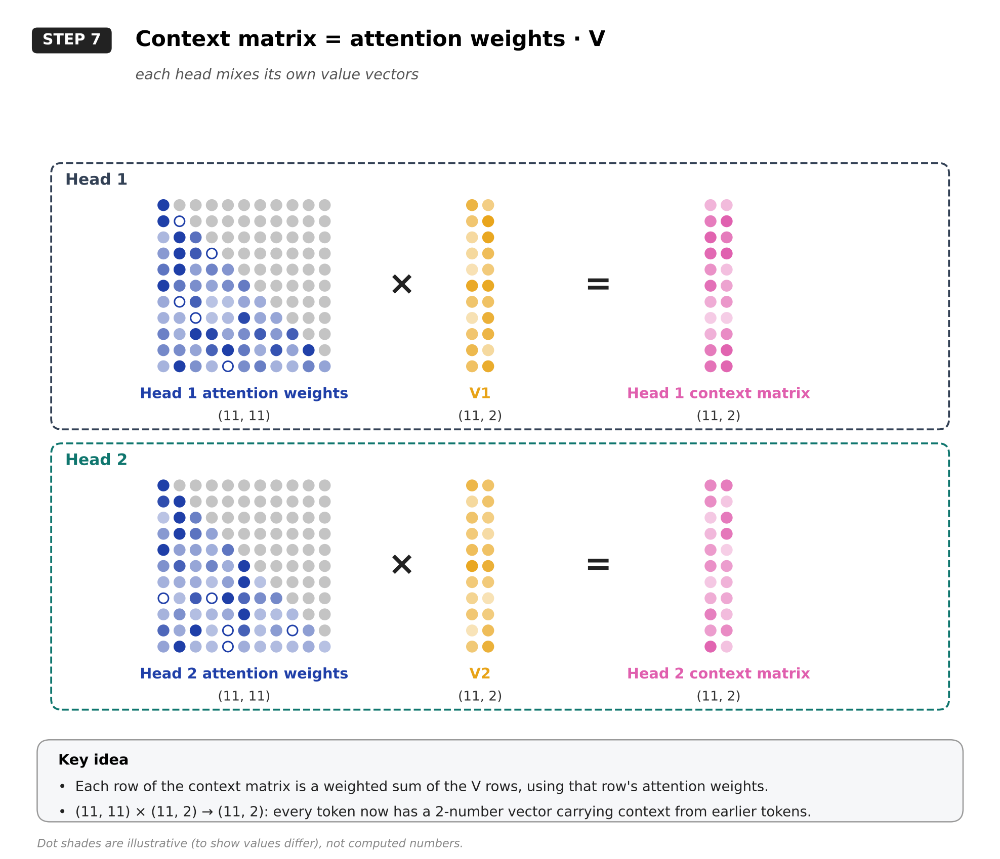
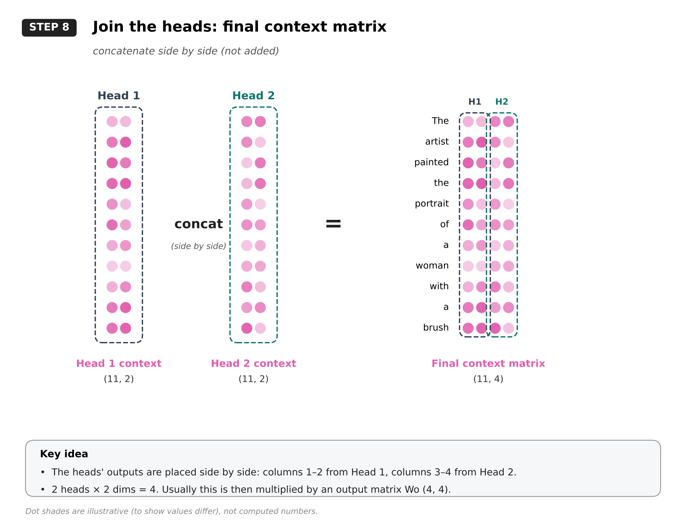

<div align="center">


<br/>

[](.)
[](.)
[](.)
[](.)
[](.)

**[← Back to the DeepSeek from Scratch series](../README.md)**

</div>

---

## Abstract

This topic extends causal self-attention to **multi-head attention**, the form used in every layer of GPT-2, GPT-3 and the attention baseline that DeepSeek later modifies. A single attention head can capture only one perspective on a sentence; multi-head attention runs several heads in parallel, each with its own query, key and value projections, and concatenates their outputs. The mechanism is first built step by step on an 11-token running example (*"The artist painted the portrait of a woman with a brush"*, $`d_{\text{in}} = 8`$, $`d_{\text{out}} = 4`$, two heads of dimension 2), following every tensor from the input embeddings to the merged context matrix and the output projection $`W_O`$. The topic then derives the two standard implementations: a **wrapper** that runs independent causal-attention modules, and the production **weight-split** form that computes all heads with one matrix multiplication per projection and recovers the heads with `view` and `transpose`. The shape of every intermediate tensor is traced for a batched example, the choice of $`\sqrt{d_{\text{head}}}`$ as the scale factor is justified, and the efficiency gain at GPT-2 scale — 432 versus 36 projection multiplications per forward pass — is quantified.

---

## At a Glance

| | |
|---|---|
| **Topic** | 06 of 26 — Stage 2 |
| **Document type** | Implementation & derivation — the attention layer used in practice |
| **Core question** | Why run several attention heads instead of one, and how are they computed efficiently? |
| **Builds on** | Topic 05 — Causal Attention · [`llm-from-scratch`](https://github.com/shivakiran-ai/llm-from-scratch) Topics 11 – 12 |
| **Running example** | `"The artist painted the portrait of a woman with a brush"` — 11 tokens, $`d_{\text{in}} = 8`$, $`d_{\text{out}} = 4`$, 2 heads, $`d_{\text{head}} = 2`$ |
| **Implementation example** | batch 1, 3 tokens, $`d_{\text{in}} = d_{\text{out}} = 6`$, 2 heads, $`d_{\text{head}} = 3`$ |
| **Key formula** | $`\mathrm{MultiHead}(X) = \mathrm{Concat}(\mathrm{head}_1, \dots, \mathrm{head}_h)\, W_O`$ |
| **Main artifact** | `Topic6_MultiHeadAttention.docx` — technical report with 8 figures |
| **Version** | 1.0 · November 2026 |

---

## 1. From Self-Attention to Multi-Head Attention

Self-attention (Topics 04 – 05) converts input embeddings into context vectors in four parts:

| Part | Operation | Result |
|:-:|---|---|
| 1 | Project the input matrix into $`Q`$, $`K`$, $`V`$ | Query, key and value matrices |
| 2 | $`QK^{\top}`$ | Attention scores |
| 3 | Scale by $`1/\sqrt{d_k}`$, causal mask, softmax, dropout | Attention weights |
| 4 | Attention weights $`\times V`$ | Context vector matrix |

Multi-head attention keeps all four parts unchanged. It simply runs them **several times in parallel**, each time with different projection matrices.

---

## 2. The Problem — One Head, One Perspective

Consider the sentence:

> *"The artist painted the portrait of a woman with a brush."*

It has two valid readings:

| Reading | What *with a brush* attaches to | Meaning |
|:-:|---|---|
| 1 | *painted* | The artist used a brush to paint a woman. |
| 2 | *woman* | The artist painted a portrait of a woman who is holding a brush. |

A single self-attention head produces **one** attention-score matrix, and therefore commits to **one** interpretation of the sentence. The same holds for a whole paragraph: a text discussing *"the government should regulate free speech"* may carry one perspective (impose restrictions) and another (protect and preserve free speech), but one head assigns only one perspective.

There can be two or more meaningful attention patterns for the same sentence. Capturing several of them makes the model's understanding richer. That is the motivation for multiple heads:

```math
1 \text{ self-attention} \;\to\; 1 \text{ perspective}
\qquad\qquad
h \text{ self-attentions} \;\to\; h \text{ perspectives}
```

Each attention mechanism is called a **head**; running $`h`$ of them in parallel and merging their outputs is **multi-head attention** [1].

---

## 3. The Mechanism

Each head $`i`$ has its own projections and runs causal scaled dot-product attention:

```math
\mathrm{head}_i \;=\; \mathrm{softmax}\left(\frac{(X W_Q^{(i)})(X W_K^{(i)})^{\top}}{\sqrt{d_{\text{head}}}} + M\right) X W_V^{(i)},
\qquad W_Q^{(i)}, W_K^{(i)}, W_V^{(i)} \in \mathbb{R}^{d_{\text{in}} \times d_{\text{head}}}
```

The heads are concatenated side by side and mixed by an output projection:

```math
\mathrm{MultiHead}(X) \;=\; \mathrm{Concat}(\mathrm{head}_1, \dots, \mathrm{head}_h)\, W_O,
\qquad W_O \in \mathbb{R}^{d_{\text{out}} \times d_{\text{out}}}
```

The output width is fixed in advance, and each head receives an equal share of it:

```math
d_{\text{head}} \;=\; \frac{d_{\text{out}}}{h}
\qquad\qquad
\text{running example: } d_{\text{head}} = \frac{4}{2} = 2
```

---

## 4. Two-Head Attention, Step by Step

The running example uses 11 tokens with input dimension $`d_{\text{in}} = 8`$, output dimension $`d_{\text{out}} = 4`$ and $`h = 2`$ heads.

### Step 1 — Input embedding matrix

<p align="center"></p>

```math
X \in \mathbb{R}^{11 \times 8}
```

Each row is the input embedding (token + positional embedding, Topic 02) of one token.

### Step 2 — Start from a single $`W_Q`$, $`W_K`$, $`W_V`$

<p align="center"></p>

Decide $`d_{\text{out}} = 4`$. One set of weight matrices projects $`X`$ into queries, keys and values. This alone is a **single-head** attention:

```math
Q = X W_Q, \quad K = X W_K, \quad V = X W_V,
\qquad W_Q, W_K, W_V \in \mathbb{R}^{8 \times 4}, \quad Q, K, V \in \mathbb{R}^{11 \times 4}
```

### Step 3 — Split each weight matrix between the heads

<p align="center"></p>

The four output columns are divided between the two heads: columns 1 – 2 go to head 1, columns 3 – 4 to head 2.

```math
W_Q = \big[\, W_Q^{(1)} \;\big|\; W_Q^{(2)} \,\big],
\qquad W_Q^{(1)}, W_Q^{(2)} \in \mathbb{R}^{8 \times 2}
\qquad \text{(same for } W_K \text{ and } W_V)
```

### Step 4 — Each head computes its own $`Q`$, $`K`$, $`V`$

<p align="center"></p>

Multiple copies of the query, key and value matrices are created, one per head:

```math
Q_i = X W_Q^{(i)}, \quad K_i = X W_K^{(i)}, \quad V_i = X W_V^{(i)},
\qquad Q_i, K_i, V_i \in \mathbb{R}^{11 \times 2}, \quad i = 1, 2
```

Because the heads use different columns of the weight matrices, their queries, keys and values are different, and so are the relationships they learn.

### Step 5 — Attention scores for each head

<p align="center"></p>

```math
S_i \;=\; Q_i K_i^{\top}, \qquad (11 \times 2)(2 \times 11) \;\to\; (11 \times 11)
```

Each head produces its own $`11 \times 11`$ score matrix — **each attention matrix captures a different perspective**.

### Step 6 — Attention weights for each head

<p align="center"></p>

Inside every head: scale, apply the causal mask, softmax and dropout (Topic 05):

```math
A_i \;=\; \mathrm{Dropout}\left(\mathrm{softmax}\left(\frac{S_i}{\sqrt{d_{\text{head}}}} + M\right)\right),
\qquad \sqrt{d_{\text{head}}} = \sqrt{2}
```

The causal mask is applied **inside each head independently** — every head obeys the same rule of looking only at the past.

### Step 7 — Context matrix for each head

<p align="center"></p>

```math
Z_i \;=\; A_i V_i, \qquad (11 \times 11)(11 \times 2) \;\to\; (11 \times 2)
```

### Step 8 — Merge the heads, then project

<p align="center"></p>

The two context matrices — perspective 1 and perspective 2 — are **concatenated**, not added:

```math
Z \;=\; \big[\, Z_1 \;\big|\; Z_2 \,\big] \in \mathbb{R}^{11 \times 4}
```

Finally, the output projection $`W_O \in \mathbb{R}^{4 \times 4}`$ mixes information across the heads:

```math
\text{Output} \;=\; Z\, W_O \in \mathbb{R}^{11 \times 4}
```

Concatenation alone only places the heads side by side; $`W_O`$ is the only operation in the layer that lets the perspectives interact.

### The trade-off

The dimension of each head is reduced, so each head captures less information on its own — but the number of perspectives increases:

| | 1 head | 2 heads | 12 heads (GPT-2 Small) |
|---|:-:|:-:|:-:|
| $`d_{\text{head}}`$ | $`d_{\text{out}}`$ | $`d_{\text{out}}/2`$ | $`768/12 = 64`$ |
| Perspectives | 1 | 2 | 12 |
| Parameters in $`W_Q, W_K, W_V`$ | $`3\, d_{\text{in}}\, d_{\text{out}}`$ | $`3\, d_{\text{in}}\, d_{\text{out}}`$ | $`3\, d_{\text{in}}\, d_{\text{out}}`$ |

Splitting into heads does **not** change the number of projection parameters — it only changes how the output dimensions are grouped.

---

## 5. Implementation 1 — The Wrapper

The most direct implementation creates $`h`$ independent `CausalAttention` modules (Topic 05), each with output width $`d_{\text{head}}`$, and concatenates their outputs:

```python
class MultiHeadAttentionWrapper(nn.Module):
    def __init__(self, d_in, d_out, context_length, dropout, num_heads, qkv_bias=False):
        super().__init__()
        self.heads = nn.ModuleList([
            CausalAttention(d_in, d_out, context_length, dropout, qkv_bias)
            for _ in range(num_heads)
        ])

    def forward(self, x):
        return torch.cat([head(x) for head in self.heads], dim=-1)
```

Here `d_out` is the width **per head**, so the result has width $`h \times d_{\text{out}}`$. The wrapper is easy to read, but each head performs its own three projections in a Python loop: $`3h`$ matrix multiplications per layer.

---

## 6. Implementation 2 — Weight Splitting (The Production Form)

Instead of $`h`$ small weight matrices, use **one** $`W_Q`$ of shape $`d_{\text{in}} \times d_{\text{out}}`$ (with $`d_{\text{out}} = h \cdot d_{\text{head}}`$), do **one** matrix multiplication, and split the result into heads by reshaping. Concatenating column blocks of $`W_Q`$ and splitting the columns of $`Q`$ are the same thing:

```math
X W_Q \;=\; X \big[\, W_Q^{(1)} \,\big|\, \cdots \,\big|\, W_Q^{(h)} \,\big] \;=\; \big[\, X W_Q^{(1)} \,\big|\, \cdots \,\big|\, X W_Q^{(h)} \,\big]
```

So the weight-split form gives exactly the same result as the wrapper (verified numerically), with far fewer operations.

### Shape walk-through

Example: batch $`b = 1`$, 3 tokens, $`d_{\text{in}} = d_{\text{out}} = 6`$, $`h = 2`$, so $`d_{\text{head}} = 6/2 = 3`$.

```python
x = torch.tensor([[[1.0, 2.0, 3.0, 4.0, 5.0, 6.0],
                   [6.0, 5.0, 4.0, 3.0, 2.0, 1.0],
                   [1.0, 1.0, 1.0, 1.0, 1.0, 1.0]]])     # (b, num_tokens, d_in) = (1, 3, 6)
```

| Step | Operation | Shape |
|:-:|---|---|
| 1 | Input $`x`$ | $`(b, T, d_{\text{in}}) = (1, 3, 6)`$ |
| 2 | Choose $`d_{\text{out}} = 6`$, $`h = 2`$ | $`d_{\text{head}} = 3`$ |
| 3 | Initialize $`W_Q, W_K, W_V`$ | $`(d_{\text{in}}, d_{\text{out}}) = (6, 6)`$ each |
| 4 | $`Q = xW_Q`$, $`K = xW_K`$, $`V = xW_V`$ — one matmul each | $`(b, T, d_{\text{out}}) = (1, 3, 6)`$ |
| 5 | `view`: split $`d_{\text{out}}`$ into heads | $`(b, T, h, d_{\text{head}}) = (1, 3, 2, 3)`$ |
| 6 | `transpose(1, 2)`: group matrices by head | $`(b, h, T, d_{\text{head}}) = (1, 2, 3, 3)`$ |
| 7 | Scores $`QK^{\top}`$ with `keys.transpose(2, 3)` | $`(b, h, T, T) = (1, 2, 3, 3)`$ |
| 8 | Causal mask, divide by $`\sqrt{d_{\text{head}}} = \sqrt{3}`$, softmax | $`(1, 2, 3, 3)`$ |
| 9 | Context = weights $`\times V`$ | $`(b, h, T, d_{\text{head}}) = (1, 2, 3, 3)`$ |
| 10 | `transpose(1, 2)` then `view`: merge heads | $`(b, T, h, d_{\text{head}}) \to (b, T, d_{\text{out}}) = (1, 3, 6)`$ |
| 11 | `out_proj` ($`W_O`$) | $`(1, 3, 6)`$ |

After step 5, each token's row is split into two halves: the first 3 numbers belong to head 1, the last 3 to head 2. Step 6 regroups them so that head 1's queries for all tokens sit together ($`Q_1`$, shape $`3 \times 3`$) and likewise for head 2 ($`Q_2`$). From then on every head runs in parallel in one batched multiplication.

### The complete class

```python
class MultiHeadAttention(nn.Module):
    def __init__(self, d_in, d_out, context_length, dropout, num_heads, qkv_bias=False):
        super().__init__()
        assert d_out % num_heads == 0, "d_out must be divisible by num_heads"
        self.d_out, self.num_heads = d_out, num_heads
        self.head_dim = d_out // num_heads
        self.W_query  = nn.Linear(d_in, d_out, bias=qkv_bias)   # one matrix for all heads
        self.W_key    = nn.Linear(d_in, d_out, bias=qkv_bias)
        self.W_value  = nn.Linear(d_in, d_out, bias=qkv_bias)
        self.out_proj = nn.Linear(d_out, d_out)                 # W_O
        self.dropout  = nn.Dropout(dropout)
        self.register_buffer("mask",
            torch.triu(torch.ones(context_length, context_length), diagonal=1))

    def forward(self, x):
        b, T, _ = x.shape
        q = self.W_query(x).view(b, T, self.num_heads, self.head_dim).transpose(1, 2)
        k = self.W_key(x).view(b, T, self.num_heads, self.head_dim).transpose(1, 2)
        v = self.W_value(x).view(b, T, self.num_heads, self.head_dim).transpose(1, 2)

        scores = q @ k.transpose(2, 3)                           # (b, h, T, T)
        scores.masked_fill_(self.mask.bool()[:T, :T], -torch.inf)
        weights = torch.softmax(scores / self.head_dim ** 0.5, dim=-1)
        weights = self.dropout(weights)

        ctx = (weights @ v).transpose(1, 2)                      # (b, T, h, head_dim)
        ctx = ctx.contiguous().view(b, T, self.d_out)            # merge heads
        return self.out_proj(ctx)                                # (b, T, d_out)
```

| Pattern | What it does | Why it matters |
|---|---|---|
| `.view(b, T, h, head_dim)` | Splits $`d_{\text{out}}`$ into heads | A zero-copy reshape — creating the head dimension costs nothing |
| `.transpose(1, 2)` | Moves heads in front of tokens | Lets one batched matmul compute every head at once |
| `k.transpose(2, 3)` | Swaps the last two dimensions of the keys | Forms $`K^{\top}`$ per head for $`QK^{\top}`$ |
| `.contiguous()` | Restores contiguous memory after `transpose` | `view` needs contiguous memory; without it PyTorch raises an error |
| `out_proj` | Learned $`d_{\text{out}} \times d_{\text{out}}`$ projection | The only operation that mixes information across heads ($`W_O`$ in [1]) |

The runnable versions of both implementations are in [`llm-from-scratch`](https://github.com/shivakiran-ai/llm-from-scratch) Topics 11 and 12.

---

## 7. Why Scale by $`\sqrt{d_{\text{head}}}`$, Not $`\sqrt{d_{\text{out}}}`$

After the split, each head works entirely inside its own $`d_{\text{head}}`$-dimensional subspace. A query–key dot product within one head sums $`d_{\text{head}}`$ terms, so under the unit-variance assumption of Topic 04:

```math
\mathrm{Var}\big(\mathbf{q}^{(i)} \cdot \mathbf{k}^{(i)}\big) \;=\; d_{\text{head}}
\qquad\Longrightarrow\qquad
\text{scale by } \frac{1}{\sqrt{d_{\text{head}}}}
```

In the examples: $`\sqrt{2}`$ for the 11-token example, $`\sqrt{3}`$ for the implementation example, and $`\sqrt{64} = 8`$ in GPT-2 Small.

---

## 8. Efficiency and Scale

| Quantity | Wrapper | Weight-split |
|---|:-:|:-:|
| Q/K/V matrix multiplications per layer | $`3h = 36`$ | 3 |
| Layers in GPT-2 Small | 12 | 12 |
| Q/K/V multiplications per forward pass | **432** | **36** |
| Output | identical | identical |

The mathematics is the same; only the batching differs. Fewer, larger matrix multiplications make far better use of a GPU, which is why the weight-split form is used in every production model.

**GPT-2 Small attention layer** ($`d_{\text{in}} = d_{\text{out}} = 768`$, $`h = 12`$, $`d_{\text{head}} = 64`$):

```math
\underbrace{4 \times 768^2}_{W_Q,\, W_K,\, W_V,\, W_O} + \underbrace{4 \times 768}_{\text{biases}} \;=\; 2{,}359{,}296 + 3{,}072 \;=\; 2{,}362{,}368 \text{ parameters}
```

| Tensor | Running example | GPT-2 Small |
|---|---|---|
| Input $`X`$ | $`(11, 8)`$ | $`(T, 768)`$ |
| $`W_Q, W_K, W_V`$ | $`(8, 4)`$ | $`(768, 768)`$ |
| Per-head $`Q_i, K_i, V_i`$ | $`(11, 2)`$ | $`(T, 64)`$ |
| Per-head scores and weights | $`(11, 11)`$ | $`(T, T)`$ |
| Per-head context $`Z_i`$ | $`(11, 2)`$ | $`(T, 64)`$ |
| Merged context, output | $`(11, 4)`$ | $`(T, 768)`$ |

---

## Key Technical Observations

1. **One head captures one perspective.** A sentence can have several valid attention patterns; $`h`$ heads can learn $`h`$ of them.
2. **Heads differ only in their projection columns.** Each head is ordinary causal attention on its own slice of $`W_Q`$, $`W_K`$, $`W_V`$.
3. **The causal mask applies inside every head.** Multi-head attention adds diversity of *what* to attend to, not a change in *direction*.
4. **Heads are concatenated, then mixed by $`W_O`$.** Concatenation places the perspectives side by side; the output projection lets them interact.
5. **More heads do not mean more projection parameters.** $`d_{\text{head}} = d_{\text{out}}/h`$, so the total width — and the weight count — stays the same.
6. **Weight splitting is exact.** One large projection followed by `view` and `transpose` equals $`h`$ separate projections, with $`h`$ times fewer matrix multiplications.
7. **Scale by $`\sqrt{d_{\text{head}}}`$.** Each dot product lives in one head's subspace.
8. **Every head needs its own keys and values at inference.** Storing them for all heads, layers and tokens is the memory cost examined in the next topic.

---

## References

References are listed in IEEE numeric format.

| # | Authors | Title | Venue | Year |
|:-:|---------|-------|-------|:-:|
| 1 | A. Vaswani et al. | Attention Is All You Need | *NeurIPS* | 2017 |
| 2 | A. Radford et al. | Language Models are Unsupervised Multitask Learners | *OpenAI Tech. Report* | 2019 |
| 3 | T. Brown et al. | Language Models are Few-Shot Learners | *NeurIPS* | 2020 |
| 4 | E. Voita et al. | Analyzing Multi-Head Self-Attention: Specialized Heads Do the Heavy Lifting, the Rest Can Be Pruned | *ACL* | 2019 |
| 5 | P. Michel, O. Levy, G. Neubig | Are Sixteen Heads Really Better than One? | *NeurIPS* | 2019 |
| 6 | S. Raschka | Build a Large Language Model (From Scratch), Ch. 3 | *Manning* | 2024 |

---

## Files in This Directory

| File | Description |
|------|-------------|
| `README.md` | This document — conceptual summary and reader entry point |
| `Topic6_MultiHeadAttention.docx` | Primary artifact (v1.0) — technical report: title page, abstract, contents, 9 sections, 8 embedded figures, both implementations, shape walk-through, IEEE references |
| `images/` | The 8 step-by-step figures used in this README and the report |

> **Code.** Both implementations are runnable in [`llm-from-scratch`](https://github.com/shivakiran-ai/llm-from-scratch) Topic 11 (`MultiHeadAttentionWrapper`) and Topic 12 (`MultiHeadAttention`).

---

## Navigation

**Previous:** &nbsp; [Topic 05 — Causal Attention](../05_causal_attention/README.md) &nbsp;·&nbsp; *Masking future tokens so every token attends only to the past*

**Next:** &nbsp; [Topic 07 — Key-Value Cache](../07_kv_cache/README.md) &nbsp;·&nbsp; *Why generation recomputes the same keys and values at every step, and how storing them trades memory for speed.*

---

<div align="center">

**DeepSeek from Scratch**  
A technical report series rebuilding the key ideas behind DeepSeek-V2 / V3 from first principles.

**Shiva Kiran Dadishetty** &nbsp;·&nbsp; Independent Research &nbsp;·&nbsp; Texas, USA  
[github.com/shivakiran-ai/deepseek-from-scratch](https://github.com/shivakiran-ai/deepseek-from-scratch)

*Document version 1.0 &nbsp;·&nbsp; Last updated November 2026*


</div>
