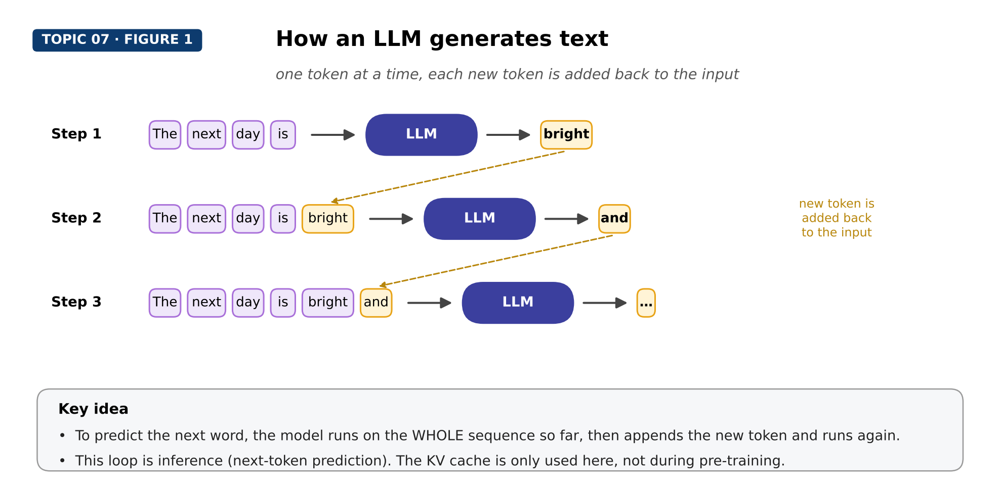
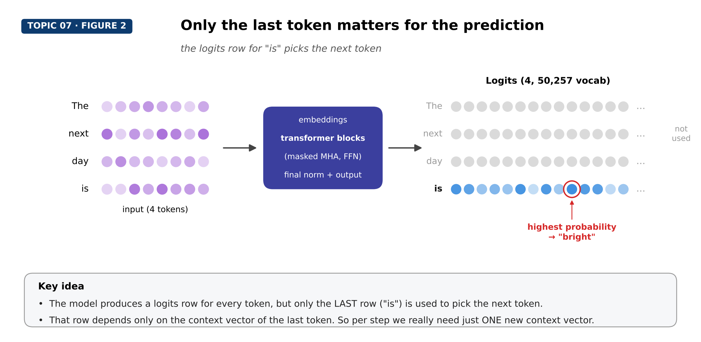
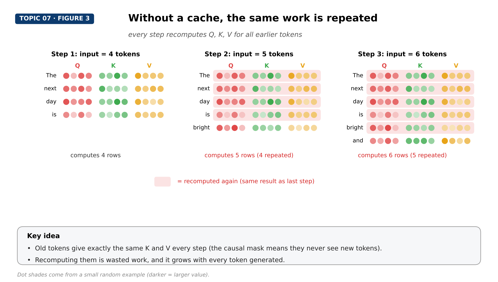
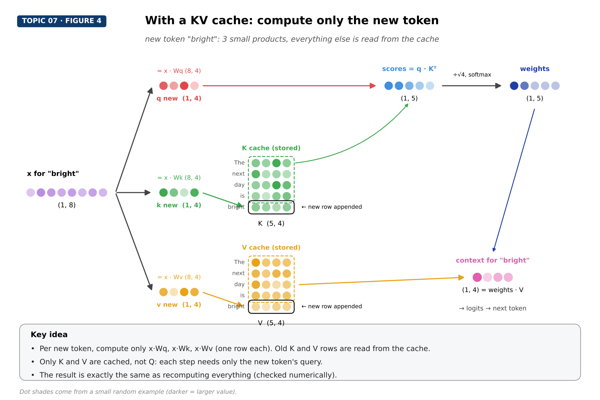
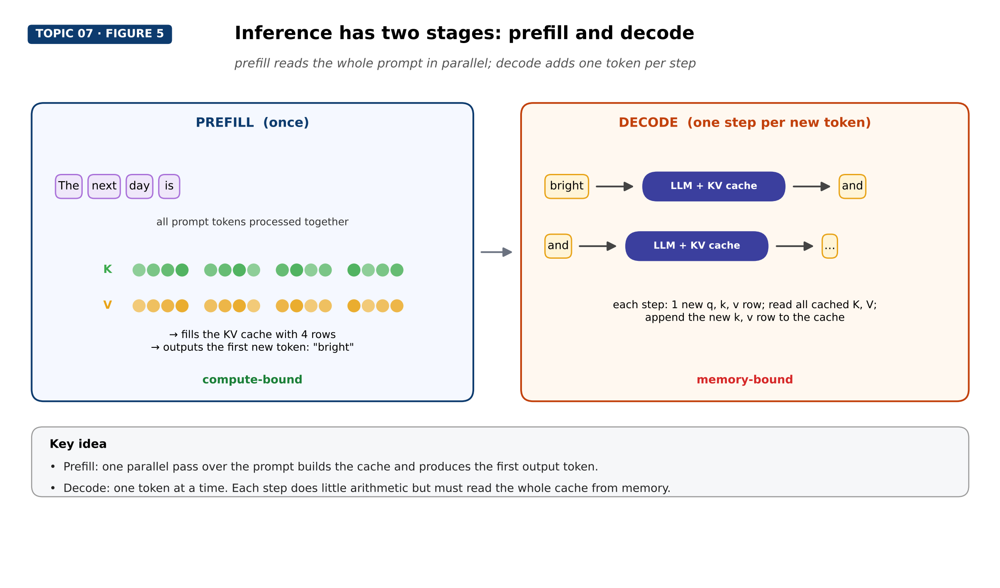
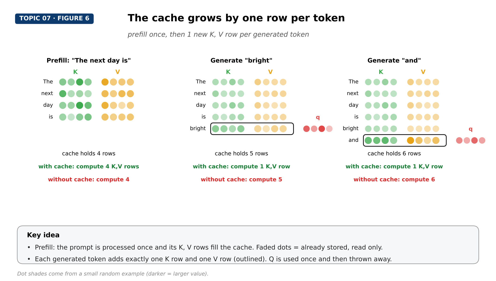
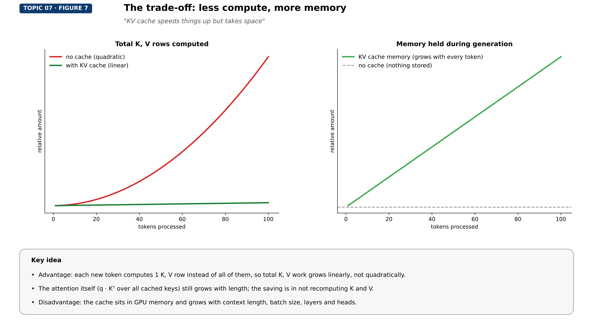
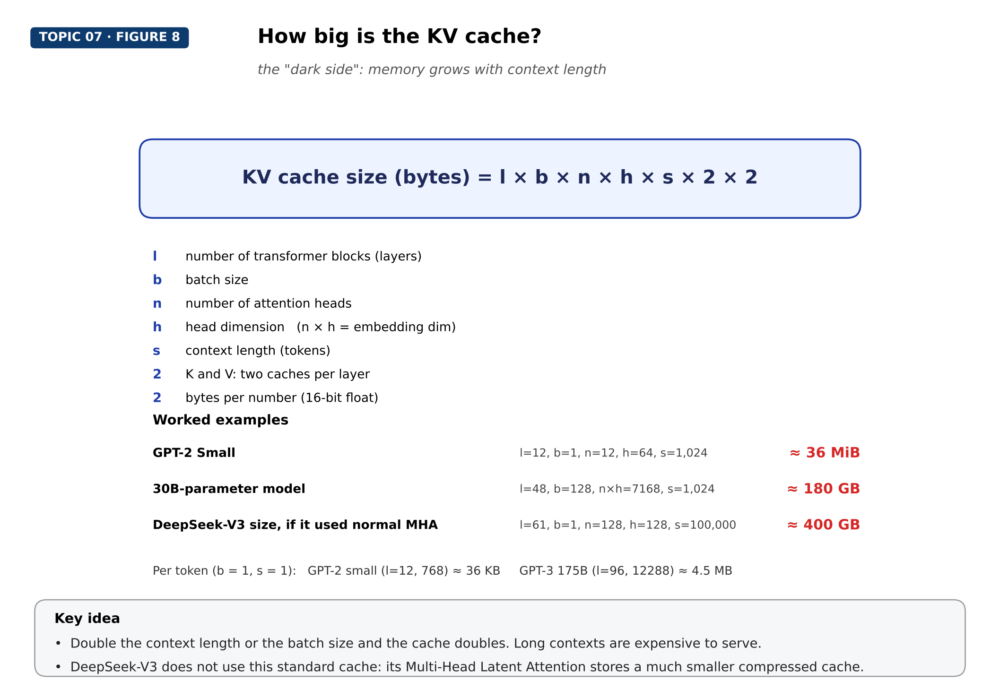
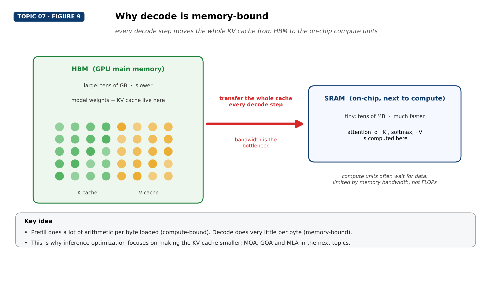
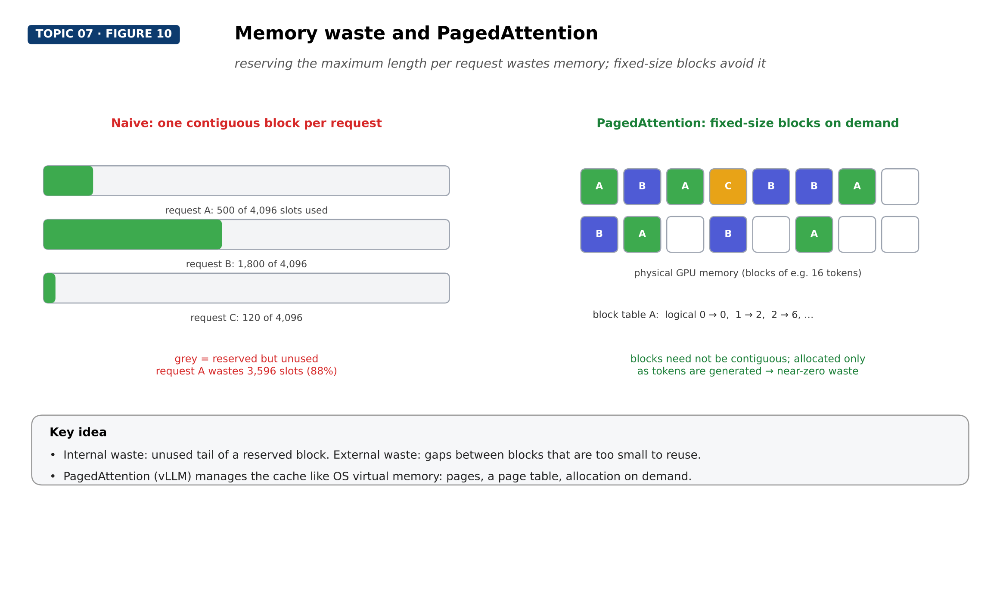

<div align="center">


<br/>

[](.)
[](.)
[](.)
[](.)
[](.)

**[← Back to the DeepSeek from Scratch series](../README.md)**

</div>

---

## Abstract

This topic derives the **key-value (KV) cache**, the optimization that makes autoregressive generation practical, and quantifies the memory cost that motivates DeepSeek's Multi-Head Latent Attention. Starting from the inference loop of a decoder-only LLM, it shows that only the **last row** of the logits matrix — and therefore only the context vector of the last token — is needed to predict the next token. Working backwards through causal attention, it establishes exactly what that row requires: the new token's query vector and the **full** key and value matrices. Because the causal mask guarantees that keys and values of earlier tokens never change, they can be computed once and reused; each decode step then computes only one new query, key and value row. The topic separates inference into a compute-bound **prefill** stage and a memory-bound **decode** stage, derives the cache size $`2 \cdot l \cdot b \cdot n_h \cdot d_h \cdot s \cdot B`$ bytes, and evaluates it for GPT-2 (36 MiB at 1,024 tokens), a 30B model (180 GB), and DeepSeek-V3 with standard attention (≈ 400 GB at 100K tokens). It closes with the "dark side" of the cache — HBM bandwidth, fragmentation and multi-request serving — and how PagedAttention addresses fragmentation.

---

## At a Glance

| | |
|---|---|
| **Topic** | 07 of 26 — Stage 2 |
| **Document type** | Inference mechanics & derivation |
| **Core question** | What does the model really need to compute for each new token, and what does it cost to store the rest? |
| **Builds on** | Topic 06 — Multi-Head Attention |
| **Running example** | `"The next day is"` → `bright` → `and` · $`d_{\text{in}} = 8`$, $`d_{\text{out}} = 4`$ |
| **Key result** | Per decode step: 1 new $`\mathbf{q}, \mathbf{k}, \mathbf{v}`$ row instead of $`t`$ rows; total K/V work $`O(T^2) \to O(T)`$ |
| **Cost** | Memory $`= 2 \cdot l \cdot b \cdot n_h \cdot d_h \cdot s \cdot B`$ bytes — linear in context length and batch |
| **Main artifact** | `Topic7_KVCache.docx` — technical report with 10 figures |
| **Version** | 1.0 · November 2026 |

---

## 1. Why Context Length Costs Money

The KV cache appears **only during inference** — never during pre-training. Its limitations depend directly on the context length, and providers price context accordingly. GPT-4's 2023 list prices illustrate this:

| Model | Context length | Input (per 1M tokens) | Output (per 1M tokens) |
|---|:-:|:-:|:-:|
| GPT-4 | 8K | \$30 | \$60 |
| GPT-4-32K | 32K | \$60 | \$120 |

*Historical list prices (2023), shown for the context-length effect only.*

Four times the context costs twice as much per token. Section 8 shows one of the main reasons: the memory a long context needs at inference.

---

## 2. How an LLM Generates Text

<p align="center"></p>

**Inference** means passing tokens into a trained model and letting it produce output tokens — for example *"The next day is"* → *bright* → *and* → … Generation is a loop: the new token is appended to the input and the whole sequence is fed back in.

```math
x_{t+1} \;=\; \arg\max_{i}\; \mathrm{softmax}\big(\mathbf{z}_t\big)_i,
\qquad
\mathbf{z}_t \;=\; \mathrm{LLM}(x_1, \dots, x_t)_{\,t} \in \mathbb{R}^{|V|}
```

Every pass runs through the full architecture of Topic 02: token and positional embeddings, the stack of transformer blocks (LayerNorm, masked multi-head attention, dropout, shortcut, LayerNorm, FFN, dropout, shortcut), the final LayerNorm and the output layer.

---

## 3. Insight 1 — Only the Last Token Matters

<p align="center"></p>

The output layer produces a logits row for **every** input token — a $`4 \times 50{,}257`$ matrix for *"The next day is"*. But to predict the next token we only look at the row for *is*: the index with the highest probability is decoded as *bright*. The rows for *The*, *next* and *day* are not used.

That last logits row depends only on the **context vector of the last token**:

```math
\mathbf{z}_t \;=\; \mathrm{LN}_f\big(\mathbf{h}_t^{(L)}\big)\, W_{\text{out}},
\qquad W_{\text{out}} \in \mathbb{R}^{d \times |V|}
```

> **Insight 1.** To predict the next token, we need the context vector of the **last token only**.

---

## 4. The Problem — The Same Work, Again and Again

<p align="center"></p>

Without any optimization, each step recomputes $`Q`$, $`K`$ and $`V`$ for the **whole** sequence:

| Step | Input | $`Q, K, V`$ shapes | Rows computed | Rows repeated |
|:-:|---|:-:|:-:|:-:|
| 1 | The next day is | $`(4, 4)`$ | 4 | — |
| 2 | The next day is bright | $`(5, 4)`$ | 5 | 4 |
| 3 | The next day is bright and | $`(6, 4)`$ | 6 | 5 |

The keys and values of earlier tokens come out **identical** every time: because of the causal mask, an earlier token never attends to a later one, so nothing about it changes when a new token arrives. Recomputing them is pure waste — and the waste grows with every token generated.

---

## 5. Insight 2 — What the Last Row Really Needs

Work backwards from the one thing we need, the context vector of the newest token (*bright*, position $`t = 5`$):

| To get… | …we need | Shape |
|---|---|:-:|
| Context vector $`\mathbf{z}_t`$ | attention weights of row $`t`$ **and the full** $`V`$ | $`(1,5)`$, $`(5,4)`$ |
| Attention weights of row $`t`$ | attention scores of row $`t`$ | $`(1,5)`$ |
| Attention scores of row $`t`$ | the query $`\mathbf{q}_t`$ **and the full** $`K`$ | $`(1,4)`$, $`(5,4)`$ |
| $`\mathbf{q}_t`$, $`\mathbf{k}_t`$, $`\mathbf{v}_t`$ | $`\mathbf{x}_t W_Q`$, $`\mathbf{x}_t W_K`$, $`\mathbf{x}_t W_V`$ | $`(1,8)(8,4) \to (1,4)`$ |

In equations:

```math
\mathbf{z}_t \;=\; \underbrace{\mathrm{softmax}\left(\frac{\mathbf{q}_t\, K_{1:t}^{\top}}{\sqrt{d_k}}\right)}_{(1 \times t)} \; V_{1:t},
\qquad \mathbf{q}_t = \mathbf{x}_t W_Q
```

So for each new token we need:

1. **only the query vector** of the new token — not the whole query matrix;
2. the **entire key matrix**;
3. the **entire value matrix**.

> **Insight 2.** We need all keys and values — but we do **not** need to recompute them. Rows $`1 \dots t-1`$ were already computed in earlier steps.

---

## 6. The KV Cache

<p align="center"></p>

**Key idea:** store the keys and values once, and at each step compute only the new row and append it:

```math
\mathbf{q}_t = \mathbf{x}_t W_Q, \qquad \mathbf{k}_t = \mathbf{x}_t W_K, \qquad \mathbf{v}_t = \mathbf{x}_t W_V
```

```math
K_{1:t} \;=\; \begin{bmatrix} K_{1:t-1} \\ \mathbf{k}_t \end{bmatrix},
\qquad
V_{1:t} \;=\; \begin{bmatrix} V_{1:t-1} \\ \mathbf{v}_t \end{bmatrix}
\qquad \text{(append to the cache)}
```

Then $`\mathbf{z}_t`$ is computed with the formula of Section 5. Only **three small products** per token: $`\mathbf{x}_t W_Q`$, $`\mathbf{x}_t W_K`$, $`\mathbf{x}_t W_V`$. The result is **exactly** the same as recomputing everything — it is the same arithmetic, just not repeated.

### Why not cache the queries?

Each step needs only the **new** token's query. Old queries are used once, to compute their own context vectors, and are never needed again. Keys and values, in contrast, are read by every later token. That is why it is a **KV** cache, not a QKV cache.

### A decode step in code

```python
def decode_step(x_new, W_q, W_k, W_v, cache):
    """x_new: (1, d_in) embedding of the newest token; cache holds K, V of all previous tokens."""
    q = x_new @ W_q                                    # (1, d_out)   only the new query
    k = x_new @ W_k                                    # (1, d_out)
    v = x_new @ W_v                                    # (1, d_out)
    cache["K"] = torch.cat([cache["K"], k], dim=0)     # (t, d_out)   append, don't recompute
    cache["V"] = torch.cat([cache["V"], v], dim=0)
    scores  = q @ cache["K"].T / cache["K"].shape[-1] ** 0.5   # (1, t)
    weights = torch.softmax(scores, dim=-1)            # no mask needed: the cache holds only the past
    return weights @ cache["V"]                        # (1, d_out)   context vector of the new token
```

No causal mask is needed during decode: the cache contains only past and current tokens, so the newest query cannot see the future.

---

## 7. Prefill and Decode

<p align="center"></p>

Inference with a KV cache runs in two stages:

| Stage | What happens | Output | Bottleneck |
|---|---|---|---|
| **Prefill** | All prompt tokens processed **in parallel**; the full $`K`$, $`V`$ are computed and stored | First output token | **Compute-bound** — GPU cores fully used |
| **Decode** | One new token per step: 1 new $`\mathbf{q}, \mathbf{k}, \mathbf{v}`$ row; read the whole cache | One token per step until end-of-sequence | **Memory-bound** — the cache must be read every step |

<p align="center"></p>

The cache grows by exactly one key row and one value row per generated token, **in every layer**:

| Stage | Cache rows held | K/V rows computed (with cache) | K/V rows computed (without cache) |
|---|:-:|:-:|:-:|
| Prefill *"The next day is"* | 4 | 4 | 4 |
| Generate *bright* | 5 | 1 | 5 |
| Generate *and* | 6 | 1 | 6 |

---

## 8. The Trade-off — Less Compute, More Memory

<p align="center"></p>

> *"The KV cache speeds things up but takes space."*

Generating $`T`$ tokens one at a time, the number of key/value rows computed is:

```math
\text{without cache: } \sum_{t=1}^{T} t \;=\; \frac{T(T+1)}{2} \;=\; O(T^2)
\qquad\qquad
\text{with cache: } \sum_{t=1}^{T} 1 \;=\; T \;=\; O(T)
```

The attention step itself ($`\mathbf{q}_t K^{\top}`$ over all cached keys) still grows with length; the saving is in not recomputing $`K`$ and $`V`$. Fewer floating-point operations mean **lower inter-token latency**. The price is memory: the cache must be held for the whole generation.

---

## 9. How Big Is the KV Cache?

<p align="center"></p>

Every token stores a key and a value vector of size $`n_h \cdot d_h`$ (heads × head dimension = embedding dimension) in **every** layer:

```math
\text{KV cache (bytes)} \;=\; 2 \times l \times b \times n_h \times d_h \times s \times B
```

| Symbol | Meaning |
|:-:|---|
| $`2`$ | two caches per layer: keys and values |
| $`l`$ | number of transformer blocks (layers) |
| $`b`$ | batch size |
| $`n_h`$ | number of attention heads |
| $`d_h`$ | head dimension ($`n_h d_h`$ = embedding dimension) |
| $`s`$ | context length — grows during generation |
| $`B`$ | bytes per number: 2 for FP16/BF16, 1 for INT8 |

| Model | $`l`$ | $`b`$ | $`n_h \times d_h`$ | $`s`$ | KV cache |
|---|:-:|:-:|:-:|:-:|:-:|
| GPT-2 Small (per token) | 12 | 1 | 768 | 1 | **36 KB** |
| GPT-2 Small | 12 | 1 | 12 × 64 | 1,024 | **36 MiB** |
| GPT-3 175B (per token) | 96 | 1 | 12,288 | 1 | **4.5 MiB** |
| 30B-parameter model | 48 | 128 | 7,168 | 1,024 | **≈ 180 GB** |
| LLaMA-2 70B, if all 64 heads cached | 80 | 1 | 64 × 128 | 4,096 | **≈ 10.7 GB** per request |
| DeepSeek-V3 size, standard MHA | 61 | 1 | 128 × 128 | 100,000 | **≈ 400 GB** |

For example, GPT-2 Small at full context:

```math
2 \times 12 \times 1 \times 12 \times 64 \times 1024 \times 2 \;=\; 37{,}748{,}736 \text{ bytes} \;\approx\; 36 \text{ MiB}
```

At 100 concurrent requests, the LLaMA-2 70B figure becomes ≈ 1.07 TB — far more than any single GPU holds. This is why memory, not compute, is the bottleneck in production serving.

> **Note.** The real LLaMA-2 70B uses grouped-query attention with only 8 key/value heads, which cuts its cache by 8× to ≈ 1.34 GB per request. DeepSeek-V3 goes further with Multi-Head Latent Attention. Both are the subject of Topics 08 – 11.

---

## 10. The Dark Side of the KV Cache

### 10.1 Decode is memory-bound

<p align="center"></p>

The cache lives in the GPU's **HBM** (high-bandwidth memory: large, tens of GB, but comparatively slow). Attention is computed in on-chip **SRAM** (tiny, tens of MB, much faster) [4]. At every decode step the whole cache must be transferred from HBM to the compute units, while each step performs very little arithmetic. The compute units sit idle waiting for data: **decode is limited by memory bandwidth, not by floating-point operations.** This is the fundamental reason LLM decoding is slow and why inference optimization focuses on memory efficiency.

### 10.2 The problems at a glance

| Problem | Detail |
|---|---|
| **Memory consumption** | Grows linearly with sequence length × batch size |
| **HBM bandwidth cost** | The full cache is transferred from HBM to SRAM at every decode step |
| **Memory fragmentation** | Pre-allocating the maximum sequence length wastes memory |
| **Multi-request serving** | Serving hundreds of requests at once fills the GPU's memory |

### 10.3 Fragmentation and PagedAttention

<p align="center"></p>

A naive implementation reserves one large **contiguous** block per request, sized for the maximum possible length. A request that uses 500 tokens of a 4,096-token reservation wastes 3,596 slots (88 %) — **internal fragmentation** — and the leftover gaps between reservations are often too small to reuse — **external fragmentation**.

**PagedAttention** [5], introduced with vLLM, manages the cache the way an operating system manages virtual memory:

- the cache is divided into **fixed-size blocks** (e.g. 16 tokens per block);
- blocks are stored **non-contiguously** in GPU memory;
- a **block table** maps each request's logical token positions to physical blocks;
- blocks are allocated **on demand**, only as tokens are generated.

The result is near-zero memory waste and 2 – 4× higher serving throughput than previous systems [5].

---

## Key Technical Observations

1. **The KV cache exists only at inference.** During pre-training the whole sequence is processed in one parallel pass; nothing is generated token by token.
2. **Only the last token's context vector is needed** to predict the next token (Insight 1).
3. **That vector needs one query but all keys and values** (Insight 2).
4. **The causal mask is what makes caching valid.** Earlier tokens never attend to later ones, so their keys and values never change.
5. **Cache K and V, never Q.** Old queries are never used again; old keys and values are used by every later token.
6. **Caching trades compute for memory.** K/V work falls from $`O(T^2)`$ to $`O(T)`$; memory grows linearly with context, batch, layers and heads.
7. **Prefill is compute-bound; decode is memory-bound.** Decoding speed is set by how fast the cache can be read from HBM.
8. **Shrinking the cache is the central inference problem.** Every term of $`2 \cdot l \cdot b \cdot n_h \cdot d_h \cdot s \cdot B`$ is a target: MQA and GQA reduce $`n_h`$, MLA compresses $`n_h d_h`$ into a small latent, and quantization reduces $`B`$.

---

## References

References are listed in IEEE numeric format.

| # | Authors | Title | Venue | Year |
|:-:|---------|-------|-------|:-:|
| 1 | A. Vaswani et al. | Attention Is All You Need | *NeurIPS* | 2017 |
| 2 | R. Pope et al. | Efficiently Scaling Transformer Inference | *MLSys* | 2023 |
| 3 | A. Radford et al. | Language Models are Unsupervised Multitask Learners | *OpenAI Tech. Report* | 2019 |
| 4 | T. Dao, D. Y. Fu, S. Ermon, A. Rudra, C. Ré | FlashAttention: Fast and Memory-Efficient Exact Attention with IO-Awareness | *NeurIPS* | 2022 |
| 5 | W. Kwon et al. | Efficient Memory Management for Large Language Model Serving with PagedAttention | *SOSP* | 2023 |
| 6 | DeepSeek-AI | DeepSeek-V2: A Strong, Economical, and Efficient Mixture-of-Experts Language Model | *arXiv:2405.04434* | 2024 |

---

## Files in This Directory

| File | Description |
|------|-------------|
| `README.md` | This document — conceptual summary and reader entry point |
| `Topic7_KVCache.docx` | Primary artifact (v1.0) — technical report: title page, abstract, contents, 10 sections, 10 embedded figures, size derivation, IEEE references |
| `images/` | The 10 figures used in this README and the report |

---

## Navigation

**Previous:** &nbsp; [Topic 06 — Multi-Head Attention](../06_multihead_attention/README.md) &nbsp;·&nbsp; *Several causal attention heads in parallel*

**Next:** &nbsp; [Topic 08 — Multi-Query Attention](../08_multi_query_attention/README.md) &nbsp;·&nbsp; *Share one key and one value across all heads, shrinking the KV cache by the number of heads — at a cost in quality.*

---

<div align="center">

**DeepSeek from Scratch**  
A technical report series rebuilding the key ideas behind DeepSeek-V2 / V3 from first principles.

**Shiva Kiran Dadishetty** &nbsp;·&nbsp; Independent Research &nbsp;·&nbsp; Texas, USA  
[github.com/shivakiran-ai/deepseek-from-scratch](https://github.com/shivakiran-ai/deepseek-from-scratch)

*Document version 1.0 &nbsp;·&nbsp; Last updated November 2026*


</div>
