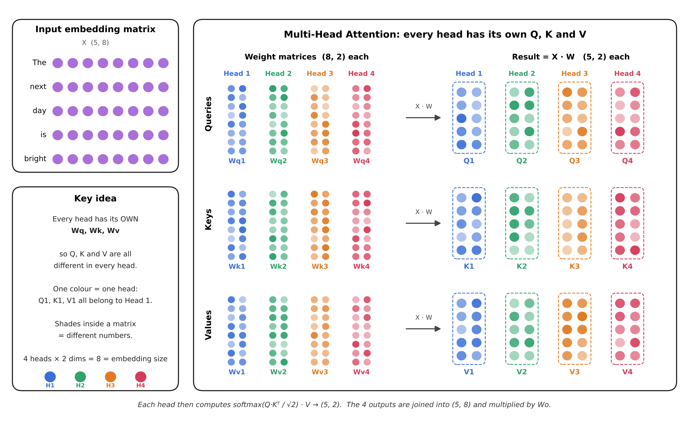
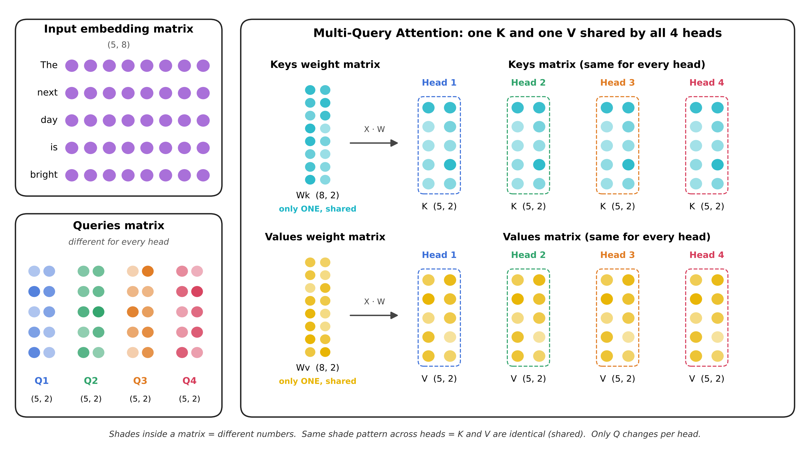
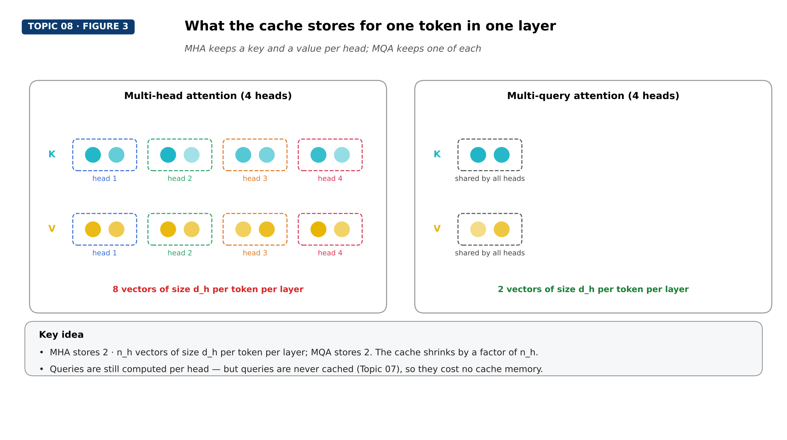
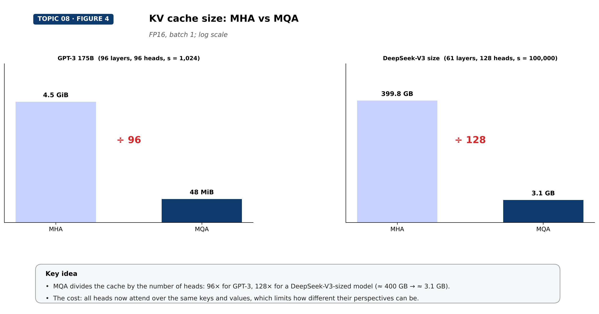
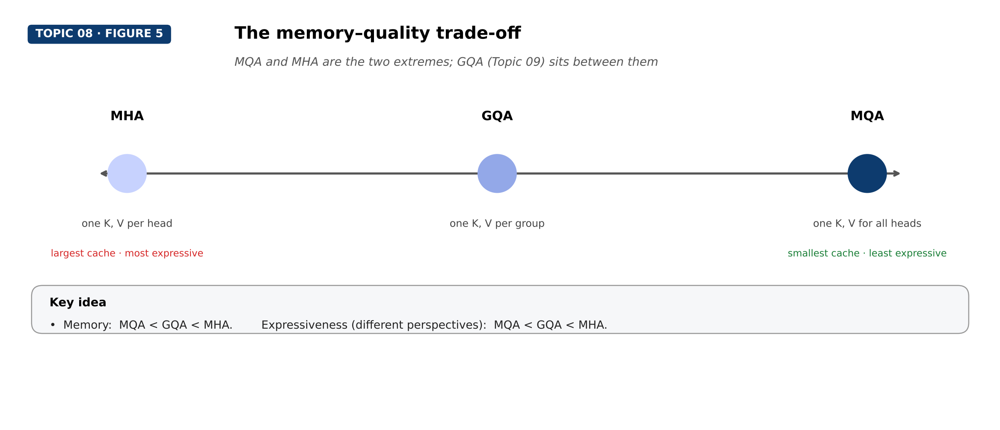

<div align="center">


<br/>

[](.)
[](.)
[](.)
[](.)
[](.)

**[← Back to the DeepSeek from Scratch series](../README.md)**

</div>

---

## Abstract

This topic introduces **multi-query attention (MQA)** [1], the first of three answers to the memory problem of the KV cache derived in Topic 07. In multi-head attention every head has its own key and value projections, so the cache stores $`n_h`$ key vectors and $`n_h`$ value vectors per token per layer. MQA keeps a separate query projection for every head but **shares one key and one value projection across all heads**, so only one key and one value vector per token per layer need to be cached. The cache therefore shrinks by a factor of $`n_h`$: from 4.5 GiB to 48 MiB for GPT-3 at 1,024 tokens, and from about 400 GB to about 3.1 GB for a DeepSeek-V3-sized model at 100,000 tokens. The topic derives the new cache-size formula, compares MHA and MQA in shapes, parameters and memory, implements MQA from scratch in PyTorch, and explains its cost: because every head attends over the same keys and values, the diversity of perspectives that motivated multi-head attention is reduced, which can degrade model quality. This trade-off motivates grouped-query attention (Topic 09) and DeepSeek's multi-head latent attention (Topics 10 – 11).

---

## At a Glance

| | |
|---|---|
| **Topic** | 08 of 26 — Stage 2 |
| **Document type** | Implementation & derivation |
| **Core question** | What if all attention heads shared the same keys and values? |
| **Builds on** | Topic 06 — Multi-Head Attention · Topic 07 — Key-Value Cache |
| **Running example** | `"The next day is bright"` — 5 tokens, $`d_{\text{in}} = 8`$, 4 heads, $`d_h = 2`$ |
| **Key result** | KV cache reduced by a factor of $`n_h`$ — 96× for GPT-3, 128× for a DeepSeek-V3-sized model |
| **Cost** | All heads attend over identical keys and values → fewer distinct perspectives |
| **Introduced by** | N. Shazeer, *Fast Transformer Decoding: One Write-Head is All You Need* (2019) |
| **Main artifact** | `Topic8_MultiQueryAttention.docx` — technical report with 5 figures |
| **Version** | 1.0 · November 2026 |

---

## 1. The Problem — The KV Cache Is Too Large

Topic 07 showed that storing keys and values makes generation fast but costs memory:

```math
\text{KV cache}_{\text{MHA}} \;=\; 2 \times l \times b \times n_h \times d_h \times s \times B \ \text{bytes}
```

For a DeepSeek-V3-sized model with standard attention ($`l = 61`$, $`n_h = 128`$, $`d_h = 128`$, $`s = 100{,}000`$) this is about **400 GB** for a single request. There are two standard ways to shrink it: **multi-query attention** (this topic) and **grouped-query attention** (Topic 09).

The idea of MQA is to attack one term of the formula, the number of heads $`n_h`$: *what if all attention heads shared the same key and value matrices?*

---

## 2. Multi-Head Attention — Recap

<p align="center"></p>

In multi-head attention (Topic 06), every head $`i`$ has its **own** $`W_Q^{(i)}`$, $`W_K^{(i)}`$ and $`W_V^{(i)}`$, so its queries, keys and values are all different:

```math
Q_i = X W_Q^{(i)}, \qquad K_i = X W_K^{(i)}, \qquad V_i = X W_V^{(i)}, \qquad i = 1, \dots, n_h
```

During generation, all $`n_h`$ key matrices and all $`n_h`$ value matrices must be cached.

---

## 3. Multi-Query Attention

<p align="center"></p>

MQA keeps **a different query projection for every head** but uses **one key projection and one value projection shared by all heads**:

```math
Q_i = X W_Q^{(i)} \quad (i = 1, \dots, n_h), \qquad K = X W_K, \qquad V = X W_V,
\qquad W_K, W_V \in \mathbb{R}^{d_{\text{in}} \times d_h}
```

```math
\mathrm{head}_i \;=\; \mathrm{softmax}\left(\frac{Q_i K^{\top}}{\sqrt{d_h}} + M\right) V,
\qquad
\mathrm{MQA}(X) \;=\; \mathrm{Concat}(\mathrm{head}_1, \dots, \mathrm{head}_{n_h})\, W_O
```

In the running example, heads 1 – 4 all use the same $`K`$ and $`V`$ of shape $`(5, 2)`$. The values *inside* $`K`$ and $`V`$ still differ from token to token — they are ordinary matrices — but they are **identical from one head to the next**. Because the queries differ, each head still computes different attention scores and different weights; it just reads from the same keys and values.

---

## 4. Why the Cache Shrinks by $`n_h`$

<p align="center"></p>

Since every head uses the same keys and values, the cache only needs **one** key and one value vector per token per layer. There is no need to cache anything separately for the other heads:

```math
\text{KV cache}_{\text{MQA}} \;=\; 2 \times l \times b \times d_h \times s \times B
\;=\; \frac{\text{KV cache}_{\text{MHA}}}{n_h}
```

In a real model, each layer's cached keys (and values) change shape from $`(b, n_h, s, d_h)`$ to $`(b, 1, s, d_h)`$.

<p align="center"></p>

| Attention type | KV cache size | GPT-3 175B ($`l = 96`$, $`n_h = 96`$, $`s = 1{,}024`$) | DeepSeek-V3 size ($`n_h = 128`$, $`s = 100{,}000`$) |
|---|---|:-:|:-:|
| Multi-head (MHA) | $`2 \cdot l \cdot b \cdot n_h \cdot d_h \cdot s \cdot B`$ | **4.5 GiB** | **≈ 400 GB** |
| Multi-query (MQA) | $`2 \cdot l \cdot b \cdot d_h \cdot s \cdot B`$ | **48 MiB** | **≈ 3.1 GB** |
| Reduction | $`n_h`$ | 96× | 128× |

*FP16 ($`B = 2`$), batch size 1, $`d_h = 128`$.*

---

## 5. MHA vs. MQA at a Glance

| Factor | MHA (e.g. GPT-2) | MQA (e.g. PaLM, Falcon-7B) | Impact |
|---|---|---|---|
| **Queries** | One projection per head | One projection per head | Unchanged |
| **Keys & values** | Separate per head | **Shared across all heads** | Less computation and memory |
| **$`W_K`$, $`W_V`$ shape** | $`d_{\text{in}} \times d_{\text{out}}`$ each | $`d_{\text{in}} \times d_h`$ each | $`n_h`$× fewer K/V parameters |
| **Cached per token per layer** | $`2 n_h`$ vectors of size $`d_h`$ | 2 vectors of size $`d_h`$ | Cache ÷ $`n_h`$ |
| **Memory traffic in decode** | Read $`n_h`$ K and V matrices | Read one K and one V matrix | Faster, memory-bound decoding |
| **Model quality** | Highest — every head has its own perspective | Can degrade | The price of MQA |

For a GPT-2 Small-sized layer ($`d = 768`$, $`n_h = 12`$), the key and value projections shrink from $`2 \times 768 \times 768 = 1{,}179{,}648`$ parameters to $`2 \times 768 \times 64 = 98{,}304`$.

Because decoding is memory-bound (Topic 07), reading $`n_h`$ times less data per step is what makes MQA decoding faster — not a reduction in arithmetic.

---

## 6. Implementing MQA from Scratch

```python
class MultiQueryAttention(nn.Module):
    def __init__(self, d_model, num_heads, dropout=0.0, max_len=1024):
        super().__init__()
        assert d_model % num_heads == 0, "d_model must be divisible by num_heads"
        self.d_model, self.num_heads = d_model, num_heads
        self.d_head = d_model // num_heads

        self.W_q = nn.Linear(d_model, d_model)       # one query projection per head (all heads at once)
        self.W_k = nn.Linear(d_model, self.d_head)   # ONE key projection, shared by all heads
        self.W_v = nn.Linear(d_model, self.d_head)   # ONE value projection, shared by all heads
        self.W_o = nn.Linear(d_model, d_model)
        self.dropout = nn.Dropout(dropout)
        self.register_buffer("mask", torch.triu(torch.ones(1, 1, max_len, max_len), diagonal=1))

    def forward(self, x):
        B, T, _ = x.shape
        q = self.W_q(x).view(B, T, self.num_heads, self.d_head).transpose(1, 2)  # (B, h, T, d_head)
        k = self.W_k(x).view(B, T, 1, self.d_head).transpose(1, 2)               # (B, 1, T, d_head)
        v = self.W_v(x).view(B, T, 1, self.d_head).transpose(1, 2)               # (B, 1, T, d_head)

        # Use the same K and V for every query head
        k = k.repeat(1, self.num_heads, 1, 1)                                    # (B, h, T, d_head)
        v = v.repeat(1, self.num_heads, 1, 1)

        scores = q @ k.transpose(-2, -1) / self.d_head ** 0.5                    # (B, h, T, T)
        scores = scores.masked_fill(self.mask[:, :, :T, :T] == 1, float("-inf"))
        weights = self.dropout(torch.softmax(scores, dim=-1))

        ctx = (weights @ v).transpose(1, 2).contiguous().view(B, T, self.d_model)
        return self.W_o(ctx)
```

Running it on a batch of shape $`(4, 64, 512)`$ with 8 heads returns an output of shape $`(4, 64, 512)`$ — the same interface as multi-head attention.

| Difference from multi-head attention | Where |
|---|---|
| `W_k`, `W_v` map to `d_head`, not `d_model` | `__init__` |
| Keys and values are reshaped with **1** head instead of `num_heads` | `forward` |
| The single K and V are repeated for every query head | `k.repeat(...)`, `v.repeat(...)` |

> **Repeat at compute time, store once.** The `repeat` only makes K and V line up with the query heads for the matrix multiplication. During generation, the KV cache stores the un-repeated K and V of shape $`(B, 1, T, d_{\text{head}})`$ — that is where the memory saving comes from. Production code often uses `expand` (or broadcasting) instead of `repeat`, which avoids copying memory at all.

---

## 7. The Cost — Fewer Perspectives

Remember the purpose of multi-head attention: **each head captures a different perspective** on the sentence (Topic 06). In MQA:

- the queries are still different for every head, so the attention scores and weights differ between heads;
- but every head attends over the **same keys** and mixes the **same values**.

This restricts the diversity that the heads can capture. In practice MQA can cause a noticeable drop in model quality compared with MHA, and training can be less stable [2]. MQA buys a very small cache at the price of expressiveness.

<p align="center"></p>

```math
\text{memory:} \quad \text{MQA} \;\lt\; \text{GQA} \;\lt\; \text{MHA}
\qquad\qquad
\text{expressiveness:} \quad \text{MQA} \;\lt\; \text{GQA} \;\lt\; \text{MHA}
```

The natural question is whether there is a middle ground — share keys and values within **groups** of heads instead of across all of them. That is grouped-query attention, the next topic. DeepSeek goes a different way: instead of sharing keys and values, it **compresses** them (Topics 10 – 11).

---

## Key Technical Observations

1. **MQA changes only the keys and values.** Queries, the scaled dot product, the causal mask and $`W_O`$ are exactly as in multi-head attention.
2. **The cache shrinks by exactly $`n_h`$.** Only one key and one value vector per token per layer are stored.
3. **Values inside K and V still differ across tokens** — they are identical only *across heads*.
4. **The speed-up in decoding comes from memory traffic,** not arithmetic: decoding is memory-bound, and MQA reads $`n_h`$ times less cache per step.
5. **MQA also cuts parameters.** $`W_K`$ and $`W_V`$ shrink from $`d_{\text{in}} \times d_{\text{out}}`$ to $`d_{\text{in}} \times d_h`$.
6. **The price is expressiveness.** Shared keys and values limit how different the heads' perspectives can be, which can degrade quality.
7. **MQA and MHA are two ends of a spectrum.** Grouped-query attention interpolates between them; MLA takes a different route by compressing instead of sharing.

---

## References

References are listed in IEEE numeric format.

| # | Authors | Title | Venue | Year |
|:-:|---------|-------|-------|:-:|
| 1 | N. Shazeer | Fast Transformer Decoding: One Write-Head is All You Need | *arXiv:1911.02150* | 2019 |
| 2 | J. Ainslie et al. | GQA: Training Generalized Multi-Query Transformer Models from Multi-Head Checkpoints | *EMNLP* | 2023 |
| 3 | A. Vaswani et al. | Attention Is All You Need | *NeurIPS* | 2017 |
| 4 | A. Chowdhery et al. | PaLM: Scaling Language Modeling with Pathways | *JMLR* | 2023 |
| 5 | E. Almazrouei et al. | The Falcon Series of Open Language Models | *arXiv:2311.16867* | 2023 |
| 6 | DeepSeek-AI | DeepSeek-V2: A Strong, Economical, and Efficient Mixture-of-Experts Language Model | *arXiv:2405.04434* | 2024 |

---

## Files in This Directory

| File | Description |
|------|-------------|
| `README.md` | This document — conceptual summary and reader entry point |
| `Topic8_MultiQueryAttention.docx` | Primary artifact (v1.0) — technical report: title page, abstract, contents, 7 sections, 5 embedded figures, MQA implementation, IEEE references |
| `images/` | The 5 figures used in this README and the report |

---

## Navigation

**Previous:** &nbsp; [Topic 07 — Key-Value Cache](../07_kv_cache/README.md) &nbsp;·&nbsp; *Store keys and values once; the cost is memory*

**Next:** &nbsp; [Topic 09 — Grouped-Query Attention](../09_grouped_query_attention/README.md) &nbsp;·&nbsp; *Share keys and values within groups of heads — the middle ground between MHA and MQA.*

---

<div align="center">

**DeepSeek from Scratch**  
A technical report series rebuilding the key ideas behind DeepSeek-V2 / V3 from first principles.

**Shiva Kiran Dadishetty** &nbsp;·&nbsp; Independent Research &nbsp;·&nbsp; Texas, USA  
[github.com/shivakiran-ai/deepseek-from-scratch](https://github.com/shivakiran-ai/deepseek-from-scratch)

*Document version 1.0 &nbsp;·&nbsp; Last updated November 2026*


</div>
