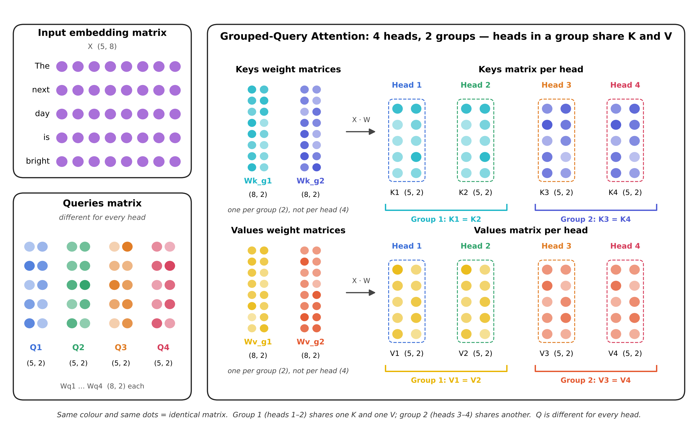
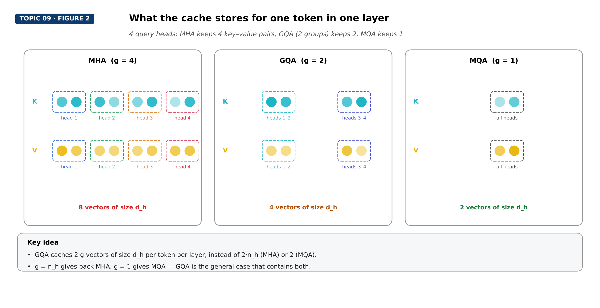
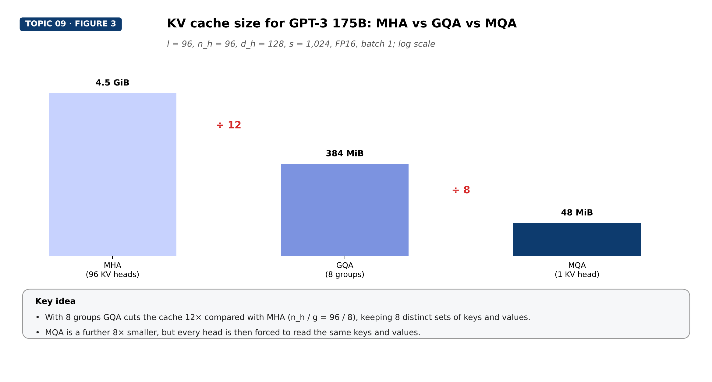
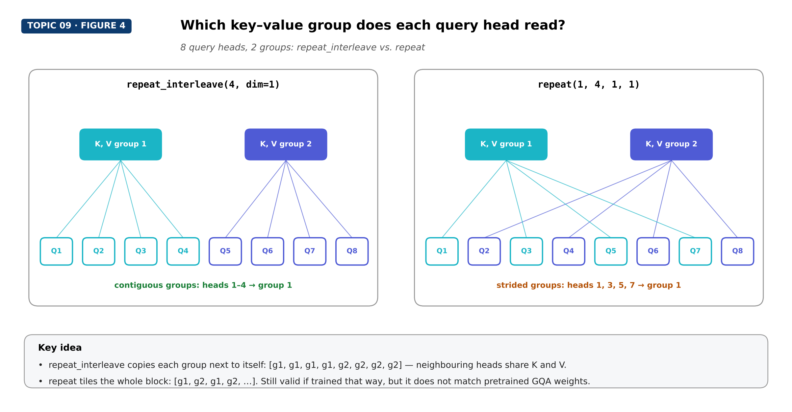

<div align="center">


<br/>

[](.)
[](.)
[](.)
[](.)
[](.)

**[← Back to the DeepSeek from Scratch series](../README.md)**

</div>

---

## Abstract

This topic introduces **grouped-query attention (GQA)** [1], the middle ground between multi-head attention (MHA) and multi-query attention (MQA, Topic 08). MHA gives every head its own keys and values and has the largest KV cache; MQA shares one key and one value matrix across all heads and has the smallest cache, but at a cost in model quality. GQA divides the $`n_h`$ query heads into $`g`$ groups and lets the heads **within a group** share one key and one value matrix, so the cache stores $`g`$ key–value pairs per token per layer instead of $`n_h`$ or one. With $`g = n_h`$ GQA is exactly MHA, and with $`g = 1`$ it is exactly MQA. For GPT-3 175B at 1,024 tokens, eight groups reduce the cache from 4.5 GiB (MHA) to 384 MiB, compared with 48 MiB for MQA, while keeping eight distinct sets of keys and values. The topic derives the general cache formula, implements GQA from scratch in PyTorch, explains why `repeat_interleave` (not `repeat`) gives the intended grouping, and reviews where GQA is used in practice — Llama 2 70B, Llama 3 and DeepSeek LLM 67B — before DeepSeek-V2 replaced it with multi-head latent attention (Topics 10 – 11).

---

## At a Glance

| | |
|---|---|
| **Topic** | 09 of 26 — Stage 2 (final topic) |
| **Document type** | Implementation & derivation |
| **Core question** | Instead of all heads sharing one K and V, what if *groups* of heads shared them? |
| **Builds on** | Topic 06 — Multi-Head Attention · Topic 07 — Key-Value Cache · Topic 08 — Multi-Query Attention |
| **Running example** | `"The next day is bright"` — 5 tokens, $`d_{\text{in}} = 8`$, 4 heads, 2 groups, $`d_h = 2`$ |
| **Key result** | KV cache reduced by $`n_h / g`$ — 12× for GPT-3 with 8 groups — with quality close to MHA |
| **Special cases** | $`g = n_h`$ → MHA · $`g = 1`$ → MQA |
| **Introduced by** | J. Ainslie et al., *GQA: Training Generalized Multi-Query Transformer Models from Multi-Head Checkpoints* (EMNLP 2023) |
| **Main artifact** | `Topic9_GroupedQueryAttention.docx` — technical report with 4 figures |
| **Version** | 1.0 · November 2026 |

---

## 1. The Idea — Share Within Groups, Not Across All Heads

Topic 08 ended with a trade-off. MQA shrinks the KV cache by $`n_h`$, but every head is forced to read the same keys and values, so the heads lose much of their ability to capture different perspectives.

GQA asks: *instead of all attention heads having the same K and V matrices, what if we create **groups** of attention heads?* Heads in the same group share one key and one value matrix; different groups have different ones. Queries remain different for every head.

---

## 2. Grouped-Query Attention

<p align="center"></p>

In the running example there are 4 heads and 2 groups. Group 1 (heads 1 and 2) uses one key weight matrix $`W_{K,1}`$ of shape $`(8, 2)`$; group 2 (heads 3 and 4) uses another, $`W_{K,2}`$. So $`K_1 = K_2`$ and $`K_3 = K_4`$, and the same holds for the values. Only **2** key and **2** value weight matrices exist, not 4.

In general, with $`n_h`$ heads and $`g`$ groups, each group contains $`n_h / g`$ heads, and head $`i`$ belongs to group $`\gamma(i)`$:

```math
\gamma(i) \;=\; \left\lceil \frac{i \, g}{n_h} \right\rceil,
\qquad
Q_i = X W_Q^{(i)} \ \ (i = 1, \dots, n_h),
\qquad
K_j = X W_K^{(j)}, \quad V_j = X W_V^{(j)} \ \ (j = 1, \dots, g)
```

```math
\mathrm{head}_i \;=\; \mathrm{softmax}\left(\frac{Q_i K_{\gamma(i)}^{\top}}{\sqrt{d_h}} + M\right) V_{\gamma(i)},
\qquad
\mathrm{GQA}(X) \;=\; \mathrm{Concat}(\mathrm{head}_1, \dots, \mathrm{head}_{n_h})\, W_O
```

The number of groups $`g`$ is a hyperparameter, and it contains both earlier mechanisms as special cases:

```math
g = n_h \;\Rightarrow\; \text{MHA (every head its own K, V)},
\qquad\qquad
g = 1 \;\Rightarrow\; \text{MQA (one K, V for all heads)}
```

---

## 3. The KV Cache of GQA

<p align="center"></p>

Per token and per layer, the cache now holds one key and one value vector **per group**:

```math
\text{KV cache}_{\text{GQA}} \;=\; 2 \times l \times b \times g \times d_h \times s \times B
\;=\; \frac{g}{n_h} \times \text{KV cache}_{\text{MHA}}
```

| Symbol | Meaning |
|:-:|---|
| $`l`$ | number of transformer blocks |
| $`b`$ | batch size |
| $`n_h`$ | number of attention heads |
| $`g`$ | number of groups (key–value heads) |
| $`d_h`$ | attention head size |
| $`s`$ | context length |
| 2 | two caches per block (K and V) |
| $`B = 2`$ | bytes per element (16-bit floating point) |

For GPT-3 175B ($`l = 96`$, $`n_h = 96`$, $`d_h = 128`$, $`s = 1{,}024`$, $`b = 1`$) with $`g = 8`$:

```math
2 \times 96 \times 1 \times 8 \times 128 \times 1024 \times 2 \;=\; 402{,}653{,}184 \ \text{bytes} \;=\; 384 \ \text{MiB}
```

<p align="center"></p>

| Attention mechanism | KV cache size | GPT-3 175B ($`l = 96`$, $`n_h = 96`$, $`d_h = 128`$) |
|---|---|:-:|
| Multi-head (MHA) | $`2 \cdot l \cdot b \cdot n_h \cdot d_h \cdot s \cdot B`$ | **4.5 GiB** |
| Grouped-query (GQA) | $`2 \cdot l \cdot b \cdot g \cdot d_h \cdot s \cdot B`$ | **384 MiB** (8 groups) |
| Multi-query (MQA) | $`2 \cdot l \cdot b \cdot d_h \cdot s \cdot B`$ | **48 MiB** |

*FP16, batch size 1, context length 1,024.*

---

## 4. MHA vs. GQA vs. MQA

| Attention mechanism | Unique key–value pairs | KV cache size | Quality (context understanding) |
|---|:-:|:-:|:-:|
| **Multi-head (MHA)** | $`n_h`$ — each head has its own K and V | Largest | Best |
| **Grouped-query (GQA)** | $`g`$ — heads are divided into $`g`$ groups, each group shares K and V | Medium | Close to MHA |
| **Multi-query (MQA)** | 1 — all heads share the same K and V | Smallest | Worst |

```math
\text{diversity of perspectives:} \quad \text{MHA} \;\gt\; \text{GQA} \;\gt\; \text{MQA}
\qquad\qquad
\text{KV cache memory:} \quad \text{MQA} \;\lt\; \text{GQA} \;\lt\; \text{MHA}
```

GQA performs better than MQA, but is still not quite as good as MHA. In the original study [1], a T5-XXL model with 8 key–value groups came close to MHA quality while decoding almost as fast as MQA.

---

## 5. Implementing GQA from Scratch

```python
class GroupedQueryAttention(nn.Module):
    def __init__(self, d_model, num_heads, num_groups, dropout=0.0, max_seq_len=1024):
        super().__init__()
        assert d_model % num_heads == 0, "d_model must be divisible by num_heads"
        assert num_heads % num_groups == 0, "num_heads must be divisible by num_groups"
        self.d_model, self.num_heads, self.num_groups = d_model, num_heads, num_groups
        self.d_head = d_model // num_heads

        self.W_q = nn.Linear(d_model, d_model)                      # one query projection per head
        self.W_k = nn.Linear(d_model, num_groups * self.d_head)     # one key projection per GROUP
        self.W_v = nn.Linear(d_model, num_groups * self.d_head)     # one value projection per GROUP
        self.W_o = nn.Linear(d_model, d_model)
        self.dropout = nn.Dropout(dropout)
        mask = torch.triu(torch.ones(1, 1, max_seq_len, max_seq_len, dtype=torch.bool), diagonal=1)
        self.register_buffer("causal_mask", mask, persistent=False)

    def forward(self, x):
        B, T, _ = x.shape
        q = self.W_q(x).view(B, T, self.num_heads,  self.d_head).transpose(1, 2)  # (B, h, T, d_head)
        k = self.W_k(x).view(B, T, self.num_groups, self.d_head).transpose(1, 2)  # (B, g, T, d_head)
        v = self.W_v(x).view(B, T, self.num_groups, self.d_head).transpose(1, 2)  # (B, g, T, d_head)

        heads_per_group = self.num_heads // self.num_groups
        k = k.repeat_interleave(heads_per_group, dim=1)                           # (B, h, T, d_head)
        v = v.repeat_interleave(heads_per_group, dim=1)

        scores = (q @ k.transpose(-2, -1)) * self.d_head ** -0.5                  # (B, h, T, T)
        scores = scores.masked_fill(self.causal_mask[:, :, :T, :T], float("-inf"))
        weights = self.dropout(torch.softmax(scores, dim=-1))

        ctx = (weights @ v).transpose(1, 2).contiguous().view(B, T, self.d_model)
        return self.W_o(ctx)

# d_model = 512, 32 heads, 4 groups (8 query heads per group)
gqa = GroupedQueryAttention(d_model=512, num_heads=32, num_groups=4)
out = gqa(torch.randn(4, 64, 512))   # → torch.Size([4, 64, 512])
```

Compared with the MQA layer of Topic 08, only two things change: `W_k` and `W_v` map to `num_groups * d_head` instead of `d_head`, and the keys and values are expanded with `repeat_interleave` instead of `repeat`. Setting `num_groups = num_heads` gives multi-head attention; setting `num_groups = 1` gives multi-query attention.

### 5.1 Why `repeat_interleave`, Not `repeat`

<p align="center"></p>

`repeat_interleave` places each group's copies next to each other, $`[g_1, g_1, g_1, g_1, g_2, g_2, g_2, g_2]`$, so neighbouring query heads share keys and values — exactly the grouping in Figure 1. `repeat` tiles the whole block, $`[g_1, g_2, g_1, g_2, \dots]`$, which assigns heads to groups in a strided pattern. A model trained either way would work, but pretrained GQA checkpoints (for example Llama's `repeat_kv`) use the contiguous layout, so `repeat` would pair heads with the wrong keys and values. In MQA there is only one group, so the two are identical — which is why Topic 08 could use `repeat`.

As in Topic 08, the expansion happens only at compute time: the KV cache stores the un-expanded keys and values of shape $`(B, g, T, d_{\text{head}})`$.

---

## 6. Converting a Multi-Head Model to GQA

GQA was proposed together with a cheap way to obtain it from an existing MHA checkpoint, called **uptraining** [1]:

1. **Convert.** For each group, the key (and value) projection matrices of its $`n_h / g`$ heads are mean-pooled into one:

```math
W_K^{(j)} \;=\; \frac{g}{n_h} \sum_{i \,:\, \gamma(i) = j} W_K^{(i)},
\qquad
W_V^{(j)} \;=\; \frac{g}{n_h} \sum_{i \,:\, \gamma(i) = j} W_V^{(i)}
```

2. **Uptrain.** The converted model is trained further for about 5% of the original pre-training compute, so it can adapt to the new structure.

Mean-pooling worked better than keeping just one head's matrices or initialising them randomly [1].

---

## 7. GQA in Practice

| Model | Query heads | Key–value heads ($`g`$) | Heads per group | Attention |
|---|:-:|:-:|:-:|---|
| Llama 2 7B / 13B | 32 / 40 | 32 / 40 | 1 | MHA |
| Llama 2 70B | 64 | 8 | 8 | GQA |
| Llama 3 8B | 32 | 8 | 4 | GQA |
| Llama 3 70B | 64 | 8 | 8 | GQA |
| DeepSeek LLM 7B | 32 | 32 | 1 | MHA |
| DeepSeek LLM 67B | 64 | 8 | 8 | GQA |
| DeepSeek-V2 / V3 | 128 | — | — | MLA (Topics 10 – 11) |

For Llama 3 70B ($`l = 80`$, $`d_h = 128`$), GQA stores $`2 \times 80 \times 8 \times 128 \times 2 = 327{,}680`$ bytes = **320 KiB per token**, against 2.5 MiB per token if it used MHA — an 8× saving at every context length.

DeepSeek's own path shows why GQA is not the end of the story. DeepSeek LLM 67B adopted GQA for inference efficiency [5], but DeepSeek-V2 reported that GQA and MQA give lower quality than MHA, and replaced them with **multi-head latent attention**, which compresses keys and values instead of sharing them, giving a smaller cache than GQA with quality comparable to or better than MHA [6].

---

## Key Technical Observations

1. **GQA shares keys and values within groups.** Queries stay different for every head; heads in the same group read the same $`K`$ and $`V`$.
2. **GQA generalises both earlier mechanisms.** $`g = n_h`$ is MHA and $`g = 1`$ is MQA.
3. **The cache shrinks by $`n_h / g`$.** For GPT-3 with 8 groups: 4.5 GiB → 384 MiB.
4. **Quality stays close to MHA.** Several distinct sets of keys and values keep most of the diversity that MQA loses.
5. **`repeat_interleave` gives contiguous groups.** `repeat` would assign heads to groups in a strided pattern and mismatch pretrained weights.
6. **An MHA model can be converted to GQA** by mean-pooling key and value heads within each group and uptraining for about 5% of the original compute.
7. **GQA is the standard in open models** such as Llama 2 70B and Llama 3 — and DeepSeek LLM 67B — but DeepSeek-V2 and V3 move beyond it to MLA.

---

## References

References are listed in IEEE numeric format.

| # | Authors | Title | Venue | Year |
|:-:|---------|-------|-------|:-:|
| 1 | J. Ainslie et al. | GQA: Training Generalized Multi-Query Transformer Models from Multi-Head Checkpoints | *EMNLP* | 2023 |
| 2 | N. Shazeer | Fast Transformer Decoding: One Write-Head is All You Need | *arXiv:1911.02150* | 2019 |
| 3 | H. Touvron et al. | Llama 2: Open Foundation and Fine-Tuned Chat Models | *arXiv:2307.09288* | 2023 |
| 4 | A. Grattafiori et al. | The Llama 3 Herd of Models | *arXiv:2407.21783* | 2024 |
| 5 | DeepSeek-AI | DeepSeek LLM: Scaling Open-Source Language Models with Longtermism | *arXiv:2401.02954* | 2024 |
| 6 | DeepSeek-AI | DeepSeek-V2: A Strong, Economical, and Efficient Mixture-of-Experts Language Model | *arXiv:2405.04434* | 2024 |
| 7 | A. Vaswani et al. | Attention Is All You Need | *NeurIPS* | 2017 |

---

## Files in This Directory

| File | Description |
|------|-------------|
| `README.md` | This document — conceptual summary and reader entry point |
| `Topic9_GroupedQueryAttention.docx` | Primary artifact (v1.0) — technical report: title page, abstract, contents, 7 sections, 4 embedded figures, GQA implementation, IEEE references |
| `images/` | The 4 figures used in this README and the report |

---

## Navigation

**Previous:** &nbsp; [Topic 08 — Multi-Query Attention](../08_multi_query_attention/README.md) &nbsp;·&nbsp; *One shared K and V for all heads*

**Next:** &nbsp; [Topic 10 — Multi-Head Latent Attention](../10_multihead_latent_attention/README.md) &nbsp;·&nbsp; *Compress keys and values instead of sharing them.*

---

<div align="center">

**DeepSeek from Scratch**  
A technical report series rebuilding the key ideas behind DeepSeek-V2 / V3 from first principles.

**Shiva Kiran Dadishetty** &nbsp;·&nbsp; Independent Research &nbsp;·&nbsp; Texas, USA  
[github.com/shivakiran-ai/deepseek-from-scratch](https://github.com/shivakiran-ai/deepseek-from-scratch)

*Document version 1.0 &nbsp;·&nbsp; Last updated November 2026*


</div>
