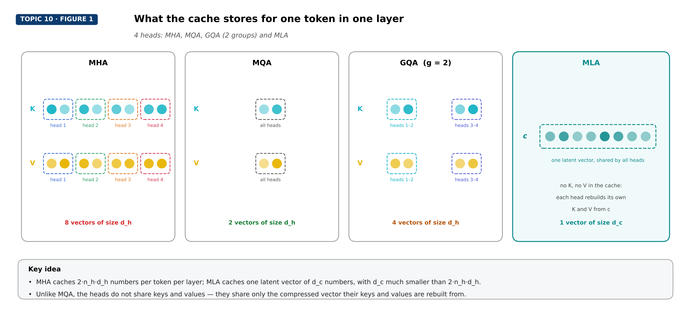
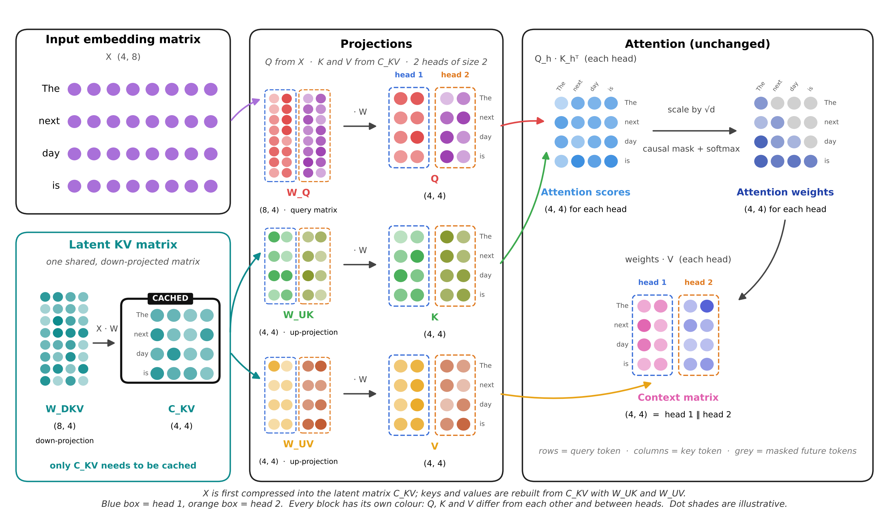
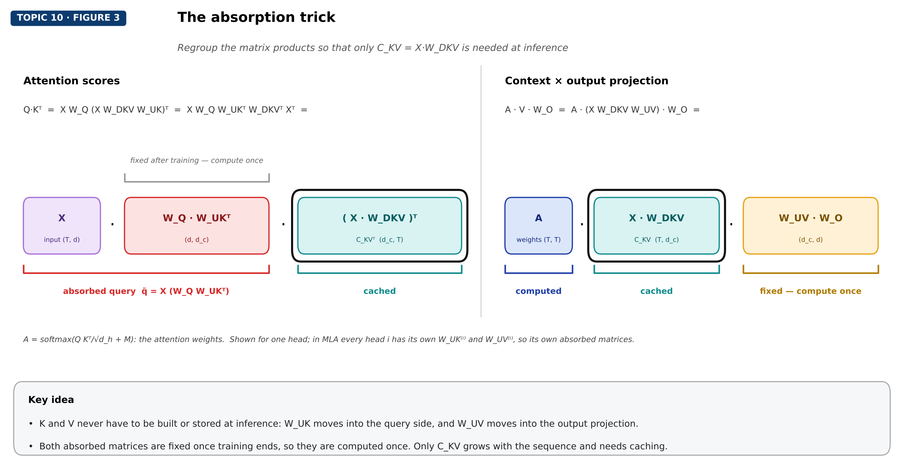
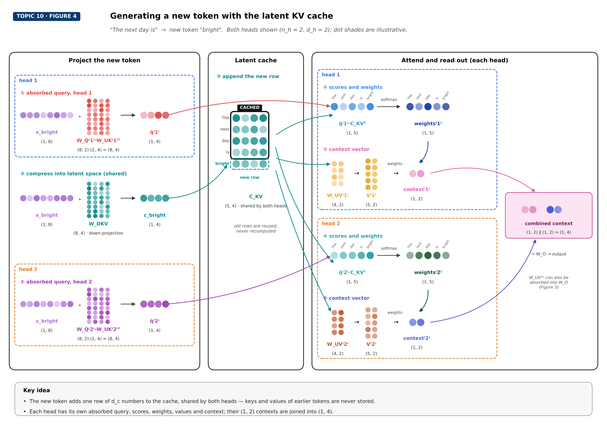
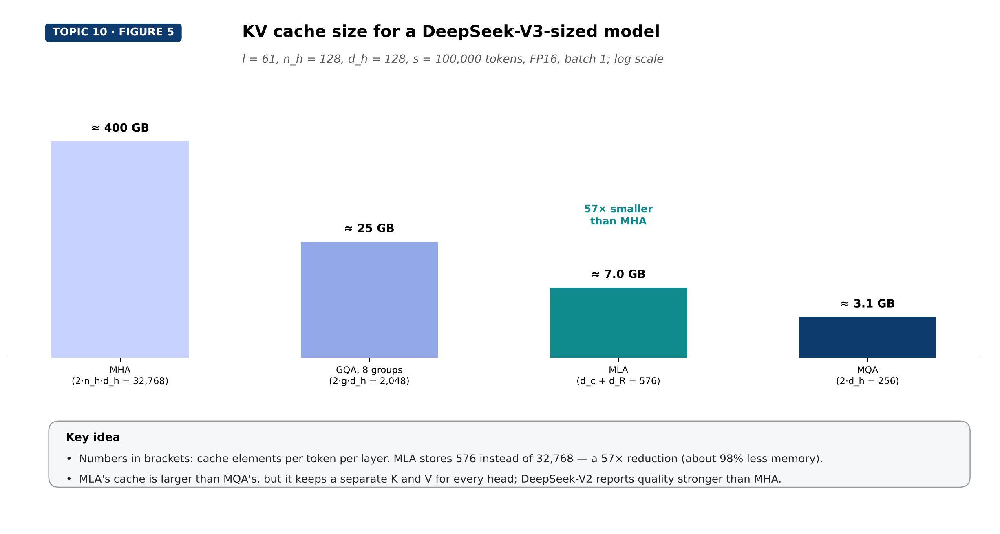

<div align="center">


<br/>

[](.)
[](.)
[](.)
[](.)
[](.)

**[← Back to the DeepSeek from Scratch series](../README.md)**

</div>

---

## Abstract

This topic introduces **multi-head latent attention (MLA)** [1], the attention mechanism of DeepSeek-V2 and DeepSeek-V3. Topics 08 and 09 showed a trade-off: multi-query and grouped-query attention shrink the KV cache by letting heads share keys and values, but sharing costs model quality. MLA asks whether both goals can be met at once — a small cache *and* a different key and value for every head. Its answer is to stop caching keys and values altogether. Each token is projected down into a single **latent vector** of width $`d_c`$, much smaller than the $`2 n_h d_h`$ numbers that multi-head attention stores, and only this latent matrix $`C_{KV}`$ is cached. Every head rebuilds its own keys and values from $`C_{KV}`$ with its own up-projection matrices $`W_{UK}`$ and $`W_{UV}`$. The **absorption trick** then shows that the keys and values never need to be built at inference at all: $`W_{UK}`$ can be merged into the query projection and $`W_{UV}`$ into the output projection, both fixed once training ends. The topic derives MLA and the absorption trick, walks through generating a new token with the latent cache, and computes the cache size: 576 numbers per token per layer for DeepSeek instead of 32,768 — a **57× reduction**, from about 400 GB to about 7 GB at 100,000 tokens — while DeepSeek-V2 reports quality stronger than multi-head attention.

---

## At a Glance

| | |
|---|---|
| **Topic** | 10 of 26 — Stage 3 (first topic) |
| **Document type** | Concept & derivation |
| **Core question** | Can we have a small KV cache *and* different keys and values for every head? |
| **Builds on** | Topic 06 — Multi-Head Attention · Topic 07 — KV Cache · Topics 08 – 09 — MQA and GQA |
| **Running example** | `"The next day is"` → `"bright"` — $`X \in \mathbb{R}^{4 \times 8}`$, 2 heads of size $`d_h = 2`$ ($`n_h d_h = 4`$), latent width 4 |
| **Key result** | Cache one latent vector per token: 57× smaller than MHA for DeepSeek, with quality stronger than MHA |
| **Key technique** | The absorption trick — $`W_{UK}`$ into the query, $`W_{UV}`$ into the output projection |
| **Introduced by** | DeepSeek-AI, *DeepSeek-V2* (2024) |
| **Main artifact** | `Topic10_MultiHeadLatentAttention.docx` — technical report with 5 figures |
| **Version** | 1.0 · November 2026 |

---

## 1. Can We Get the Best of Both Worlds?

We want two things at the same time:

1. **A low cache size.** The KV cache of multi-head attention is

```math
\text{KV cache}_{\text{MHA}} \;=\; 2 \times l \times b \times {\underbrace{n_h \times d_h}_{\text{to be reduced}}} \times s \times B
```

For DeepSeek ($`n_h = 128`$, $`d_h = 128`$, $`l = 61`$), standard attention would need about **400 GB** at 100,000 tokens (Topic 07). The term $`n_h \times d_h`$ is what needs to shrink.

2. **Good language-model performance.** For this, every head should have **different values** in its K and V matrices — exactly what MQA gives up, and GQA gives up partly.

MQA and GQA shrink $`n_h`$ by sharing keys and values between heads, which works against goal 2. MLA takes a different route.

---

## 2. The Key Idea — Cache One Small Matrix

<p align="center"></p>

*What if we don't have to cache keys and values separately?* And *what if the one matrix we do cache has fewer dimensions than $`n_h \times d_h`$?*

Multi-head attention caches two matrices (K and V), each $`n_h d_h`$ wide. MLA caches **one** matrix of width $`d_c`$, the latent dimension:

```math
\underbrace{2 \times n_h \times d_h}_{\text{MHA: K and V}}
\quad\longrightarrow\quad
\underbrace{1 \times d_c}_{\text{MLA: one latent}},
\qquad d_c \ll 2\, n_h d_h
```

The difference from MQA is what the heads share. In MQA all heads read **the same keys and values**. In MLA the heads share only the **compressed latent vector**, and each head rebuilds its own, different keys and values from it.

**Why such strong compression is possible.** In multi-head attention, every key and value is a linear function of the same input: stacking all heads, $`[K \;\, V] = X \, [W_K \;\, W_V]`$, a matrix of rank at most $`d`$, the model width. For DeepSeek-V3, $`d = 7{,}168`$ [2], while multi-head attention would cache $`2 n_h d_h = 32{,}768`$ numbers per token — so those numbers span at most 7,168 independent directions, and the cached keys and values are already redundant. MLA makes this bottleneck explicit and narrower ($`d_c = 512`$) and learns the down- and up-projections jointly during training, so the latent keeps the directions attention actually uses. This does not guarantee that nothing is lost; that is an empirical question, and DeepSeek-V2 reports quality stronger than multi-head attention [1].

---

## 3. Projecting into a Latent Space

<p align="center"></p>

To get this matrix, the input embedding matrix $`X`$ is first projected into a **latent space** with a down-projection matrix $`W_{DKV}`$ ("D" for down, "KV" for the KV cache). The result $`C_{KV}`$ is the latent matrix that will be cached. Keys and values are then rebuilt from it with two **up-projection** matrices:

```math
Q = X W_Q, \qquad
C_{KV} = X W_{DKV}, \qquad
K = C_{KV} W_{UK} = X W_{DKV} W_{UK}, \qquad
V = C_{KV} W_{UV} = X W_{DKV} W_{UV}
```

| Matrix | Role | Shape (running example: $`n_h = 2`$, $`d_h = 2`$) | Shape (general) |
|---|---|:-:|:-:|
| $`W_Q`$ | query matrix | $`(8, 4)`$ | $`d \times n_h d_h`$ |
| $`W_{DKV}`$ | down-projection into the latent space | $`(8, 4)`$ | $`d \times d_c`$ |
| $`W_{UK}`$ | up-projection for keys | $`(4, 4)`$ | $`d_c \times n_h d_h`$ |
| $`W_{UV}`$ | up-projection for values | $`(4, 4)`$ | $`d_c \times n_h d_h`$ |
| $`C_{KV}`$ | latent KV matrix — **the only thing cached** | $`(4, 4)`$ | $`s \times d_c`$ |

In the running example $`n_h d_h = 2 \times 2 = 4`$, so these are the full multi-head shapes. Each head owns two columns: $`W_Q^{(i)}`$ is $`(8, 2)`$, and $`W_{UK}^{(i)}`$ and $`W_{UV}^{(i)}`$ are $`(4, 2)`$. (Topic 11 uses $`d_h = 4`$, so there $`W_q`$ is $`(8, 8)`$ and $`W_{uk}`$, $`W_{uv}`$ are $`(4, 8)`$.)

Because $`W_{UK}`$ and $`W_{UV}`$ are split into one block per head, head $`i`$ gets its own keys and values even though all heads start from the same $`C_{KV}`$:

```math
K_i = C_{KV} W_{UK}^{(i)}, \qquad V_i = C_{KV} W_{UV}^{(i)}, \qquad i = 1, \dots, n_h
```

After that, attention proceeds exactly as in multi-head attention: scaled scores, causal mask, softmax, and the weighted sum of values.

> **A note on sizes.** In the running example the latent is as wide as K and V (4), which keeps the picture readable. In DeepSeek-V2 and V3 the latent is $`d_c = 512`$, against $`n_h d_h = 16{,}384`$ for K alone — that gap is where the saving comes from.

**Queries.** In this version $`W_Q`$ stays the same as in multi-head attention. Later versions of latent attention (DeepSeek-V2 and V3) also project the queries through a low-rank latent space [1], but that compression saves activation memory during training and does not affect the KV cache.

---

## 4. The Absorption Trick

<p align="center"></p>

How does adding a latent matrix help, if keys and values still have to be rebuilt? The answer is that at inference they do **not** have to be rebuilt. The matrix products can be regrouped so that the up-projections disappear into other, fixed matrices.

### 4.1 Attention scores

For one head (head index omitted):

```math
Q K^{\top}
\;=\; X W_Q \,\left(X W_{DKV} W_{UK}\right)^{\top}
\;=\; X W_Q \, W_{UK}^{\top} W_{DKV}^{\top} X^{\top}
\;=\; \underbrace{X \left(W_Q W_{UK}^{\top}\right)}_{\text{absorbed query } \tilde{Q}} \; \underbrace{\left(X W_{DKV}\right)^{\top}}_{C_{KV}^{\top} \text{ — cached}}
```

$`W_Q W_{UK}^{\top}`$ is fixed once training ends, so it is computed **only once**. The query is projected straight into the latent space, $`\tilde{Q} = X (W_Q W_{UK}^{\top})`$, and compared directly with the cached latent rows. The keys $`K`$ are never formed.

### 4.2 Context vectors and output projection

With $`A = \mathrm{softmax}\left(Q K^{\top} / \sqrt{d_h} + M\right)`$ the attention weights, the context matrix passed through the output projection $`W_O`$ is

```math
A \, V \, W_O
\;=\; A \left(X W_{DKV} W_{UV}\right) W_O
\;=\; \underbrace{A}_{\text{already computed}} \; \underbrace{\left(X W_{DKV}\right)}_{C_{KV} \text{ — cached}} \; \underbrace{\left(W_{UV} W_O\right)}_{\text{fixed — computed once}}
```

So $`W_{UV}`$ is absorbed into the output projection, and the values $`V`$ are never formed either. With several heads, each head $`i`$ has its own absorbed matrices $`W_Q^{(i)} W_{UK}^{(i)\top}`$ and $`W_{UV}^{(i)} W_O^{(i)}`$, while all heads read the **same** cached $`C_{KV}`$:

```math
\mathrm{MLA}(X) \;=\; \sum_{i=1}^{n_h} A_i \, C_{KV} \, \bigl( {W_{UV}}^{(i)} \, {W_O}^{(i)} \bigr),
\qquad
A_i = \mathrm{softmax}\left(\frac{X \, \bigl( {W_Q}^{(i)} \, {W_{UK}}^{(i)\top} \bigr) \, C_{KV}^{\top}}{\sqrt{d_h}} + M\right)
```

| Quantity | Status at inference |
|---|---|
| $`W_Q W_{UK}^{\top}`$, $`W_{UV} W_O`$ | fixed after training — computed once |
| $`C_{KV} = X W_{DKV}`$ | **cached** — grows by one row per token |
| $`\tilde{Q}`$, $`A`$ | computed for each new token |
| $`K`$, $`V`$ | never formed |

If we cache $`C_{KV} = X W_{DKV}`$, we can compute the attention scores and the context vectors — and therefore the next token. A numerical check with random matrices confirms that the absorbed form gives exactly the same output as the explicit one (difference about $`10^{-15}`$).

**The cost of absorption.** With absorption, each head compares its query with the cached latent rows in $`d_c`$ dimensions instead of $`d_h`$ — for DeepSeek, 512 instead of 128 — so computing the attention scores takes about 4× more multiply-adds per head. This is a good trade at inference, because decoding is memory-bound (Topic 07): at every step the whole cache is read from GPU memory, and MLA reads one latent row per token per layer, shared by all 128 heads, instead of 128 separate keys and values. A little extra arithmetic buys a large cut in memory traffic.

---

## 5. Generating a New Token

<p align="center"></p>

The latent cache already holds $`C_{KV} = X W_{DKV}`$ of shape $`(4, 4)`$ for `"The next day is"`. What happens when the new token `"bright"` comes in? Steps 1, 4 and 5 are done separately for each head $`i`$ ($`d_h = 2`$); Figure 4 shows both heads.

1. **Absorbed query.** For head $`i`$, the new token's query is projected straight into the latent space:

```math
\tilde{q}_{\text{bright}}^{(i)} \;=\; x_{\text{bright}} \, \bigl( {W_Q}^{(i)} \, {W_{UK}}^{(i)\top} \bigr),
\qquad (1, 8) \cdot (8, 2) \cdot (2, 4) \;\to\; (1, 4)
```

2. **Compress the new token.** $`c_{\text{bright}} = x_{\text{bright}} W_{DKV}`$, of shape $`(1, 4)`$.
3. **Append it to the latent cache.** $`C_{KV}`$ grows from $`(4, 4)`$ to $`(5, 4)`$. The old rows are reused, never recomputed.
4. **Scores and weights.** For each head, $`\tilde{q}_{\text{bright}}^{(i)} \, C_{KV}^{\top}`$ gives the attention scores for `"bright"`, of shape $`(1, 5)`$; softmax turns them into attention weights $`(1, 5)`$.
5. **Context vector.** $`C_{KV} W_{UV}^{(i)}`$ gives head $`i`$'s value matrix $`(5, 2)`$, and its weights times these values give head $`i`$'s context vector for `"bright"`, of shape $`(1, 2)`$. The two heads together give $`(1, 4)`$. In practice $`W_{UV}`$ is absorbed into the output projection (Section 4.2), so even this step needs no value matrix.

Here we need just **one latent cache** — no separate cache for keys and values.

---

## 6. KV Cache Size

The latent cache holds one vector of $`d_c`$ numbers per token, per layer, so the factor $`2 \times n_h \times d_h`$ of multi-head attention is gone:

```math
\text{KV cache}_{\text{MLA}} \;=\; l \times b \times s \times d_c \times B,
\qquad
\frac{\text{KV cache}_{\text{MHA}}}{\text{KV cache}_{\text{MLA}}} \;=\; \frac{2\, n_h d_h}{d_c}
```

DeepSeek-V2 and V3 cache $`512`$ latent numbers plus a $`64`$-number positional key per token per layer (Section 8), so 576 in total [1]:

```math
\frac{2 \times 128 \times 128}{576} \;=\; \frac{32{,}768}{576} \;\approx\; 57
```

For a DeepSeek-V3-sized model ($`l = 61`$) at $`s = 100{,}000`$ tokens in FP16, the cache falls from about **400 GB** to

```math
61 \times 1 \times 100{,}000 \times 576 \times 2 \ \text{bytes} \;\approx\; 7.0 \ \text{GB}
```

— a **57× reduction**, or about 98% less memory.

<p align="center"></p>

---

## 7. MHA vs. MQA vs. GQA vs. MLA

| Attention mechanism | KV cache size | Per token per layer (DeepSeek-V3 size) | Cache at 100K tokens | Quality [1] |
|---|---|:-:|:-:|:-:|
| Multi-head (MHA) | $`2 \cdot l \cdot b \cdot s \cdot n_h \cdot d_h \cdot B`$ | 32,768 | ≈ 400 GB | Strong |
| Grouped-query (GQA, 8 groups) | $`2 \cdot l \cdot b \cdot s \cdot g \cdot d_h \cdot B`$ | 2,048 | ≈ 25 GB | Moderate |
| Multi-query (MQA) | $`2 \cdot l \cdot b \cdot s \cdot d_h \cdot B`$ | 256 | ≈ 3.1 GB | Weak |
| **Multi-head latent (MLA)** | $`l \cdot b \cdot s \cdot d_c \cdot B`$ | **576** | **≈ 7.0 GB** | **Stronger** |

*FP16 ($`B = 2`$), batch size 1, $`l = 61`$, $`n_h = d_h = 128`$. The quality column is DeepSeek-V2's own comparison [1].*

Two things make MLA different from everything before it:

1. **Keys and values are not cached separately.** Only $`X W_{DKV}`$ is cached, and it is shared across all attention heads.
2. **Unlike MQA, every head keeps its own keys and values.** The shared latent matrix is projected back up into keys and values with $`W_{UK}`$ and $`W_{UV}`$, whose weights are different for each head. This solves the quality problem of MQA. DeepSeek-V2 reports that its cache equals that of GQA with only 2.25 groups, while its quality is stronger than MHA [1].

---

## 8. What This Simplified Version Leaves Out

The MLA derived here is the core idea. DeepSeek's production version adds two things, both covered later in the series:

- **Query compression.** DeepSeek-V2 and V3 also pass the queries through a low-rank latent ($`d_c' = 1536`$) to save activation memory in training [1], [2]. It does not change the KV cache.
- **Decoupled RoPE.** Rotary positional encodings rotate keys by position, which breaks the absorption trick: $`W_{UK}`$ can no longer be merged into the query. DeepSeek keeps a small extra key of width $`d_h^R = 64`$ that carries the position, cached alongside the latent — which is why the cache is $`512 + 64 = 576`$ rather than 512 [1]. This is the subject of Topic 15, after RoPE is introduced in Topics 12 – 14.

MLA is implemented from scratch in Topic 11.

---

## Key Technical Observations

1. **MLA caches neither K nor V.** It caches one latent matrix $`C_{KV} = X W_{DKV}`$ of width $`d_c`$, shared by all heads.
2. **Each head still has its own keys and values,** rebuilt from $`C_{KV}`$ with per-head up-projections $`W_{UK}^{(i)}`$ and $`W_{UV}^{(i)}`$ — the difference from MQA.
3. **The absorption trick removes the up-projections at inference.** $`W_{UK}`$ merges into the query ($`W_Q W_{UK}^{\top}`$) and $`W_{UV}`$ into the output projection ($`W_{UV} W_O`$), both computed once after training.
4. **A new token adds one row of $`d_c`$ numbers** to the cache; earlier rows are reused, never recomputed.
5. **The cache shrinks by $`2 n_h d_h / d_c`$.** For DeepSeek: 32,768 → 576 numbers per token per layer, 57×, about 400 GB → 7 GB at 100K tokens.
6. **MLA breaks the memory–quality trade-off** of MQA and GQA: a cache close to MQA's, with quality reported as stronger than MHA.
7. **RoPE needs special handling.** Position-dependent rotations break absorption, which DeepSeek solves with a small decoupled RoPE key (Topic 15).

---

## References

References are listed in IEEE numeric format.

| # | Authors | Title | Venue | Year |
|:-:|---------|-------|-------|:-:|
| 1 | DeepSeek-AI | DeepSeek-V2: A Strong, Economical, and Efficient Mixture-of-Experts Language Model | *arXiv:2405.04434* | 2024 |
| 2 | DeepSeek-AI | DeepSeek-V3 Technical Report | *arXiv:2412.19437* | 2024 |
| 3 | A. Vaswani et al. | Attention Is All You Need | *NeurIPS* | 2017 |
| 4 | N. Shazeer | Fast Transformer Decoding: One Write-Head is All You Need | *arXiv:1911.02150* | 2019 |
| 5 | J. Ainslie et al. | GQA: Training Generalized Multi-Query Transformer Models from Multi-Head Checkpoints | *EMNLP* | 2023 |
| 6 | J. Su et al. | RoFormer: Enhanced Transformer with Rotary Position Embedding | *Neurocomputing* | 2024 |

---

## Files in This Directory

| File | Description |
|------|-------------|
| `README.md` | This document — conceptual summary and reader entry point |
| `Topic10_MultiHeadLatentAttention.docx` | Primary artifact (v1.0) — technical report: title page, abstract, contents, 8 sections, 5 embedded figures, IEEE references |
| `images/` | The 5 figures used in this README and the report |

---

## Navigation

**Previous:** &nbsp; [Topic 09 — Grouped-Query Attention](../09_grouped_query_attention/README.md) &nbsp;·&nbsp; *Share keys and values within groups of heads*

**Next:** &nbsp; [Topic 11 — Multi-Head Latent Attention — Coded](../11_mla_code/README.md) &nbsp;·&nbsp; *MLA from scratch in PyTorch.*

---

<div align="center">

**DeepSeek from Scratch**  
A technical report series rebuilding the key ideas behind DeepSeek-V2 / V3 from first principles.

**Shiva Kiran Dadishetty** &nbsp;·&nbsp; Independent Research &nbsp;·&nbsp; Texas, USA  
[github.com/shivakiran-ai/deepseek-from-scratch](https://github.com/shivakiran-ai/deepseek-from-scratch)

*Document version 1.0 &nbsp;·&nbsp; Last updated November 2026*


</div>
