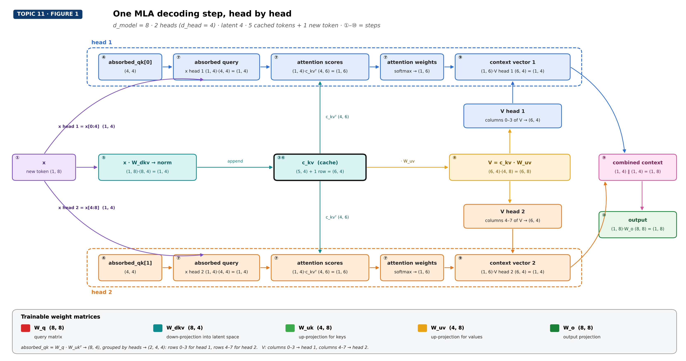

<div align="center">


<br/>

[](.)
[](.)
[](.)
[](./Topic11_MLA_from_scratch.ipynb)

**[← Back to the DeepSeek from Scratch series](../README.md)**

</div>

---

## Abstract

This topic codes **multi-head latent attention (MLA)** from scratch for one decoding step. Five tokens — *"The next day is bright"* — are already stored in the latent KV cache. A new token arrives, and in ten steps we compute its context vector: absorbed query matrices, compression of the new token, appending it to the cache, attention scores and weights for each head, the value matrix, and the context vector. Every step shows the shapes and the actual values. Part 2 gives the PyTorch implementation, with memory and cache-growth tests.

---

## At a Glance

| | |
|---|---|
| **Topic** | 11 of 26 — Stage 3 |
| **Builds on** | Topic 10 — Multi-Head Latent Attention |
| **Example** | `d_model = 8`, `kv_latent_dim = 4`, `n_heads = 2`, `d_head = 4`; 5 cached tokens + 1 new token |
| **Code** | [`Topic11_MLA_from_scratch.ipynb`](./Topic11_MLA_from_scratch.ipynb) — NumPy, runs top to bottom |
| **Version** | 1.0 · November 2026 |

<p align="center"></p>

---

## Part 1 — Step-by-Step Walkthrough

### ① Initial Setup and Parameters

- Embedding dimension: `d_model = 8` — the width of every token vector
- KV cache dimension: `kv_latent_dim = 4` — the width of one cache row, which MLA stores per token instead of a full key and value
- Number of heads: `n_heads = 2`
- Head dimension: `d_head = d_model / n_heads = 8 / 2 = 4` — the width each head works in
- Input token embedding: `x = [0.1, -0.2, 0.3, -0.4, 0.5, -0.6, 0.7, -0.8]` &nbsp;→&nbsp; (1, 8)
- Prior context: 5 tokens ("The next day is bright"), already stored in the cache

---

### ② Trained Weight Matrices

- These five matrices are learned during training and stay fixed during inference.
- `W_dkv` compresses a token from 8 to 4 numbers; `W_uk` and `W_uv` decompress 4 numbers back to 8 for keys and values.
- `W_q` and `W_o` play the same role as in ordinary multi-head attention.

```
W_q (8x8):                                    W_uk (4x8):
[ [0.1, 0.2, 0.1, 0.3, 0.1, 0.2, 0.1, 0.3],   [ [0.2, 0.1, 0.3, 0.1, 0.2, 0.1, 0.3, 0.1],
  [0.2, 0.1, 0.3, 0.1, 0.2, 0.1, 0.3, 0.1],     [0.3, 0.2, 0.1, 0.2, 0.3, 0.2, 0.1, 0.2],
  [0.1, 0.3, 0.1, 0.2, 0.1, 0.3, 0.1, 0.2],     [0.1, 0.3, 0.2, 0.3, 0.1, 0.3, 0.2, 0.3],
  [0.3, 0.1, 0.2, 0.1, 0.3, 0.1, 0.2, 0.1],     [0.2, 0.1, 0.3, 0.1, 0.2, 0.1, 0.3, 0.1] ]
  [0.1, 0.2, 0.1, 0.3, 0.1, 0.2, 0.1, 0.3],
  [0.2, 0.1, 0.3, 0.1, 0.2, 0.1, 0.3, 0.1],   W_uv (4x8):
  [0.1, 0.3, 0.1, 0.2, 0.1, 0.3, 0.1, 0.2],   [ [0.2, 0.1, 0.3, 0.1, 0.2, 0.1, 0.3, 0.1],
  [0.3, 0.1, 0.2, 0.1, 0.3, 0.1, 0.2, 0.1] ]    [0.1, 0.2, 0.1, 0.3, 0.1, 0.2, 0.1, 0.3],
                                                [0.3, 0.1, 0.2, 0.1, 0.3, 0.1, 0.2, 0.1],
W_dkv (8x4):                                    [0.1, 0.3, 0.1, 0.2, 0.1, 0.3, 0.1, 0.2] ]
[ [ 0.1,  0.2,  0.3,  0.1],
  [-0.2,  0.1,  0.3,  0.2],                   W_o (8x8): output projection
  [ 0.3, -0.1,  0.2,  0.1],
  [ 0.2,  0.3, -0.1,  0.2],
  [ 0.1,  0.2,  0.1,  0.3],
  [-0.1,  0.2,  0.3,  0.1],
  [ 0.3,  0.1,  0.2, -0.1],
  [ 0.2, -0.1,  0.3,  0.2] ]
```

| Matrix | Shape | Role |
|---|:-:|---|
| `W_q` | (8, 8) | query matrix |
| `W_dkv` | (8, 4) | down-projection |
| `W_uk` | (4, 8) | up-projection for keys |
| `W_uv` | (4, 8) | up-projection for values |
| `W_o` | (8, 8) | output projection |

Columns 0 – 3 of `W_q`, `W_uk` and `W_uv` belong to **head 1**, columns 4 – 7 to **head 2**.

---

### ③ Latent KV Cache Computed Previously

- Each row is one earlier token compressed by `W_dkv`: 4 numbers instead of 16 for a full key and value (8 + 8).
- These rows were computed when those tokens were first processed; they are reused, never recomputed.

```math
X \cdot W_{dkv} \;\rightarrow\; (5, 4), \qquad (5 \times 8)\,(8 \times 4)
```

```
previous_cache = [
  [ 1.2,  0.3, -0.5, -0.8],     The
  [ 0.9, -0.2,  0.6,  0.4],     next
  [-0.7,  0.5,  0.8, -0.3],     day
  [ 0.6,  0.7, -0.4,  0.1],     is
  [-0.5, -0.6,  0.3,  0.9]  ]   bright        5x4
```

---

### ④ Absorbed Query Matrix

- Instead of building keys `K = c_kv · W_uk`, multiply `W_q` and `W_uk` once, ahead of time.
- The result maps a query straight into the latent space, so it can be compared with the cache rows directly.
- It is computed once after training: shape (8, 4), grouped into one (4, 4) block per head.

```math
W_q \cdot W_{uk}^{\top} \;\rightarrow\; (8, 4), \qquad (8 \times 8)\,(8 \times 4)
```

```
W_q @ W_uk.T = absorbed_qk (8x4):
[ [0.20, 0.28, 0.36, 0.20],      ┐
  [0.30, 0.26, 0.28, 0.30],      │  head 1
  [0.20, 0.28, 0.36, 0.20],      │
  [0.28, 0.30, 0.26, 0.28],      ┘
  [0.20, 0.28, 0.36, 0.20],      ┐
  [0.30, 0.26, 0.28, 0.30],      │  head 2
  [0.20, 0.28, 0.36, 0.20],      │
  [0.28, 0.30, 0.26, 0.28] ]     ┘
```

Group by heads: (n_heads, head_dim, latent_dim) = **(2, 4, 4)**.

```
absorbed_qk[0] (4x4):  head 1          absorbed_qk[1] (4x4):  head 2
[ [0.20, 0.28, 0.36, 0.20],            [ [0.20, 0.28, 0.36, 0.20],
  [0.30, 0.26, 0.28, 0.30],              [0.30, 0.26, 0.28, 0.30],
  [0.20, 0.28, 0.36, 0.20],              [0.20, 0.28, 0.36, 0.20],
  [0.28, 0.30, 0.26, 0.28] ]  4x4        [0.28, 0.30, 0.26, 0.28] ]  4x4
```

---

### ⑤ Compute Compressed KV Representation for the New Token

- Only `W_dkv` is used: the new token is squeezed from 8 numbers to 4.
- LayerNorm puts the latent values on a stable scale before they are stored.
- This (1, 4) row is the only new thing the cache needs for this token.

```math
x \cdot W_{dkv} \;\rightarrow\; (1, 4), \qquad (1 \times 8)\,(8 \times 4)
```

```
W_dkv(x) = x @ W_dkv
         = [0.1, -0.2, 0.3, -0.4, 0.5, -0.6, 0.7, -0.8] @ W_dkv

new_c_kv (before layernorm) = [0.22, -0.02, -0.16, -0.22]           1x4
new_c_kv (after layernorm)  = [1.5647, 0.1476, -0.6790, -1.0333]    1x4
```

---

### ⑥ Append to KV Cache

- The cache grows by exactly one row; the five old rows are untouched.
- After T tokens the cache has shape (T, 4) — it grows linearly with the sequence.

```
previous_cache (old cache)           c_kv (new cache)
[ [ 1.2,  0.3, -0.5, -0.8],          [ [ 1.2,     0.3,    -0.5,    -0.8   ],
  [ 0.9, -0.2,  0.6,  0.4],            [ 0.9,    -0.2,     0.6,     0.4   ],
  [-0.7,  0.5,  0.8, -0.3],            [-0.7,     0.5,     0.8,    -0.3   ],
  [ 0.6,  0.7, -0.4,  0.1],            [ 0.6,     0.7,    -0.4,     0.1   ],
  [-0.5, -0.6,  0.3,  0.9] ]           [-0.5,    -0.6,     0.3,     0.9   ],
                                       [ 1.5647,  0.1476, -0.6790, -1.0333] ]
5x4                                  6x4
```

---

### ⑦ Compute Query Representation for the New Token + Attention

- Each head takes its half of `x` and its own absorbed block, giving a (1, 4) query that already lives in the latent space.
- Multiplying by `c_kvᵀ` compares the new token with all six tokens at once — one score per token.
- Dividing by √d_head = 2 keeps the scores from growing with the head size; softmax turns them into weights that sum to 1.
- The new token is the last position, so it may look at all six tokens and no mask is needed here.

**Reshape the new token input into 2 heads:**

```
x' = [ [0.1, -0.2, 0.3, -0.4],     →  head 1   (1x4)
       [0.5, -0.6, 0.7, -0.8] ]    →  head 2   (1x4)
```

**Absorbed query vectors:**

```math
\text{tmp}_h \;=\; x_h \cdot \text{absorbed\_qk}[h], \qquad (1 \times 4)\,(4 \times 4) = (1 \times 4)
```

```
tmp_head1 = [0.1, -0.2, 0.3, -0.4] · absorbed_qk[0]  =  [-0.092, -0.060, -0.016, -0.092]     1x4
tmp_head2 = [0.5, -0.6, 0.7, -0.8] · absorbed_qk[1]  =  [-0.164, -0.060,  0.056, -0.164]     1x4
```

**Attention scores** — each absorbed query times the new cache transposed, divided by $`\sqrt{d_{head}} = 2`$:

```math
\text{scores}_h \;=\; \frac{\text{tmp}_h \cdot c_{kv}^{\top}}{\sqrt{d_{head}}}, \qquad (1 \times 4)\,(4 \times 6) = (1 \times 6)
```

```
c_kv_transposed = [
  [ 1.2,  0.9, -0.7,  0.6, -0.5,  1.5647],
  [ 0.3, -0.2,  0.5,  0.7, -0.6,  0.1476],
  [-0.5,  0.6,  0.8, -0.4,  0.3, -0.6790],
  [-0.8,  0.4, -0.3,  0.1,  0.9, -1.0333] ]      4x6

attn_scores_head1 = [-0.0234, -0.0586, 0.0246, -0.0500, -0.0028, -0.0234]     1x6
attn_scores_head2 = [-0.0558, -0.0838, 0.0894, -0.0896, -0.0064, -0.0670]     1x6
```

**Attention weights** — softmax of the scores:

```
attn_weights_head1 = [0.1664, 0.1607, 0.1746, 0.1620, 0.1699, 0.1664]     1x6
attn_weights_head2 = [0.1630, 0.1585, 0.1885, 0.1576, 0.1713, 0.1612]     1x6
```

---

### ⑧ Find Values Matrix

- Values are rebuilt from the cache with `W_uv`: (6, 4) → (6, 8).
- Columns 0–3 belong to head 1 and columns 4–7 to head 2.
- Keys were never built (step ④ absorbed them); values are built here to show the step, although `W_uv` can also be absorbed into `W_o`.

```math
\text{updated cache} \cdot W_{uv} \;\rightarrow\; V, \qquad (6 \times 4)\,(4 \times 8) = (6 \times 8)
```

```
V = [                head 1                 |                head 2
  [ 0.04,   -0.11,    0.21,    0.00  ]  |  [ 0.04,   -0.11,    0.21,    0.00  ],
  [ 0.38,    0.23,    0.41,    0.17  ]  |  [ 0.38,    0.23,    0.41,    0.17  ],
  [ 0.12,    0.02,   -0.03,    0.10  ]  |  [ 0.12,    0.02,   -0.03,    0.10  ],
  [ 0.08,    0.19,    0.18,    0.25  ]  |  [ 0.08,    0.19,    0.18,    0.25  ],
  [ 0.02,    0.13,   -0.06,   -0.02  ]  |  [ 0.02,    0.13,   -0.06,   -0.02  ],
  [ 0.0207, -0.1919,  0.2450, -0.0738]  |  [ 0.0207, -0.1919,  0.2450, -0.0738] ]
                   6x4                                       6x4
```

---

### ⑨ Find Context Vector

- Each head mixes its six value rows using its own attention weights, giving a (1, 4) summary of the context.
- The two head outputs are placed side by side, giving (1, 8) — the same width as the input token.

```math
\text{head } h: \quad \text{attention weights}_h \;(1, 6) \;\cdot\; V_h \;(6, 4) \;=\; (1, 4)
```

```
context_head1 = [0.1085, 0.0431, 0.1553, 0.0696]     1x4
context_head2 = [0.1087, 0.0436, 0.1511, 0.0699]     1x4

combined_context = [0.1085, 0.0431, 0.1553, 0.0696, 0.1087, 0.0436, 0.1511, 0.0699]     1x8
```

---

### ⑩ Output Projection

- `W_o` mixes the information from both heads into one (1, 8) vector.
- This vector continues through the rest of the transformer block and finally the language-model head, which predicts the next token.

```math
\text{combined\_context} \;(1, 8) \;\cdot\; W_o \;(8, 8) \;\rightarrow\; (1, 8)
```

---

## Part 2 — PyTorch Implementation

### Step 1: Writing the code for the Multi-Head Latent Attention

- `__init__` creates the five weight matrices of Part 1 as `nn.Linear` layers without bias, plus the LayerNorm for the latent vector.
- `forward` runs Part 1 for a whole batch: compress and append (⑤ ⑥), values (⑧), split `x` and score each head (⑦), causal mask and softmax, context (⑨), output (⑩).
- `absorbed_k` is computed on the first call and reused afterwards.
- It returns the output and the updated cache, which is passed back in for the next token.

```python
import torch
import torch.nn as nn
import torch.nn.functional as F

class RopelessMLA(nn.Module):
    def __init__(self, d_model, n_heads, kv_latent_dim):
        super().__init__()
        self.d_model = d_model
        self.n_heads = n_heads
        self.dh = d_model // n_heads                                # dimension per head

        # Projection layers
        self.W_q   = nn.Linear(d_model, d_model, bias=False)        # Query projection
        self.W_dkv = nn.Linear(d_model, kv_latent_dim, bias=False)  # Compress into latent KV space
        self.W_uk  = nn.Linear(kv_latent_dim, d_model, bias=False)  # Decompress K
        self.W_uv  = nn.Linear(kv_latent_dim, d_model, bias=False)  # Decompress V
        self.W_o   = nn.Linear(d_model, d_model, bias=False)        # Final output projection

        self.ln = nn.LayerNorm(kv_latent_dim)
        self.register_buffer('absorbed_k', None)                    # Holds W_q @ W_uk

    def forward(self, x, kv_cache=None, past_length=0):
        B, S, D = x.size()

        # Compute absorbed_k once: W_q @ W_uk, shape: (D, latent_dim)
        if self.absorbed_k is None:
            absorbed = torch.matmul(self.W_q.weight, self.W_uk.weight)   # (D, latent_dim)
            self.absorbed_k = absorbed.view(self.n_heads, self.dh, -1)   # (n_heads, dh, latent_dim)

        # Compress x into latent KV space
        new_c_kv = self.ln(self.W_dkv(x))                           # (B, S, latent_dim)
        if kv_cache is None:
            c_kv = new_c_kv
        else:
            c_kv = torch.cat([kv_cache, new_c_kv], dim=1)           # (B, S_total, latent_dim)

        S_full = c_kv.size(1)

        # Decompress V to full d_model and split into heads
        v_full = self.W_uv(c_kv)                                    # (B, S_full, D)
        v = v_full.view(B, S_full, self.n_heads, self.dh).transpose(1, 2)
                                                                    # (B, n_heads, S_full, dh)

        # Use input x directly (since W_q is absorbed)
        q = x.view(B, S, self.n_heads, self.dh)                     # (B, S, n_heads, dh)

        # Compute attention scores
        attn_scores = torch.zeros(B, self.n_heads, S, S_full, device=x.device)
        for h in range(self.n_heads):
            tmp = torch.matmul(q[:, :, h], self.absorbed_k[h])      # (B, S, latent_dim)
            attn_scores[:, h] = torch.bmm(tmp, c_kv.transpose(1, 2))    # (B, S, S_full)

        # Scale and apply causal mask
        attn_scores = attn_scores / (self.dh ** 0.5)
        mask = torch.tril(torch.ones((S, S_full), device=x.device), diagonal=past_length)
        attn_scores = attn_scores.masked_fill(mask.view(1, 1, S, S_full) == 0,
                                              float('-inf'))

        # Softmax to get attention weights
        attn_weights = F.softmax(attn_scores, dim=-1)               # (B, n_heads, S, S_full)

        # Apply attention weights to each head's V separately
        out_heads = []
        for h in range(self.n_heads):
            context_h = torch.matmul(attn_weights[:, h], v[:, h])   # (B, S, dh)
            out_heads.append(context_h)

        # Concatenate all head outputs along the feature dimension
        out = torch.cat(out_heads, dim=-1)                          # (B, S, D)

        return self.W_o(out), c_kv                       # Final output projection + updated cache
```

### Step 2: Memory testing

- Uses a larger model: `d_model = 512`, 8 heads, latent width 256.
- A standard cache stores a key and a value (2 × 512 numbers per token); the latent cache stores 256 per token — 4× less.

```python
# === Demo for Testing ===
def demo():
    model = RopelessMLA(d_model=512, n_heads=8, kv_latent_dim=256)
    x = torch.randn(1, 5, 512)

    out, cache = model(x)
    print(f"Output: {out.shape}, Cache: {cache.shape}")

    # Memory comparison
    std_size = 2 * 2 * 10 * 512 * 4 / 1024    # KB (standard KV: B * 2 (K,V) * T * D * float32)
    latent_size = 2 * 10 * 256 * 4 / 1024     # KB (latent cache: B * T * latent_dim * float32)
    print(f"Memory: Standard={std_size:.1f}KB, Latent={latent_size:.1f}KB, "
          f"Reduction={std_size/latent_size:.1f}x")

if __name__ == "__main__":
    demo()
```

```
Output: torch.Size([1, 5, 512]), Cache: torch.Size([1, 5, 256])
Memory: Standard=80.0KB, Latent=20.0KB, Reduction=4.0x
```

### Step 3: Cache testing — single new inference

- The first call processes 5 tokens and returns a cache of shape (1, 5, 4).
- The second call passes one new token, the cache and `past_length = 5`; the cache grows to (1, 6, 4) and the output is for the new token only.

```python
def demo_cache_usage():
    torch.manual_seed(0)
    model = RopelessMLA(d_model=8, n_heads=2, kv_latent_dim=4)

    # ---- Step 1: Initial input (sequence of 5 tokens) ----
    x1 = torch.randn(1, 5, 8)                                  # (B=1, S=5, D=8)
    out1, cache1 = model(x1)
    print("Step 1: Initial input")
    print(f"Output shape: {out1.shape}")
    print(f"Cache shape:  {cache1.shape}")                     # Expect: (1, 5, 4)

    # ---- Step 2: Append 1 token ----
    x2 = torch.randn(1, 1, 8)                                  # (B=1, S=1, D=8)
    out2, cache2 = model(x2, kv_cache=cache1, past_length=5)
    print("\nStep 2: New token")
    print(f"Output shape: {out2.shape}")
    print(f"Cache shape:  {cache2.shape}")                     # Expect: (1, 6, 4)

demo_cache_usage()
```

```
Step 1: Initial input              Step 2: New token
Output shape: (1, 5, 8)            Output shape: (1, 1, 8)
Cache shape:  (1, 5, 4)            Cache shape:  (1, 6, 4)
```

### Step 4: Cache growth

- Starts with 50 tokens, then adds one token at a time.
- Each step adds exactly one row of `kv_latent_dim = 4` numbers: 50 → 51 → … → 54.

```python
def demo_kv_cache_growth(num_initial_tokens=5, num_new_tokens=3):
    torch.manual_seed(0)
    model = RopelessMLA(d_model=8, n_heads=2, kv_latent_dim=4)

    # Step 1: Start with initial token batch
    x = torch.randn(1, num_initial_tokens, 8)
    out, cache = model(x)
    print(f"Step 0: Initial input of {num_initial_tokens} tokens -> "
          f"cache shape: {cache.shape}")

    # Step 2: Incrementally append new tokens one at a time
    for step in range(1, num_new_tokens + 1):
        new_token = torch.randn(1, 1, 8)                            # (B=1, S=1, D=8)
        out, cache = model(new_token, kv_cache=cache, past_length=cache.shape[1])
        print(f"Step {step}: Added 1 token -> cache shape: {cache.shape}")

demo_kv_cache_growth(num_initial_tokens=50, num_new_tokens=4)
```

```
Step 0: Initial input of 50 tokens -> cache shape: torch.Size([1, 50, 4])
Step 1: Added 1 token -> cache shape: torch.Size([1, 51, 4])
Step 2: Added 1 token -> cache shape: torch.Size([1, 52, 4])
Step 3: Added 1 token -> cache shape: torch.Size([1, 53, 4])
Step 4: Added 1 token -> cache shape: torch.Size([1, 54, 4])
```

### Step 5: Visualizing W_q, W_uk and W_uv matrices for different heads

- Takes `W_q`, `W_uk` and `W_uv` out of the model as NumPy arrays.
- Reshapes them per head and draws one heatmap per head and matrix, showing the weights each head works with.

```python
import torch
import torch.nn as nn
import matplotlib.pyplot as plt
import seaborn as sns

class RopelessMLA(nn.Module):
    def __init__(self, d_model=8, n_heads=2, kv_latent_dim=4):
        super().__init__()
        self.d_model = d_model
        self.n_heads = n_heads
        self.dh = d_model // n_heads

        self.W_q  = nn.Linear(d_model, d_model, bias=False)
        self.W_uk = nn.Linear(kv_latent_dim, d_model, bias=False)
        self.W_uv = nn.Linear(kv_latent_dim, d_model, bias=False)

model = RopelessMLA()

# Extract weights
W_q  = model.W_q.weight.detach().numpy()
W_uk = model.W_uk.weight.detach().numpy()
W_uv = model.W_uv.weight.detach().numpy()

# Split per head
n_heads = model.n_heads
dh = model.dh
W_q_heads  = W_q.reshape(n_heads, dh, -1)
W_uk_heads = W_uk.T.reshape(n_heads, dh, -1)
W_uv_heads = W_uv.T.reshape(n_heads, dh, -1)

# Plot heatmaps
fig, axes = plt.subplots(n_heads, 3, figsize=(12, 5))
for h in range(n_heads):
    sns.heatmap(W_q_heads[h], ax=axes[h, 0], cbar=False, annot=True, fmt=".2f")
    axes[h, 0].set_title(f"Head {h} - W_q")

    sns.heatmap(W_uk_heads[h], ax=axes[h, 1], cbar=False, annot=True, fmt=".2f")
    axes[h, 1].set_title(f"Head {h} - W_uk")

    sns.heatmap(W_uv_heads[h], ax=axes[h, 2], cbar=False, annot=True, fmt=".2f")
    axes[h, 2].set_title(f"Head {h} - W_uv")

plt.tight_layout()
plt.show()
```

---

## Notes

- **Normalisation (Step ⑤):** the compressed latent vector is normalised with LayerNorm, as in the PyTorch code. DeepSeek-V2 and V3 use RMSNorm at this point [1].
- **Scaling (Step ⑦):** the attention scores are divided by $`\sqrt{d_{head}} = 2`$ before the softmax, so they do not grow with the head size.
- **Head split (Step ⑦):** this walkthrough and the code split the input `x` between the heads. In the standard multi-head formulation each head's query is $`x \cdot W_q[:, \text{head columns}]`$, which uses all of `x`; that version gives different numbers (for head 1, scores [−0.0396, −0.0712, 0.0570, −0.0698, −0.0046, −0.0057]).

---

## References

1. DeepSeek-AI, "DeepSeek-V3 Technical Report," *arXiv:2412.19437*, 2024.
2. DeepSeek-AI, "DeepSeek-V2: A Strong, Economical, and Efficient Mixture-of-Experts Language Model," *arXiv:2405.04434*, 2024.

---

## Files in This Directory

| File | Description |
|------|-------------|
| `README.md` | This document |
| `Topic11_MLA_from_scratch.ipynb` | Part 1 in NumPy (every step, with outputs) and Part 2 in PyTorch (run in Colab) |
| `Topic11_CodingMLA.docx` | Technical report |
| `images/` | Figure used in this README and the report |

---

## Navigation

**Previous:** &nbsp; [Topic 10 — Multi-Head Latent Attention](../10_multihead_latent_attention/README.md)

**Next:** &nbsp; [Topic 12 — Integer & Binary Positional Encodings](../12_integer_binary_positional_encoding/README.md)

---

<div align="center">

**DeepSeek from Scratch**  
A technical report series rebuilding the key ideas behind DeepSeek-V2 / V3 from first principles.

**Shiva Kiran Dadishetty** &nbsp;·&nbsp; Independent Research &nbsp;·&nbsp; Texas, USA  
[github.com/shivakiran-ai/deepseek-from-scratch](https://github.com/shivakiran-ai/deepseek-from-scratch)

*Document version 1.0 &nbsp;·&nbsp; Last updated November 2026*


</div>
