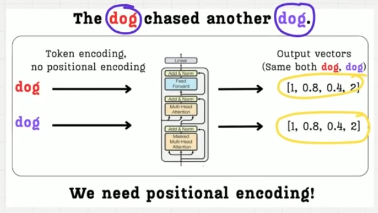
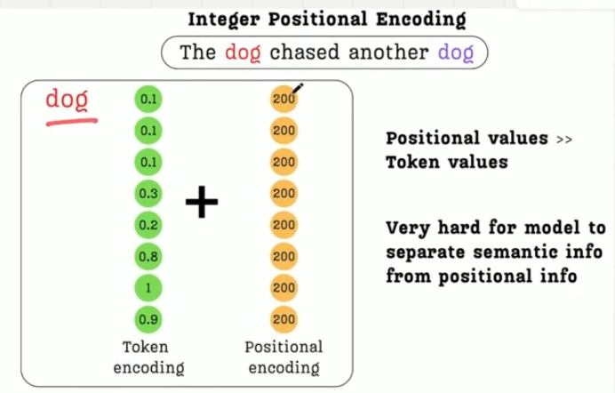
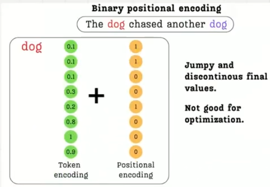
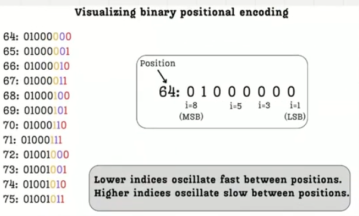
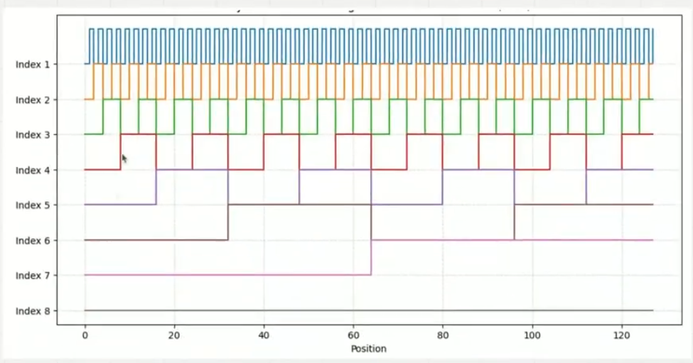
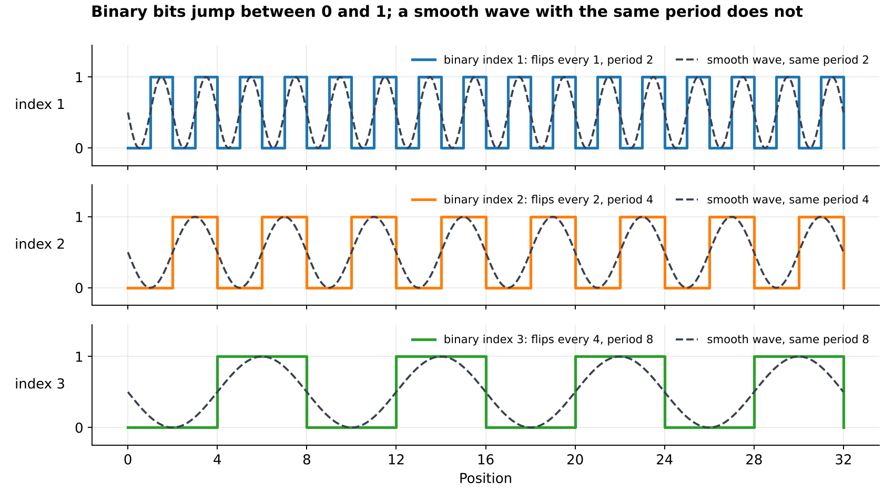

<div align="center">


<br/>

[](.)
[](.)
[](.)
[](.)
[](.)

**[← Back to the DeepSeek from Scratch series](../README.md)**

</div>

---

## Abstract

Topics 10 and 11 built multi-head latent attention without any notion of word order. DeepSeek adds that notion with rotary positional encodings (RoPE) and then has to make RoPE fit with MLA. This topic is the first step on the road to RoPE: it asks **why a transformer needs positional information at all**, and studies the two simplest ways to provide it. Self-attention on its own treats the input as a set, so the two occurrences of *dog* in *"The dog chased another dog"* receive the same representation even though one is chasing and the other is being chased. **Integer positional encoding** adds the position number to every dimension of the token embedding. It carries the order, but its values grow without limit — a token at position 200 receives +200 on embedding values that sit near zero — and the position swamps the meaning. **Binary positional encoding** writes the position in binary instead, which keeps every value in $`\{0, 1\}`$. Its bits reveal a useful structure: low indices flip quickly from one position to the next and high indices flip slowly, so every index is a wave with its own period. But the values jump between 0 and 1, and neighbouring positions can look far apart — positions 63 and 64 differ in seven bits. These discontinuities make binary encoding hard to optimise. The two ingredients it uses, the **position** and the **index**, carry over directly to the smooth sinusoidal encoding of Topic 13 and to RoPE in Topic 14.

---

## At a Glance

| | |
|---|---|
| **Topic** | 12 of 26 — Stage 3 (third topic) |
| **Document type** | Concept & motivation |
| **Core question** | Why does a transformer need positional encoding, and why are the simplest encodings not good enough? |
| **Builds on** | Topic 04 — Self-Attention · Topics 10 – 11 — Multi-Head Latent Attention |
| **Running example** | `"The dog chased another dog"` — the first *dog* at position 200, embedding dimension $`d = 8`$ |
| **Key result** | Integer encoding swamps the token embedding; binary encoding is bounded but discontinuous |
| **Key insight** | Each binary index is a square wave whose period doubles with the index — position and index are the two factors every later encoding uses |
| **Leads to** | Topic 13 — Sinusoidal Positional Encodings · Topic 14 — RoPE · Topic 15 — RoPE in MLA |
| **Main artifact** | `Topic12_IntegerBinaryPositionalEncoding.docx` — technical report with 6 figures |
| **Version** | 1.0 · November 2026 |

---

## 1. Where This Topic Sits

The core of MLA is the **low-rank joint compression** of keys and values, which shrinks the KV cache. In the notation of the DeepSeek-V2 paper [1], where $`h_t`$ is the input of token $`t`$ as a column vector:

```math
c_t^{KV} = W^{DKV} h_t, \qquad k_t^{C} = W^{UK} c_t^{KV}, \qquad v_t^{C} = W^{UV} c_t^{KV}
```

This is the row-vector form $`C_{KV} = X W_{DKV}`$, $`K = C_{KV} W_{UK}`$, $`V = C_{KV} W_{UV}`$ used in Topics 10 and 11. It is **basic MLA, with no positional information**: nothing in these three equations depends on where token $`t`$ sits in the sentence. DeepSeek uses RoPE for position and then integrates it with MLA. That integration is not automatic — RoPE rotates keys by an amount that depends on position, which sits between $`W_Q`$ and $`W_{UK}`$ and breaks the absorption trick of Topic 10. Topic 15 shows how DeepSeek solves this with decoupled RoPE.

To understand RoPE, this topic and the next two build it up from the beginning:

| Topic | Encoding | Idea | Problem it leaves |
|---|---|---|---|
| **12** | Integer | Add the position number | Values grow without limit |
| **12** | Binary | Add the position in binary | Values jump; not smooth |
| 13 | Sinusoidal | Replace each binary bit with a smooth sine or cosine wave | Added to the embedding, mixing position and meaning |
| 14 | RoPE | Rotate queries and keys by an angle that depends on position | Breaks MLA's absorption |
| 15 | Decoupled RoPE | Carry position in a small separate part of the query and key | — |

---

## 2. Why Position Matters

The position at which a word appears in a sentence is central to its meaning. In *"The dog chased another dog"*, both occurrences of *dog* are the same token with the same token embedding, yet the first dog is **chasing** and the second is **being chased**.

Self-attention computes each output from the dot products of queries and keys and a weighted sum of values. None of these operations looks at the order of the rows of $`X`$: if the input tokens are shuffled, the outputs are shuffled in the same way and are otherwise unchanged. Self-attention is **permutation-equivariant** — it treats the sentence as a set of words, not a sequence.

<p align="center"></p>

<p align="center"><sub><b>Figure 1.</b> Without positional encoding, both occurrences of <i>dog</i> enter the transformer block with the same vector and leave it with the same output vector.</sub></p>

- Without positional encoding, the attention output for the two *dog* tokens is exactly the same.
- After the attention block, we want the model to understand the context of the sentence: the **context vectors of the two dogs should be different**.
- The fix is to add information about each token's position to its embedding before the first transformer block.

> **A precise note on causal models.** Figure 1 shows the point in its cleanest form: in attention *without* a causal mask, the two dogs receive identical outputs. In a causal decoder such as GPT or DeepSeek, the mask gives the two dogs different sets of tokens to attend to — the first sees *"The dog"*, the second sees the whole sentence — so their outputs do differ. But they differ only because of what came before, not because the model is told where each token sits. Haviv et al. [3] show that causal models can learn some positional information implicitly; every widely used LLM still provides it explicitly.

---

## 3. Integer Positional Encoding

The simplest choice is to use the position number itself. Suppose the sentence sits inside a longer text and the first *dog* is at position 200. Then *chased* is at 201, *another* at 202 and the second *dog* at 203. If the embedding dimension is $`d = 8`$, we repeat the position value 8 times and add it to the token embedding:

```math
x_p = e_p + p \, \mathbf{1}_d, \qquad \mathbf{1}_d = (1, 1, \dots, 1) \in \mathbb{R}^{1 \times d}
```

where $`e_p`$ is the token embedding of the token at position $`p`$, as a $`(1, d)`$ row vector.

<p align="center"></p>

<p align="center"><sub><b>Figure 2.</b> Integer positional encoding for the first <i>dog</i>: the position 200 is repeated in all 8 dimensions and added to the token encoding.</sub></p>

For the first *dog*:

| | Values |
|---|---|
| Token encoding $`e_{200}`$ | [0.1, 0.1, 0.1, 0.3, 0.2, 0.8, 1.0, 0.9] |
| Positional encoding $`200 \cdot \mathbf{1}_8`$ | [200, 200, 200, 200, 200, 200, 200, 200] |
| Sum $`x_{200}`$ | [200.1, 200.1, 200.1, 200.3, 200.2, 200.8, 201.0, 200.9] |

**The problem — positional values ≫ token values.**

- The token embedding values are clustered around 0. This is what is usually seen in pre-trained LLMs, and it is desirable for training: small values help prevent vanishing or exploding gradients. GPT-2, for example, initialises its embeddings from a normal distribution with standard deviation 0.02 [4].
- Integer positional values, on the other hand, can be very large. Adding 200 to values near 0 means the sum is almost entirely position: the token's meaning is a small ripple on top.
- This heavily pollutes the semantic information captured by the token embeddings. It becomes very hard for the model to separate semantic information from positional information.
- The values also grow without limit as the text gets longer, so a model trained on short texts meets values it has never seen on long ones.

To avoid this, the positional encoding values must be **constrained** and must not become too high.

> **Why not just divide by the length?** Scaling to $`p / (L - 1)`$ keeps values in $`[0, 1]`$, but the same position then gets a different value in texts of different length $`L`$, and the gap between neighbouring positions, $`1 / (L - 1)`$, shrinks as the text grows. The model can no longer rely on a fixed meaning for "one step apart". Bounding the values has to be done without losing this.

---

## 4. Binary Positional Encoding

A natural way to keep the values bounded is to write the position in **binary**. Every value is then 0 or 1, on the same scale as the token embedding. For position 200 and $`d = 8`$:

```math
200 = 128 + 64 + 8 = (1\,1\,0\,0\,1\,0\,0\,0)_2
```

This binary positional encoding is then added to the token encoding vector.

<p align="center"></p>

<p align="center"><sub><b>Figure 3.</b> Binary positional encoding for the first <i>dog</i>: position 200 written as 11001000, most significant bit at the top, added to the token encoding.</sub></p>

Numbering the indices from $`i = 1`$ for the least significant bit (LSB) to $`i = d`$ for the most significant bit (MSB), index $`i`$ of the encoding of position $`p`$ is

```math
\mathrm{PE}(p)_i = \left\lfloor \frac{p}{2^{\,i-1}} \right\rfloor \bmod 2, \qquad i = 1, \dots, d
```

| | Values (MSB first) |
|---|---|
| Token encoding $`e_{200}`$ | [0.1, 0.1, 0.1, 0.3, 0.2, 0.8, 1.0, 0.9] |
| Binary encoding of 200 | [1, 1, 0, 0, 1, 0, 0, 0] |
| Sum $`x_{200}`$ | [1.1, 1.1, 0.1, 0.3, 1.2, 0.8, 1.0, 0.9] |

The token's own values are now still visible in the sum, which was the goal. The second *dog*, at position 203 = 11001011, receives a different encoding, so the two dogs are no longer identical.

---

## 5. Visualizing Binary Encoding

To see the structure of binary encoding, look at positions 64 to 75.

<p align="center"></p>

<p align="center"><sub><b>Figure 4.</b> Binary encodings of positions 64 to 75. Index 1 (the LSB, right) changes at every step; index 8 (the MSB, left) never changes in this range.</sub></p>

- **Index 1 (LSB)** flips at every position: 0, 1, 0, 1, …
- **Index 2** flips every 2 positions, **index 3** every 4, **index 4** every 8.
- **Higher indices** change only rarely: in this range, indices 5 to 8 never change.

**Lower indices oscillate fast between positions; higher indices oscillate slowly.** Plotting each index against the position over 0 to 127, as in Figure 5, makes this clear:

- **x-axis (Position):** the sequential positions in the input sequence.
- **y-axis (Index 1 to Index 8):** the different levels of the encoding.
- **Lower indices** (Index 1, Index 2, …) change more frequently: a **fine-grained** encoding. The LSB flips often.
- **Higher indices** (Index 7, Index 8) change less frequently: a **coarse** encoding. The MSB flips slowly.
- **Index 8 stays at 0** across the whole plot: positions 0 to 127 need only 7 bits, and index 8 first becomes 1 at position 128.

<p align="center"></p>

<p align="center"><sub><b>Figure 5.</b> Each binary index as a function of the position, from 0 to 127. Index 1 flips at every position; each higher index flips half as often as the one below it.</sub></p>

Every index is a **square wave**. Index $`i`$ stays constant for $`2^{i-1}`$ positions, then flips, so its period is $`2^{i}`$ positions:

| Index $`i`$ | 1 | 2 | 3 | 4 | 5 | 6 | 7 | 8 |
|---|---|---|---|---|---|---|---|---|
| Flips every (positions) | 1 | 2 | 4 | 8 | 16 | 32 | 64 | 128 |
| Period (positions) | 2 | 4 | 8 | 16 | 32 | 64 | 128 | 256 |

Two factors determine every value in this encoding: **the position of the token** and **the index number**. The same two factors appear again in the sinusoidal positional encoding (Topic 13) and in rotary positional encoding (Topic 14).

---

## 6. Why Binary Encoding Still Fails

Binary encoding solves the magnitude problem, but its values are **jumpy and discontinuous**: every value is exactly 0 or 1, and moving one position forward switches some indices abruptly from one to the other. This is not good for optimisation. During pre-training, the LLM is optimised by gradient descent, which works best when small changes in the input give small changes in the output. Sudden jumps make it hard for the optimiser to deal with these discontinuities.

The jumps also make the distance between neighbouring positions uneven. The short NumPy check below builds both encodings for the first *dog* and measures how far apart the binary encodings of neighbouring positions are.

```python
import numpy as np

def integer_pe(p, d=8):
    return np.full(d, float(p))                          # repeat the position d times

def binary_pe(p, d=8):
    bits = [(p >> (i - 1)) & 1 for i in range(1, d + 1)]  # i = 1 is the LSB
    return np.array(bits[::-1], dtype=float)              # MSB first (i = 8 ... 1)

token = np.array([0.1, 0.1, 0.1, 0.3, 0.2, 0.8, 1.0, 0.9])   # "dog"
print("integer :", token + integer_pe(200))
print("binary  :", binary_pe(200).astype(int), "->", token + binary_pe(200))

dist = lambda a, b: np.linalg.norm(binary_pe(a) - binary_pe(b))
for a, b in [(64, 65), (65, 66), (63, 64), (127, 128)]:
    print(f"|b({a}) - b({b})| = {dist(a, b):.3f}")
```

```
integer : [200.1 200.1 200.1 200.3 200.2 200.8 201.  200.9]
binary  : [1 1 0 0 1 0 0 0] -> [1.1 1.1 0.1 0.3 1.2 0.8 1.  0.9]
|b(64) - b(65)| = 1.000
|b(65) - b(66)| = 1.414
|b(63) - b(64)| = 2.646
|b(127) - b(128)| = 2.828
```

Every pair is one step apart, yet the distances differ:

```math
\lVert \mathrm{PE}(64) - \mathrm{PE}(65) \rVert_2 = 1, \qquad \lVert \mathrm{PE}(63) - \mathrm{PE}(64) \rVert_2 = \sqrt{7} \approx 2.646
```

Going from 63 = 00111111 to 64 = 01000000 flips seven bits at once, so two neighbouring positions look further apart than 64 and 65. The encoding has no consistent notion of "one step".

| Property | Integer | Binary |
|---|---|---|
| Distinguishes positions | ✅ | ✅ |
| Values bounded | ❌ grows with $`p`$ | ✅ in $`\{0, 1\}`$ |
| Token meaning preserved | ❌ swamped | ✅ same scale |
| Smooth from one position to the next | — | ❌ jumps between 0 and 1 |
| Even distance between neighbours | ✅ | ❌ depends on how many bits flip |

---

## 7. Toward a Smooth Encoding

Binary encoding gives the right structure — fast-changing low indices and slow-changing high indices — in the wrong shape. What we want is the same idea with **smooth variations and no jumps**.

<p align="center"></p>

<p align="center"><sub><b>Figure 6.</b> Indices 1 to 3 of the binary encoding (solid) next to smooth waves with the same periods (dashed). The smooth waves keep the fast-to-slow structure without the jumps.</sub></p>

Replacing each square wave with a smooth wave gives exactly the encoding of the original transformer [2], the topic of Topic 13. There, the value at position $`p`$ and index pair $`k`$ is

```math
\mathrm{PE}(p, 2k) = \sin\!\left( \frac{p}{10000^{2k/d}} \right), \qquad \mathrm{PE}(p, 2k+1) = \cos\!\left( \frac{p}{10000^{2k/d}} \right)
```

It keeps what worked in binary encoding: the values stay bounded, between −1 and 1, and the index sets the speed of oscillation, with low indices fast and high indices slow. The value still depends on the same two factors, position $`p`$ and index $`k`$, but it now changes smoothly from one position to the next.

---

## Key Technical Observations

1. **Self-attention ignores order.** Without positional information it is permutation-equivariant, and the two *dog* tokens get the same output.
2. **The two dogs' context vectors should differ.** Position has to be added to the token embedding before the first block.
3. **Integer encoding swamps meaning.** Adding $`p`$ to embedding values near 0 makes the sum almost entirely position, and the values grow without limit.
4. **Dividing by the length is not a fix.** It bounds the values but makes the step between neighbours depend on the length of the text.
5. **Binary encoding bounds the values** in $`\{0, 1\}`$, so the token's meaning stays visible.
6. **Each binary index is a square wave** with period $`2^{i}`$: low indices oscillate fast, high indices slowly.
7. **Binary encoding is discontinuous.** Its jumps are hard to optimise, and neighbouring positions can be far apart — 63 and 64 differ in seven bits.
8. **Position and index are the two factors** that carry over to sinusoidal encoding and RoPE.

---

## References

References are listed in IEEE numeric format.

| # | Authors | Title | Venue | Year |
|---|---|---|---|---|
| 1 | DeepSeek-AI | DeepSeek-V2: A Strong, Economical, and Efficient Mixture-of-Experts Language Model | *arXiv:2405.04434* | 2024 |
| 2 | A. Vaswani et al. | Attention Is All You Need | *NeurIPS* | 2017 |
| 3 | A. Haviv, O. Ram, O. Press, P. Izsak, O. Levy | Transformer Language Models without Positional Encodings Still Learn Positional Information | *Findings of EMNLP* | 2022 |
| 4 | A. Radford et al. | Language Models are Unsupervised Multitask Learners | *OpenAI Technical Report* | 2019 |
| 5 | J. Su et al. | RoFormer: Enhanced Transformer with Rotary Position Embedding | *Neurocomputing* | 2024 |

---

## Files in This Directory

| File | Description |
|------|-------------|
| `README.md` | This document — conceptual summary and reader entry point |
| `Topic12_IntegerBinaryPositionalEncoding.docx` | Primary artifact (v1.0) — technical report: title page, abstract, contents, 7 sections, 6 embedded figures, IEEE references |
| `images/` | The 6 figures used in this README and the report |

---

## Navigation

**Previous:** &nbsp; [Topic 11 — Multi-Head Latent Attention — Coded](../11_mla_code/README.md) &nbsp;·&nbsp; *MLA from scratch in PyTorch*

**Next:** &nbsp; [Topic 13 — Sinusoidal Positional Encodings](../13_sinusoidal_positional_encoding/README.md) &nbsp;·&nbsp; *Smooth waves at many frequencies*

---

<div align="center">

**DeepSeek from Scratch**  
A technical report series rebuilding the key ideas behind DeepSeek-V2 / V3 from first principles.

**Shiva Kiran Dadishetty** &nbsp;·&nbsp; Independent Research &nbsp;·&nbsp; Texas, USA  
[github.com/shivakiran-ai/deepseek-from-scratch](https://github.com/shivakiran-ai/deepseek-from-scratch)

*Document version 1.0 &nbsp;·&nbsp; Last updated November 2026*


</div>
