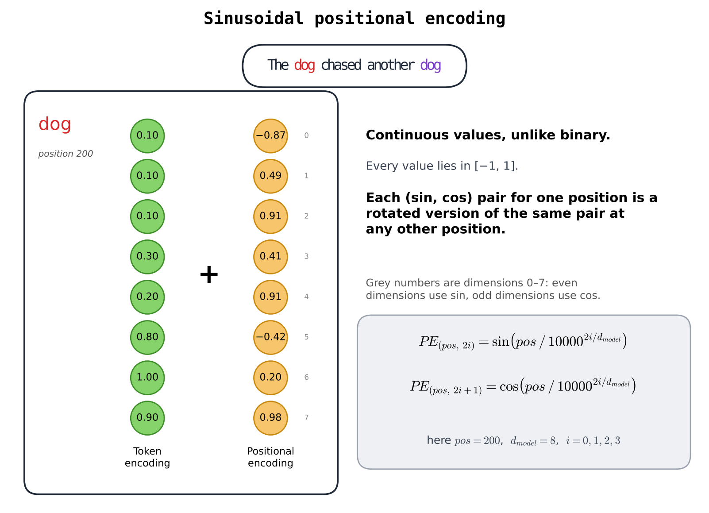
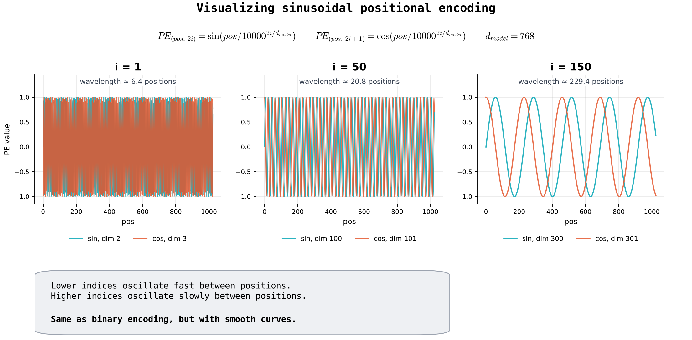
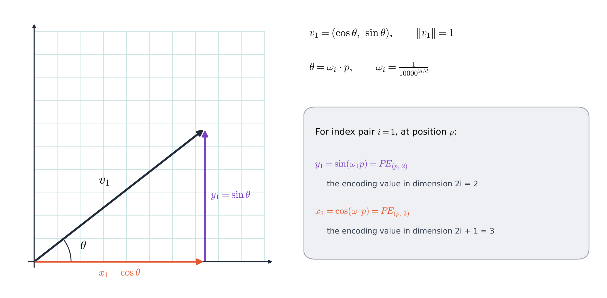
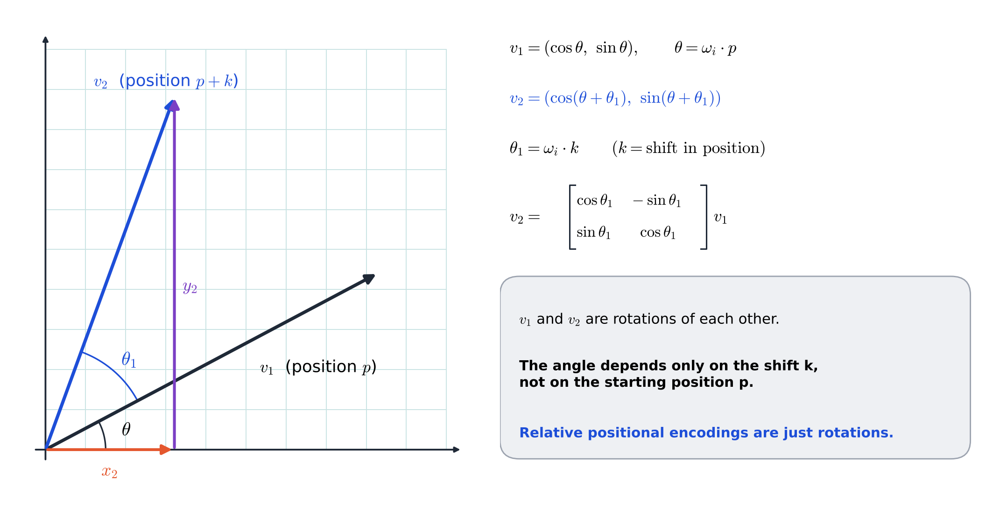
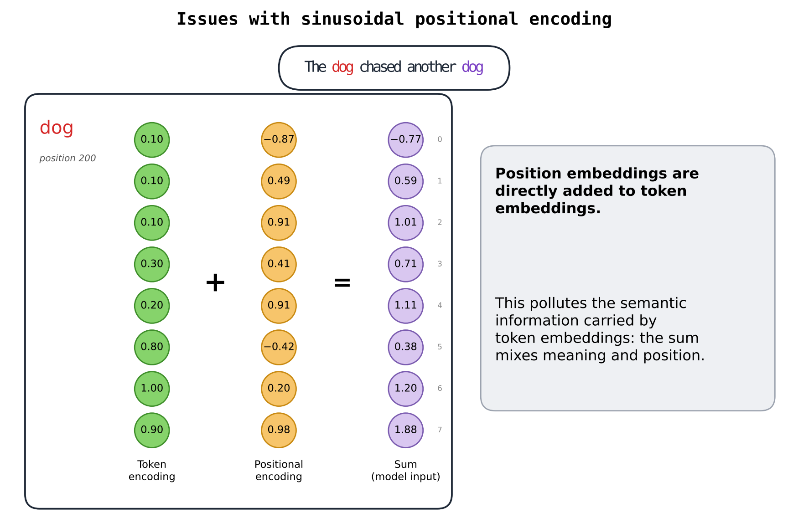
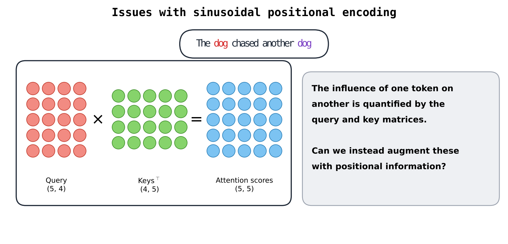
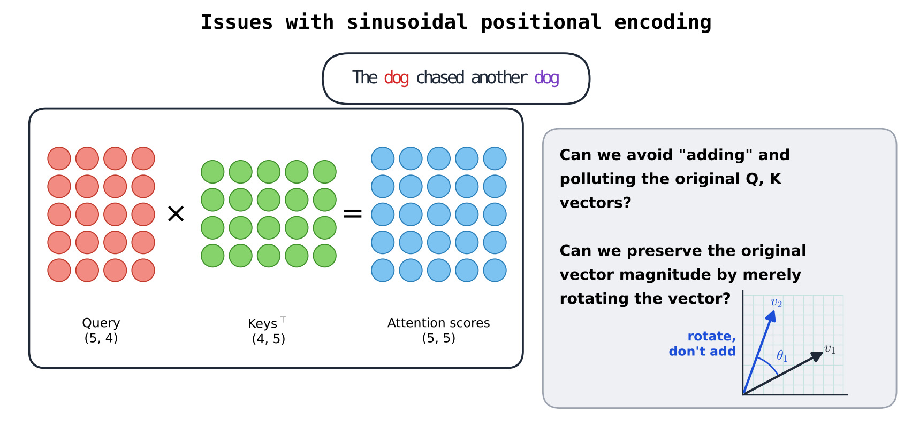

<div align="center">


<br/>

[](.)
[](.)
[](.)
[](.)
[](.)

**[← Back to the DeepSeek from Scratch series](../README.md)**

</div>

---

## Abstract

Topic 12 showed that binary positional encoding has the right structure — low indices change fast and high indices change slowly — but jumps between 0 and 1. **Sinusoidal positional encoding**, proposed in *Attention Is All You Need* [1], keeps that structure and makes it smooth: each pair of embedding dimensions holds a sine and a cosine of the position, at a frequency that falls with the index. The values are continuous and bounded in $`[-1, 1]`$, which gives a much more stable optimisation than binary encoding. The choice of a **sine and a cosine** in each pair is the key idea of this topic. Together they form a unit vector $`(\cos\theta, \sin\theta)`$ whose angle is the position times a fixed frequency, so moving forward by $`k`$ positions **rotates** that vector by an angle that depends only on $`k`$. Relative positions become rotations, and the dot product between two positional encodings depends only on how far apart they are. The encoding still has one weakness: it is **added** to the token embedding, so position and meaning are mixed before attention sees them. Asking whether we could instead rotate the query and key vectors, without adding anything, leads directly to rotary positional encoding (RoPE) in Topic 14.

---

## At a Glance

| | |
|---|---|
| **Topic** | 13 of 26 — Stage 3 (fourth topic) |
| **Document type** | Concept & derivation |
| **Core question** | How do sine and cosine turn binary encoding into a smooth encoding, and why does that make relative positions rotations? |
| **Builds on** | Topic 12 — Integer and Binary Positional Encodings |
| **Running example** | `"The dog chased another dog"` — the first *dog* at position 200, $`d_{model} = 8`$; plots use GPT-2 sizes, $`d_{model} = 768`$ and 1024 positions |
| **Key result** | Each (sin, cos) pair at position $`p + k`$ is the pair at position $`p`$ rotated by $`\omega_i k`$ |
| **Key insight** | Relative positions are rotations — and rotating, instead of adding, is the idea behind RoPE |
| **Leads to** | Topic 14 — RoPE · Topic 15 — RoPE in MLA |
| **Main artifact** | `Topic13_SinusoidalPositionalEncoding.docx` — technical report with 7 figures |
| **Version** | 1.0 · November 2026 |

---

## 1. From Binary to Sinusoidal

The main aim of sinusoidal positional encoding is to keep what binary positional encoding got right, but with values that are smooth and continuous. The main lessons from binary encoding (Topic 12) are:

- **Lower indices** (Index 1, Index 2, …) change more frequently: a **fine-grained** encoding. The LSB flips often.
- **Higher indices** (Index 7, Index 8, …) change less frequently: a **coarse** encoding. The MSB flips slowly.
- Every value depends on **two factors**: the position of the token and the index number.

The new encoding keeps all three, but replaces each jumpy square wave with a smooth wave.

---

## 2. The Sinusoidal Formula

In the 2017 paper *Attention Is All You Need* [1], the authors proposed the following formula for positional encoding:

```math
\mathrm{PE}_{(pos,\, 2i)} = \sin\!\left( \frac{pos}{10000^{2i/d_{model}}} \right), \qquad \mathrm{PE}_{(pos,\, 2i+1)} = \cos\!\left( \frac{pos}{10000^{2i/d_{model}}} \right)
```

The formula depends on the same two factors as before: the token position $`pos`$ and the index $`i`$. It gives the value at every dimension of the positional encoding vector:

- The **even dimensions** $`2i = 0, 2, 4, \dots`$ are given by the **sine** formula.
- The **odd dimensions** $`2i + 1 = 1, 3, 5, \dots`$ are given by the **cosine** formula.
- So $`i`$ counts **pairs** of dimensions: $`i = 0, 1, \dots, d_{model}/2 - 1`$, and both dimensions of pair $`i`$ share the same frequency.

<p align="center"></p>

<p align="center"><sub><b>Figure 1.</b> Sinusoidal positional encoding for the first <i>dog</i> at position 200 with d<sub>model</sub> = 8. The positional values are continuous, lie in [−1, 1], and come in (sin, cos) pairs.</sub></p>

For the first *dog* at position 200 with $`d_{model} = 8`$, the four pairs have frequencies $`1, 0.1, 0.01, 0.001`$:

| Pair $`i`$ | Frequency $`1/10000^{2i/8}`$ | Dimension $`2i`$ (sin) | Dimension $`2i+1`$ (cos) |
|---|---|---|---|
| 0 | 1 | $`\sin(200) = -0.87`$ | $`\cos(200) = 0.49`$ |
| 1 | 0.1 | $`\sin(20) = 0.91`$ | $`\cos(20) = 0.41`$ |
| 2 | 0.01 | $`\sin(2) = 0.91`$ | $`\cos(2) = -0.42`$ |
| 3 | 0.001 | $`\sin(0.2) = 0.20`$ | $`\cos(0.2) = 0.98`$ |

Unlike integer encoding, every value stays between −1 and 1, on the same scale as the token embedding. Unlike binary encoding, the values are continuous.

---

## 3. Visualizing Sinusoidal Encoding

To see the formula in practice, take the sizes of the **GPT-2** architecture [2] as a reference. GPT-2 has $`d_{model} = 768`$ and a context size of 1024. This means:

- The range of the position variable $`pos`$ is $`0`$ to $`1023`$.
- The dimensions run from $`0`$ to $`767`$, so the pair index $`i`$ runs from $`0`$ to $`383`$.

> **Note.** GPT-2 itself *learns* its position embeddings as a trainable table; it does not use the sinusoidal formula. Its sizes are used here only to make the plots concrete.

We can now plot the sinusoidal positional encoding as a function of position for different indices.

<p align="center"></p>

<p align="center"><sub><b>Figure 2.</b> Sine (dimension 2i) and cosine (dimension 2i + 1) values over 1024 positions for i = 1, 50 and 150, with d<sub>model</sub> = 768. Low indices oscillate fast; high indices oscillate slowly.</sub></p>

Lower indices oscillate fast between positions, and higher indices oscillate slowly — the same as binary encoding, but with smoother curves. Writing the formula as $`\sin(\omega_i \, pos)`$ shows why. The **frequency of oscillation** of pair $`i`$ is

```math
\omega_i = \frac{1}{10000^{2i/d_{model}}}, \qquad \text{wavelength} = \frac{2\pi}{\omega_i}
```

- The index $`i`$ sits in the **exponent of the denominator**. For a low index the denominator is close to 1, so $`\omega_i`$ is high and the wave oscillates fast.
- For a high index the denominator is large, so $`\omega_i`$ is low and the wave oscillates slowly.

| Index $`i`$ | Dimensions | Frequency $`\omega_i`$ | Wavelength (positions) | Full cycles in 1024 positions |
|---|---|---|---|---|
| 1 | 2, 3 | 0.976 | 6.4 | ≈ 159 |
| 50 | 100, 101 | 0.301 | 20.8 | ≈ 49 |
| 150 | 300, 301 | 0.0274 | 229.4 | ≈ 4.5 |

**Why 10000?** The base is an empirical choice of the original authors. The wavelengths form a geometric progression from $`2\pi`$ for $`i = 0`$ to almost $`10000 \cdot 2\pi \approx 62{,}800`$ positions for the last pair. Because the slowest waves are much longer than any sequence the model sees, no two positions in the context get the same encoding.

The main advantage of sinusoidal encoding over binary encoding is that the positional graphs are **continuous**, as opposed to being jumpy and discontinuous like binary encodings. This leads to a much more stable LLM optimisation.

---

## 4. Why Sine *and* Cosine? Relative Positions as Rotations

Why are the even indices given by sine and the odd indices by cosine? Understanding the reason truly sets the stage for RoPE.

The main reason is that it helps in knowing the **relative positions** of tokens. Given the positional encoding of one token at position $`pos`$, the sine and cosine make it much easier to find the positional encoding of another token at position $`pos + k`$. Imagine the transformer wants to learn positional patterns: if there is already an underlying pattern encoded, it is much easier for the transformer to learn position patterns among different tokens.

### 4.1 One pair as a vector

Take one pair of dimensions, $`(2i, 2i + 1)`$, and treat its two values as a 2-D vector:

```math
v_1 = (\cos\theta, \sin\theta), \qquad \theta = \omega_i \cdot p, \qquad \omega_i = \frac{1}{10000^{2i/d}}
```

<p align="center"></p>

<p align="center"><sub><b>Figure 3.</b> One (sin, cos) pair of the positional encoding at position p, drawn as a vector v<sub>1</sub> at angle θ = ω<sub>i</sub>p. For i = 1, y<sub>1</sub> is the value in dimension 2 and x<sub>1</sub> is the value in dimension 3.</sub></p>

- The magnitude of $`v_1`$ is 1, so $`y_1 = \sin\theta`$ and $`x_1 = \cos\theta`$.
- In the figure the index is $`i = 1`$, so $`2i = 2`$ and $`2i + 1 = 3`$.
- $`y_1`$ is the sinusoidal positional encoding value for position $`p`$ at **dimension 2**.
- $`x_1`$ is the sinusoidal positional encoding value for position $`p`$ at **dimension 3**.

### 4.2 Shifting the position rotates the vector

Now suppose we want the sinusoidal positional encoding values for the position shifted by $`k`$, that is $`p + k`$, at the same pair. The angle becomes $`\omega_i (p + k) = \theta + \theta_1`$:

```math
v_2 = \bigl( \cos(\theta + \theta_1), \; \sin(\theta + \theta_1) \bigr), \qquad \theta_1 = \omega_i \cdot k
```

<p align="center"></p>

<p align="center"><sub><b>Figure 4.</b> The same pair at position p + k is the vector v<sub>1</sub> rotated by θ<sub>1</sub> = ω<sub>i</sub>k. The rotation angle depends only on the shift k.</sub></p>

- $`y_2`$ is the positional encoding value of position $`p + k`$ at dimension 2.
- $`x_2`$ is the positional encoding value of position $`p + k`$ at dimension 3.
- To find these values for position $`p + k`$, all we have to do is **rotate** $`v_1`$ by the angle $`\theta_1 = \omega_i k`$, where $`k`$ is the position shift.

Using the angle-addition formulas, this rotation is a fixed matrix:

```math
\begin{bmatrix} \cos(\theta + \theta_1) \\ \sin(\theta + \theta_1) \end{bmatrix} = \begin{bmatrix} \cos\theta_1 & -\sin\theta_1 \\ \sin\theta_1 & \cos\theta_1 \end{bmatrix} \begin{bmatrix} \cos\theta \\ \sin\theta \end{bmatrix}
```

The matrix depends only on $`k`$ and the index $`i`$ — **not on the starting position** $`p`$. So $`v_1`$ and $`v_2`$ are rotations of each other, and relative positional encodings are just rotations of each other. This is why alternate indices are encoded with sine and cosine: to rotate a vector, we need both a sine and a cosine term.

A direct consequence is that the dot product between two positional encodings depends only on their distance:

```math
\mathrm{PE}(p) \cdot \mathrm{PE}(p + k) = \sum_{i=0}^{d/2 - 1} \bigl[ \sin(\omega_i p) \sin(\omega_i (p+k)) + \cos(\omega_i p) \cos(\omega_i (p+k)) \bigr] = \sum_{i=0}^{d/2 - 1} \cos(\omega_i k)
```

The NumPy check below builds the full encoding with GPT-2 sizes and confirms both facts.

```python
import numpy as np

def sinusoidal_pe(n_pos, d_model):
    pos = np.arange(n_pos)[:, None]                  # (n_pos, 1)
    i = np.arange(d_model // 2)[None, :]             # (1, d_model/2)
    omega = 1.0 / 10000 ** (2 * i / d_model)         # one frequency per pair
    pe = np.zeros((n_pos, d_model))
    pe[:, 0::2] = np.sin(pos * omega)                # even dimensions: sin
    pe[:, 1::2] = np.cos(pos * omega)                # odd dimensions: cos
    return pe, omega[0]

pe, omega = sinusoidal_pe(1024, 768)                 # GPT-2 sizes
print(pe.shape, pe.min().round(3), pe.max().round(3))

# rotation: the pair (cos, sin) at p + k is the pair at p rotated by omega_i * k
p, k, i = 200, 7, 1
v1 = np.array([pe[p, 2*i+1], pe[p, 2*i]])            # (cos, sin) at position p
t1 = omega[i] * k
R = np.array([[np.cos(t1), -np.sin(t1)],
              [np.sin(t1),  np.cos(t1)]])
v2 = np.array([pe[p+k, 2*i+1], pe[p+k, 2*i]])        # (cos, sin) at position p + k
print("R @ v1 == v2:", np.allclose(R @ v1, v2))

# the dot product depends only on the offset k, not on p
for p in (0, 100, 500):
    print(f"PE({p}) . PE({p+k}) = {pe[p] @ pe[p+k]:.4f}")
```

```
(1024, 768) -1.0 1.0
R @ v1 == v2: True
PE(0) . PE(7) = 281.8705
PE(100) . PE(107) = 281.8705
PE(500) . PE(507) = 281.8705
```

Rotations ensure that relative shifts map to fixed angular differences, which then translate into predictable, learnable attention patterns — like focusing more on nearby words. We are injecting information that positions are related to each other, and the transformer later learns to use this injected information. When this formula was released, a huge number of researchers and organisations used it to build foundation models.

---

## 5. The Problem with Sinusoidal Encoding

The main problem with sinusoidal encoding is that the **position embeddings are directly added to the token embeddings**.

<p align="center"></p>

<p align="center"><sub><b>Figure 5.</b> The positional encoding is added to the token encoding, so the vector that enters the model mixes meaning and position.</sub></p>

- We have one vector, the token embedding, and want to include information about its position.
- Currently we just **add another vector** to it. This changes the individual values and can change the **magnitude** of the current vector.
- This pollutes the semantic information carried by the token embedding.

The mixing carries through to attention. With $`x_p = e_p + \mathrm{PE}(p)`$, and writing $`W = W_Q W_K^{\top}`$, the attention score between positions $`p`$ and $`q`$ expands into four terms:

```math
x_p W x_q^{\top} = \underbrace{e_p W e_q^{\top}}_{\text{meaning, meaning}} + \underbrace{e_p W \, \mathrm{PE}(q)^{\top}}_{\text{meaning, position}} + \underbrace{\mathrm{PE}(p) W e_q^{\top}}_{\text{position, meaning}} + \underbrace{\mathrm{PE}(p) W \, \mathrm{PE}(q)^{\top}}_{\text{position, position}}
```

Only the first term is about meaning alone. The relative-position property of Section 4 holds for $`\mathrm{PE}(p) \cdot \mathrm{PE}(q)`$, but the projections $`W_Q`$ and $`W_K`$ sit in between, so it is not guaranteed to survive in the score.

The influence of one token on another is quantified by the query and key matrices: the attention scores are $`Q K^{\top}`$, a $`(5, 4) \cdot (4, 5) = (5, 5)`$ product for our five-token sentence.

<p align="center"></p>

<p align="center"><sub><b>Figure 6.</b> The attention scores come from queries times keys. Positional information could be brought in here, where token-to-token influence is measured.</sub></p>

So why not bring position into the query and key vectors, which are where relative token information is measured? If we add positional information at that later stage, we would not pollute the meaning carried by the token embeddings. And instead of adding another vector, we could **just rotate** each query and key vector:

- If we rotate a vector, its individual values change, but its **magnitude stays the same**.
- The amount of rotation depends on the position of the token.
- No other vector is added, so the token embedding is not contaminated.

<p align="center"></p>

<p align="center"><sub><b>Figure 7.</b> The idea behind RoPE: rotate the query and key vectors by an angle that depends on position, preserving their magnitude, instead of adding a positional vector.</sub></p>

**Rotary Positional Encodings (RoPE)** [3] exploit this idea, along with the rotation intuition of Section 4. That is the topic of Topic 14.

---

## Key Technical Observations

1. **Sinusoidal encoding keeps binary's structure.** Low indices oscillate fast, high indices slowly, and every value depends on position and index.
2. **The values are continuous and bounded** in $`[-1, 1]`$, giving a much more stable optimisation than binary encoding.
3. **The index counts pairs.** Dimension $`2i`$ uses sine and dimension $`2i + 1`$ uses cosine, both with frequency $`\omega_i = 1/10000^{2i/d_{model}}`$.
4. **The wavelengths grow geometrically** from $`2\pi`$ to about $`10000 \cdot 2\pi`$ positions, so positions in the context do not repeat.
5. **Each (sin, cos) pair is a unit vector** at angle $`\omega_i p`$.
6. **Shifting by $`k`$ rotates the pair by $`\omega_i k`$**, independent of the starting position $`p`$: relative positions are rotations.
7. **The dot product of two encodings depends only on their distance**, $`\sum_i \cos(\omega_i k)`$.
8. **The encoding is added to the token embedding**, mixing meaning and position before attention.
9. **Rotating query and key vectors instead of adding** preserves magnitude and keeps the token embedding clean — the idea behind RoPE.

---

## References

References are listed in IEEE numeric format.

| # | Authors | Title | Venue | Year |
|---|---|---|---|---|
| 1 | A. Vaswani et al. | Attention Is All You Need | *NeurIPS* | 2017 |
| 2 | A. Radford et al. | Language Models are Unsupervised Multitask Learners | *OpenAI Technical Report* | 2019 |
| 3 | J. Su et al. | RoFormer: Enhanced Transformer with Rotary Position Embedding | *Neurocomputing* | 2024 |

---

## Files in This Directory

| File | Description |
|------|-------------|
| `README.md` | This document — conceptual summary and reader entry point |
| `Topic13_SinusoidalPositionalEncoding.docx` | Primary artifact (v1.0) — technical report: title page, abstract, contents, 5 sections, 7 embedded figures, IEEE references |
| `images/` | The 7 figures used in this README and the report |

---

## Navigation

**Previous:** &nbsp; [Topic 12 — Integer and Binary Positional Encodings](../12_integer_binary_positional_encoding/README.md) &nbsp;·&nbsp; *Why position matters*

**Next:** &nbsp; [Topic 14 — Rotary Positional Encodings (RoPE)](../14_rotary_positional_encoding/README.md) &nbsp;·&nbsp; *Rotate queries and keys by position*

---

<div align="center">

**DeepSeek from Scratch**  
A technical report series rebuilding the key ideas behind DeepSeek-V2 / V3 from first principles.

**Shiva Kiran Dadishetty** &nbsp;·&nbsp; Independent Research &nbsp;·&nbsp; Texas, USA  
[github.com/shivakiran-ai/deepseek-from-scratch](https://github.com/shivakiran-ai/deepseek-from-scratch)

*Document version 1.0 &nbsp;·&nbsp; Last updated November 2026*


</div>
