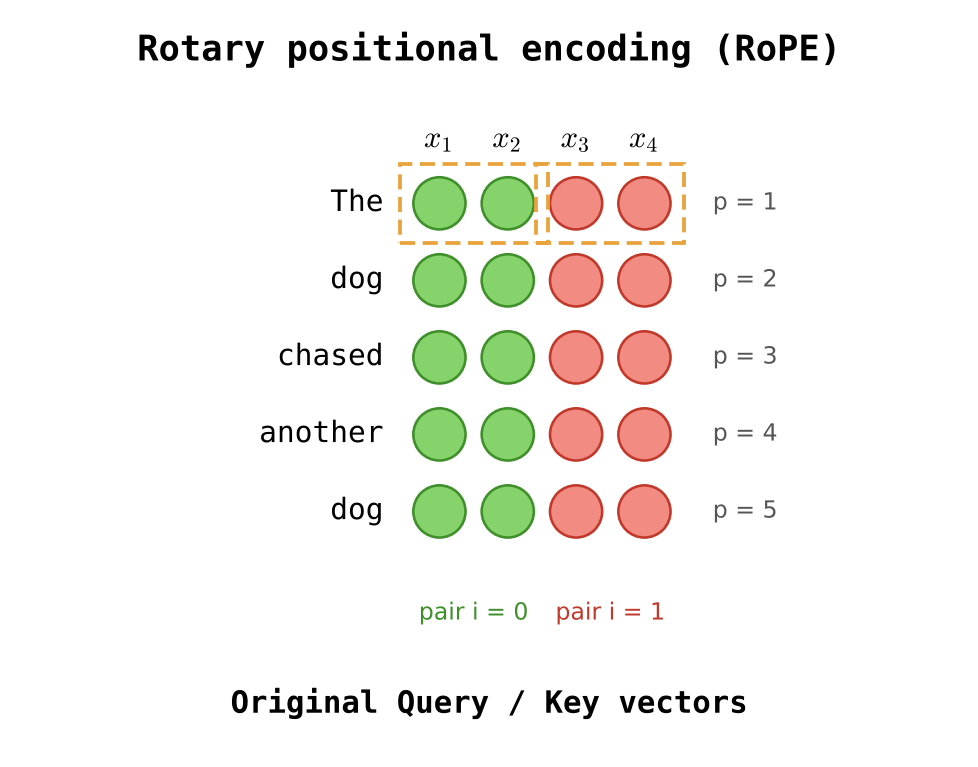
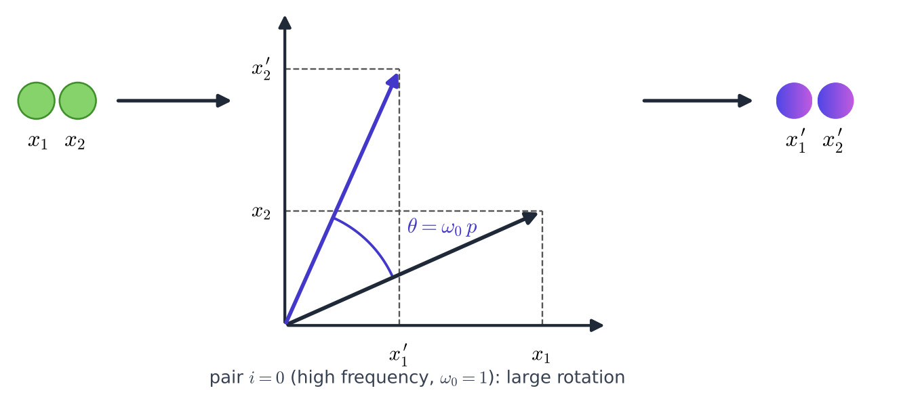
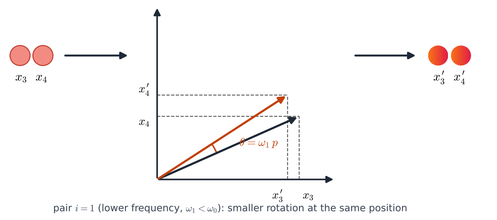
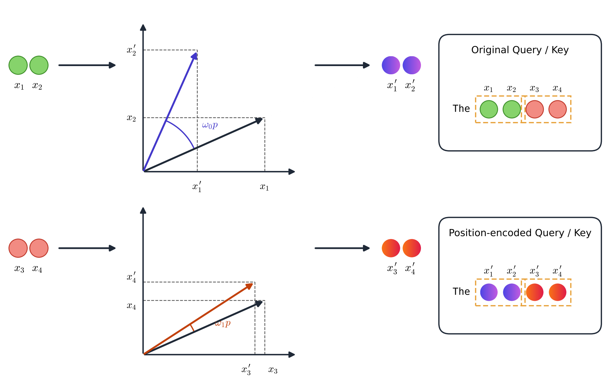
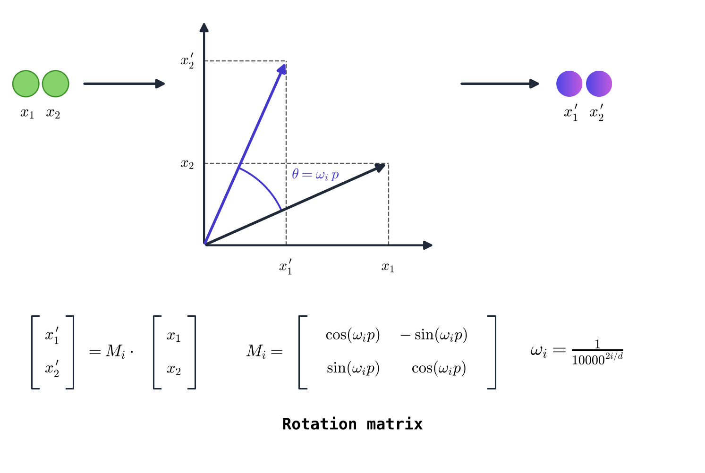
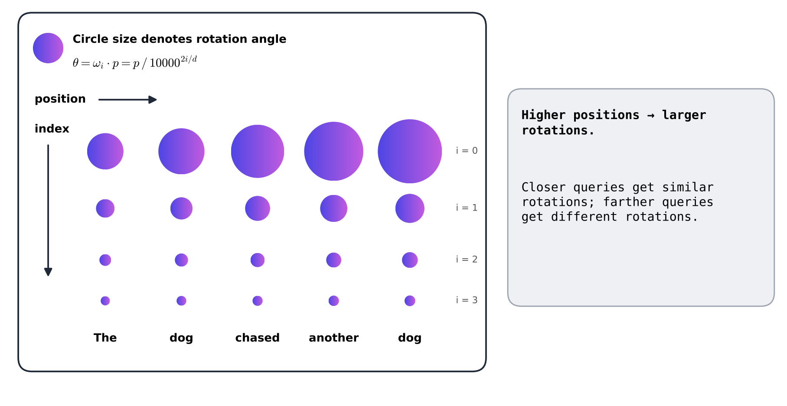
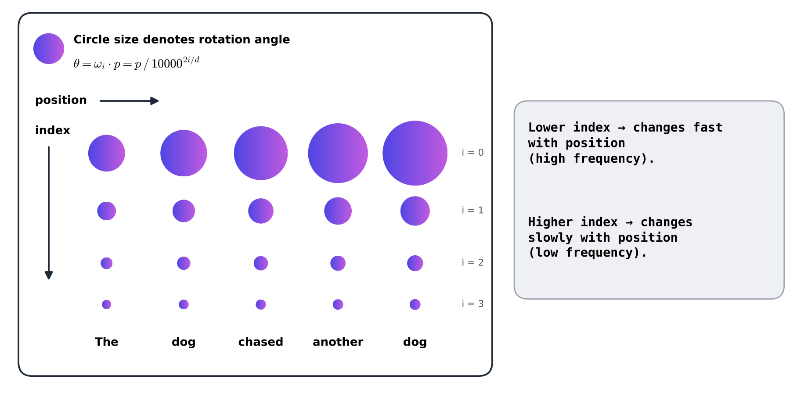
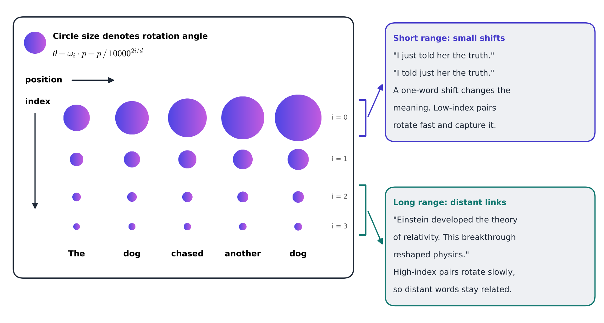

<div align="center">


<br/>

[](.)
[](.)
[](.)
[](.)
[](.)

**[← Back to the DeepSeek from Scratch series](../README.md)**

</div>

---

## Abstract

Topic 13 ended with a problem and a question. Sinusoidal positional encodings are **added** to the token embeddings, which pollutes the semantic information they carry. Could we instead bring position into the attention mechanism itself, and **rotate** the query and key vectors rather than add anything to them? **Rotary positional encoding (RoPE)** [1] does exactly this. Each query and key vector is split into pairs of indices, $`(x_1, x_2), (x_3, x_4), \dots`$, and each pair is rotated by an angle $`\theta = \omega_i \, p`$ that grows with the token's position $`p`$, at a frequency $`\omega_i = 1 / 10000^{2i/d}`$ that falls with the pair index $`i`$ — the same frequencies as sinusoidal encoding. A rotation changes the individual values but never the **magnitude** of the vector, so the token's meaning is not overwritten. And because rotations compose, the dot product between a query at position $`m`$ and a key at position $`n`$ depends only on the **distance** $`m - n`$: relative position appears directly in the attention score. Low-index pairs rotate fast and capture small, local shifts in word order; high-index pairs rotate slowly and keep distant words related. RoPE is used by most modern LLMs, including DeepSeek, where fitting it into multi-head latent attention needs one more idea — the subject of Topic 15.

---

## At a Glance

| | |
|---|---|
| **Topic** | 14 of 26 — Stage 3 (fifth topic) |
| **Document type** | Concept & derivation |
| **Core question** | How can position be injected into attention by rotating queries and keys, and why does that encode relative position? |
| **Builds on** | Topic 13 — Sinusoidal Positional Encodings · Topic 04 — Self-Attention |
| **Running example** | `"The dog chased another dog"` — 5 query/key vectors with 4 indices each, positions $`p = 1, \dots, 5`$ |
| **Key result** | $`q_m^{\top} k_n`$ after RoPE depends only on $`m - n`$, and every vector keeps its magnitude |
| **Key insight** | Rotate, don't add: position lives in the angle, meaning lives in the length |
| **Leads to** | Topic 15 — DeepSeek MLA + RoPE (Decoupled RoPE) |
| **Main artifact** | `Topic14_RotaryPositionalEncoding.docx` — technical report with 8 figures |
| **Version** | 1.0 · November 2026 |

---

## 1. From Adding to Rotating

In sinusoidal positional encoding, the position embeddings are directly added to the token embeddings. This pollutes the semantic information carried by the token embeddings (Topic 13, Section 5).

- What if we inject information about the token's position **in the attention mechanism itself**?
- Instead of adding the positional embedding to the token embedding, we include the positional information in multi-head attention: we **inject it into the query and key vectors**.
- And instead of adding another vector to form a new vector, we **rotate** the original query or key vector.

If a token has a higher position, we rotate its vector by a larger angle; if it has a lower position, by a smaller angle. But the **magnitude of the vector remains the same**: the magnitude of the query or key vector is not going to change.

---

## 2. RoPE on the Query and Key Vectors

The main idea of RoPE is to take the query and key vectors and apply the sine and cosine positional encoding to these vectors, as a rotation.

Let us say we have 5 query vectors for *"The dog chased another dog"*. Each query vector has 4 indices with values $`x_1, x_2, x_3, x_4`$.

<p align="center"></p>

<p align="center"><sub><b>Figure 1.</b> The original query (or key) vectors for the five tokens, each with four indices. RoPE groups the indices into pairs: (x<sub>1</sub>, x<sub>2</sub>) is pair i = 0 and (x<sub>3</sub>, x<sub>4</sub>) is pair i = 1.</sub></p>

- Indices $`(x_1, x_2)`$ form **pair 0** and indices $`(x_3, x_4)`$ form **pair 1**.
- With $`d`$ indices there are $`d/2`$ pairs, numbered $`i = 0, 1, \dots, d/2 - 1`$.
- The same procedure is applied to every query vector and every key vector, each with its own position $`p`$.

---

## 3. Rotating Each Pair

In RoPE, we first take the first two indices $`x_1, x_2`$ of the query vector. We form a 2-D vector out of these, $`(x_1, x_2)`$, and rotate this vector by an amount

```math
\theta = \omega_i \cdot p, \qquad \omega_i = \frac{1}{10000^{2i/d}}
```

where $`p`$ is the position of the token and $`i`$ is the index of the pair. The new values of the first two indices are $`x_1', x_2'`$.

<p align="center"></p>

<p align="center"><sub><b>Figure 2.</b> Pair 0, (x<sub>1</sub>, x<sub>2</sub>), drawn as a 2-D vector and rotated by θ = ω<sub>0</sub>p. Its new coordinates are (x<sub>1</sub>', x<sub>2</sub>').</sub></p>

We do the same for the 3rd and 4th indices, with pair index $`i = 1`$:

<p align="center"></p>

<p align="center"><sub><b>Figure 3.</b> Pair 1, (x<sub>3</sub>, x<sub>4</sub>), rotated by θ = ω<sub>1</sub>p. At the same position, pair 1 rotates by a smaller angle than pair 0, because ω<sub>1</sub> &lt; ω<sub>0</sub>.</sub></p>

For our example with $`d = 4`$, the two frequencies are $`\omega_0 = 1/10000^{0} = 1`$ and $`\omega_1 = 1/10000^{2/4} = 0.01`$:

| Token | Position $`p`$ | Pair 0 angle $`\omega_0 p`$ | Pair 1 angle $`\omega_1 p`$ |
|---|---|---|---|
| The | 1 | 1 rad (57.3°) | 0.01 rad (0.57°) |
| dog | 2 | 2 rad (114.6°) | 0.02 rad (1.15°) |
| chased | 3 | 3 rad (171.9°) | 0.03 rad (1.72°) |
| another | 4 | 4 rad (229.2°) | 0.04 rad (2.29°) |
| dog | 5 | 5 rad (286.5°) | 0.05 rad (2.86°) |

The two *dog* tokens now receive different rotations, so the model can tell them apart.

<p align="center"></p>

<p align="center"><sub><b>Figure 4.</b> Both pairs of the query vector for “The” are rotated, each by its own angle. The original query–key vector (top) becomes the position-encoded query–key vector (bottom).</sub></p>

- We injected information about the position, quantified by $`\theta`$.
- **Nowhere did we change the magnitude** of the original vector.
- We effectively rotate parts of the original query vector and hence maintain its magnitude, avoiding the vector-polluting issue we saw with sinusoidal encodings.

---

## 4. The Rotation Matrix

Rotating a 2-D vector by an angle $`\theta`$ is a multiplication by a rotation matrix. For pair $`i`$ of a token at position $`p`$:

```math
\begin{bmatrix} x_1' \\ x_2' \end{bmatrix} = M_i \begin{bmatrix} x_1 \\ x_2 \end{bmatrix}, \qquad M_i = \begin{bmatrix} \cos(\omega_i p) & -\sin(\omega_i p) \\ \sin(\omega_i p) & \cos(\omega_i p) \end{bmatrix}, \qquad \omega_i = \frac{1}{10000^{2i/d}}
```

<p align="center"></p>

<p align="center"><sub><b>Figure 5.</b> The rotation of one pair written as a matrix product. M<sub>i</sub> rotates the pair counter-clockwise by ω<sub>i</sub>p.</sub></p>

Written out, the new values are

```math
x_1' = x_1 \cos(\omega_i p) - x_2 \sin(\omega_i p), \qquad x_2' = x_1 \sin(\omega_i p) + x_2 \cos(\omega_i p)
```

- The frequency $`\omega_i`$ is exactly the frequency of sinusoidal positional encoding (Topic 13): the sine and cosine values are the same, but they are now used to **rotate** rather than to be added.
- For the full vector, the pair matrices sit along the diagonal of one block-diagonal matrix $`R_p = \mathrm{diag}(M_0, M_1, \dots, M_{d/2-1})`$, so $`x' = R_p \, x`$.
- A rotation matrix is orthogonal, $`M_i^{\top} M_i = I`$, so $`\lVert x' \rVert = \lVert x \rVert`$: the magnitude is preserved exactly.

---

## 5. Why Rotation Encodes Relative Position

Apply RoPE to a query at position $`m`$ and a key at position $`n`$: $`q_m = R_m q`$ and $`k_n = R_n k`$. The attention score is their dot product. Because rotating by $`m`$ and then undoing a rotation by $`n`$ is a single rotation by $`n - m`$, that is $`R_m^{\top} R_n = R_{n-m}`$:

```math
q_m^{\top} k_n = (R_m q)^{\top} (R_n k) = q^{\top} R_m^{\top} R_n \, k = q^{\top} R_{n-m} \, k
```

The score depends on the content of the query and key, $`q`$ and $`k`$, and on their **relative position** $`n - m`$ — not on where in the sequence the pair sits. This is the rotation property of Topic 13 (Section 4), now applied directly inside attention. Unlike sinusoidal encoding, no projection matrix sits between the rotation and the dot product, so the property holds exactly in the score.

The short NumPy check below applies RoPE to one query and one key and confirms both properties.

```python
import numpy as np

def rope(x, p):
    """Rotate each pair (x[2i], x[2i+1]) of x by the angle omega_i * p."""
    d = x.shape[-1]
    omega = 1.0 / 10000 ** (2 * np.arange(d // 2) / d)   # one frequency per pair
    theta = omega * p
    x1, x2 = x[0::2], x[1::2]                            # x1, x3, ... and x2, x4, ...
    out = np.empty_like(x)
    out[0::2] = x1 * np.cos(theta) - x2 * np.sin(theta)
    out[1::2] = x1 * np.sin(theta) + x2 * np.cos(theta)
    return out

rng = np.random.default_rng(0)
q = rng.standard_normal(4)                               # one query, d = 4
k = rng.standard_normal(4)                               # one key

# 1. rotation keeps the magnitude of the vector
print("|q|        =", np.linalg.norm(q).round(4))
print("|rope(q,5)| =", np.linalg.norm(rope(q, 5)).round(4))

# 2. the score depends only on the distance m - n
for m, n in [(3, 1), (10, 8), (100, 98)]:
    print(f"m={m:3d}, n={n:3d}:  q_m . k_n = {rope(q, m) @ rope(k, n):.4f}")
```

```
|q|        = 0.6741
|rope(q,5)| = 0.6741
m=  3, n=  1:  q_m . k_n = 0.9686
m= 10, n=  8:  q_m . k_n = 0.9686
m=100, n= 98:  q_m . k_n = 0.9686
```

The three pairs of positions are two steps apart in each case, and the score is identical.

---

## 6. Reading the Frequencies

The rotation angle $`\theta = \omega_i \cdot p = p / 10000^{2i/d}`$ depends on both the position and the pair index. Drawing each angle as a circle, with larger circles for larger angles, shows how the two interact.

<p align="center"></p>

<p align="center"><sub><b>Figure 6.</b> Rotation angle by position (left to right) and pair index (top to bottom). Later positions rotate more; circle sizes are drawn on a compressed scale.</sub></p>

- **Higher positions → larger rotations.** This means closer queries have similar positional encodings, and farther queries have different positional encodings.

<p align="center"></p>

<p align="center"><sub><b>Figure 7.</b> The same grid read down the columns: the angle grows fast with position for low indices and slowly for high indices.</sub></p>

- **Lower index → changes fast with position** (high frequency).
- **Higher index → changes slowly with position** (low frequency).

Both kinds of pair are useful, for different reasons:

<p align="center"></p>

<p align="center"><sub><b>Figure 8.</b> Low-index pairs capture small shifts in word order; high-index pairs keep distant words related.</sub></p>

- **Short range.** In *"I just told her the truth"* vs *"I told just her the truth"*, a one-word shift changes the meaning. Low-index frequencies ensure the model captures these small shifts, because a single step already changes the angle a lot.
- **Long range.** In *"Einstein developed the theory of relativity. This breakthrough reshaped physics."*, *"This breakthrough"* refers to *"the theory of relativity"* several words earlier. High-index components ensure that even with large position differences, the relationship is preserved, because the angle changes only a little over many steps.

> **Note on large angles.** A rotation by $`\theta`$ and by $`\theta + 2\pi`$ is the same rotation. For pair 0 the angle is $`p`$ radians, so it wraps around a full circle about every 6.3 positions; in the table of Section 3 the fifth token is already at 286.5°, and position 7 passes a full turn. The circles in Figures 6 – 8 show the unwrapped angle, which is why the slowly rotating high-index pairs are the ones that keep distant positions distinguishable.

---

## 7. RoPE in Practice

- **Only queries and keys are rotated**, never the values: position is needed to decide *how much* one token attends to another, which is the score $`QK^{\top}`$. The values carry the content that is mixed.
- **RoPE is applied in every attention layer**, after the projections $`XW_Q`$ and $`XW_K`$ and before the dot product, and separately in every head.
- **Pairing convention.** RoFormer [1] pairs adjacent indices, $`(x_1, x_2), (x_3, x_4), \dots`$, as in this topic. Some implementations, such as the LLaMA code [4], instead pair index $`j`$ with index $`j + d/2`$. The two are equivalent up to a fixed reordering of the indices.
- **RoPE in DeepSeek.** DeepSeek-V2 and V3 use RoPE [3]. But the rotation $`R_m`$ depends on the token's position and sits between $`W_Q`$ and $`W_{UK}`$ in the attention score, so it breaks the weight absorption of multi-head latent attention (Topic 10). Topic 15 shows how DeepSeek solves this with **decoupled RoPE**.

---

## Key Technical Observations

1. **RoPE injects position inside attention**, into the query and key vectors, instead of adding it to the token embedding.
2. **Each pair of indices is rotated** by $`\theta = \omega_i p`$, with $`\omega_i = 1/10000^{2i/d}`$ — the same frequencies as sinusoidal encoding.
3. **Different pairs rotate by different angles** at the same position: pair 0 fastest, the last pair slowest.
4. **The rotation matrix is orthogonal**, so the magnitude of every query and key vector is preserved.
5. **The attention score depends only on relative position**: $`q_m^{\top} k_n = q^{\top} R_{n-m} k`$.
6. **Unlike sinusoidal encoding**, no projection sits between the rotation and the score, so the relative property holds exactly.
7. **Low-index pairs capture short-range order**, and high-index pairs keep long-range relationships.
8. **Only Q and K are rotated**, in every layer and head; values are left unchanged.
9. **RoPE breaks MLA's weight absorption**, which DeepSeek resolves with decoupled RoPE (Topic 15).

---

## References

References are listed in IEEE numeric format.

| # | Authors | Title | Venue | Year |
|---|---|---|---|---|
| 1 | J. Su, M. Ahmed, Y. Lu, S. Pan, W. Bo, Y. Liu | RoFormer: Enhanced Transformer with Rotary Position Embedding | *Neurocomputing* | 2024 |
| 2 | A. Vaswani et al. | Attention Is All You Need | *NeurIPS* | 2017 |
| 3 | DeepSeek-AI | DeepSeek-V2: A Strong, Economical, and Efficient Mixture-of-Experts Language Model | *arXiv:2405.04434* | 2024 |
| 4 | H. Touvron et al. | LLaMA: Open and Efficient Foundation Language Models | *arXiv:2302.13971* | 2023 |

---

## Files in This Directory

| File | Description |
|------|-------------|
| `README.md` | This document — conceptual summary and reader entry point |
| `Topic14_RotaryPositionalEncoding.docx` | Primary artifact (v1.0) — technical report: title page, abstract, contents, 7 sections, 8 embedded figures, IEEE references |
| `images/` | The 8 figures used in this README and the report |

---

## Navigation

**Previous:** &nbsp; [Topic 13 — Sinusoidal Positional Encodings](../13_sinusoidal_positional_encoding/README.md) &nbsp;·&nbsp; *Relative positions as rotations*

**Next:** &nbsp; [Topic 15 — DeepSeek MLA + RoPE (Decoupled RoPE)](../15_deepseek_mla_rope/README.md) &nbsp;·&nbsp; *Why RoPE breaks weight absorption*

---

<div align="center">

**DeepSeek from Scratch**  
A technical report series rebuilding the key ideas behind DeepSeek-V2 / V3 from first principles.

**Shiva Kiran Dadishetty** &nbsp;·&nbsp; Independent Research &nbsp;·&nbsp; Texas, USA  
[github.com/shivakiran-ai/deepseek-from-scratch](https://github.com/shivakiran-ai/deepseek-from-scratch)

*Document version 1.0 &nbsp;·&nbsp; Last updated November 2026*


</div>
