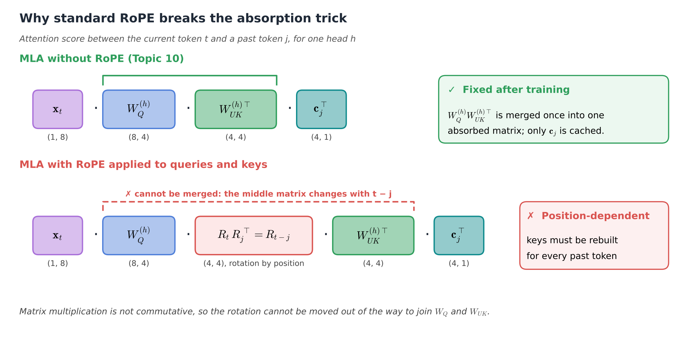
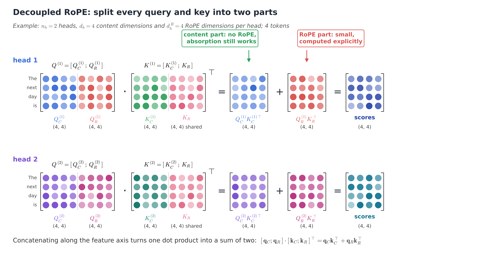
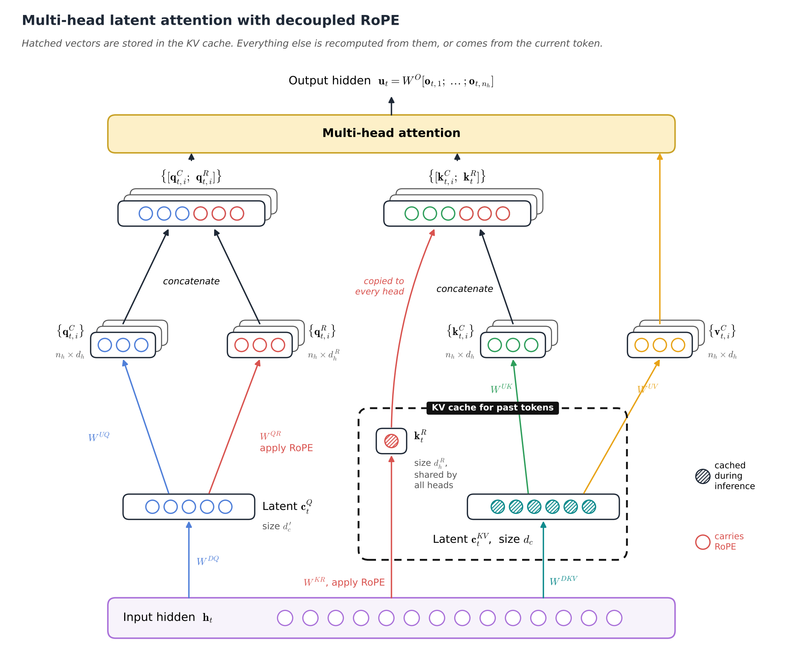
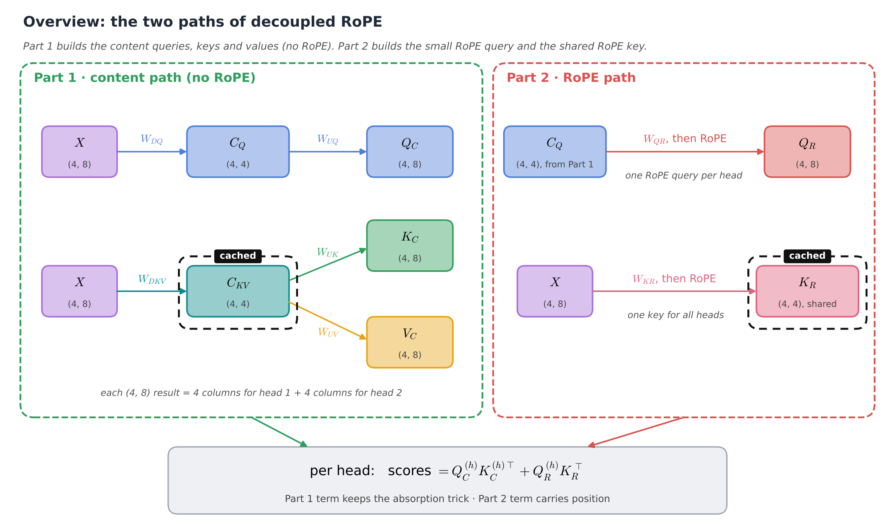
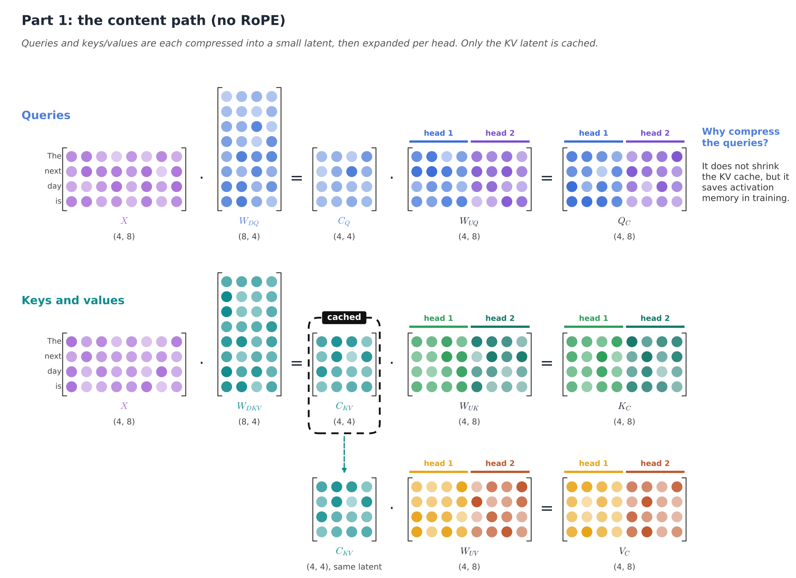
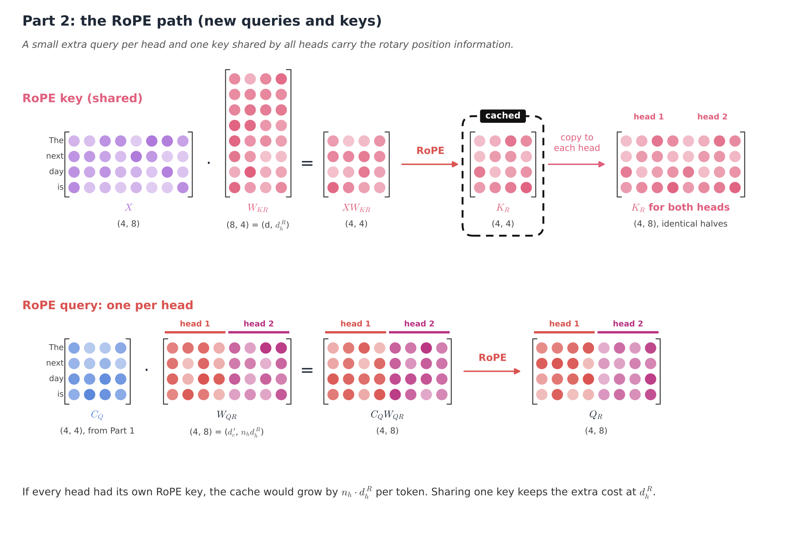
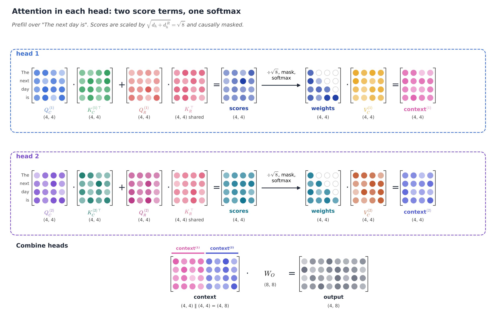
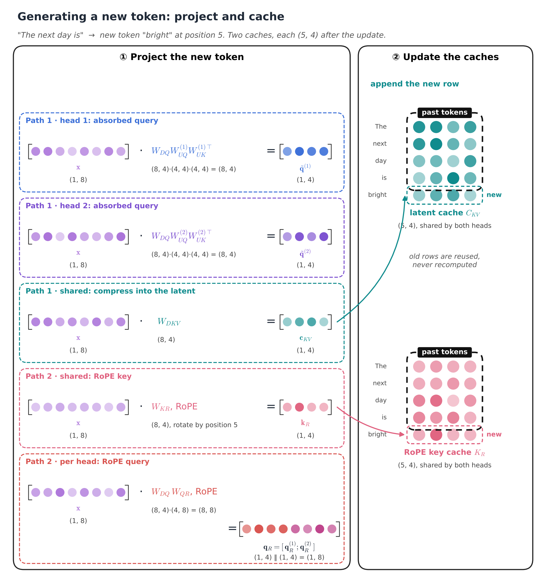
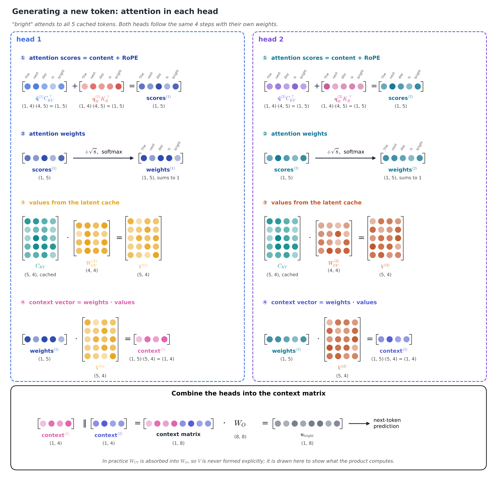

<div align="center">


<br/>

[](.)
[](.)
[](.)
[](.)
[](.)

**[← Back to the DeepSeek from Scratch series](../README.md)**

</div>

---

## Abstract

This topic puts together the two halves of Stage 3: **multi-head latent attention (MLA)**, which shrinks the KV cache by caching one small latent vector per token (Topics 10 – 11), and **rotary positional encoding (RoPE)**, which injects position by rotating queries and keys (Topics 12 – 14). The two do not combine directly. MLA's efficiency rests on the **absorption trick**: the query and key up-projections multiply into one fixed matrix after training, so keys never have to be rebuilt during inference. RoPE inserts a **position-dependent rotation** between those two matrices, and because matrix multiplication is not commutative, they can no longer be merged — every past key would have to be recomputed at every step. DeepSeek-V2 [1] solves this with **decoupled RoPE**. Each query and key is split into a **content part**, which carries no position and keeps absorption, and a small **RoPE part**, which carries position and is computed explicitly. The attention score becomes a sum of two terms, $`q_C k_C^{\top} + q_R k_R^{\top}`$. The RoPE key is **shared by all heads**, so the cache grows by only $`d_h^R`$ numbers per token. This report follows every equation of the DeepSeek-V2 architecture through a small example with two heads, traces one decoding step with both caches, and verifies in NumPy that the cached computation matches full recomputation exactly. With DeepSeek's sizes, the cache holds **576 numbers per token per layer instead of 32,768 — about 57× smaller than multi-head attention**.

---

## At a Glance

| | |
|---|---|
| **Topic** | 15 of 26 — Stage 3 (final topic) |
| **Document type** | Architecture & derivation |
| **Core question** | Why does RoPE break MLA's absorption trick, and how does decoupled RoPE restore it? |
| **Builds on** | Topics 10 – 11 — Multi-Head Latent Attention · Topic 14 — RoPE |
| **Running example** | `"The next day is"` → `"bright"` · $`d = 8`$, $`n_h = 2`$ heads, $`d_h = 4`$, $`d_c = d_c' = 4`$, $`d_h^R = 4`$ |
| **Key result** | Score $`= q_C k_C^{\top} + q_R k_R^{\top}`$; cache per token $`= d_c + d_h^R`$ |
| **Key insight** | Keep position out of the part that is absorbed, and carry it in a small shared part that is not |
| **DeepSeek numbers** | 576 = 512 + 64 cached values per token per layer · ≈ 57× smaller than MHA |
| **Leads to** | Stage 4 — Mixture of Experts |
| **Main artifact** | `Topic15_DeepSeekMLA_DecoupledRoPE.docx` — technical report with 9 figures |
| **Version** | 1.0 · November 2026 |

---

## 1. Recap: Basic MLA and the Absorption Trick

Take the four tokens *"The next day is"* with embedding dimension 8, so the input is $`X \in \mathbb{R}^{4 \times 8}`$. In basic MLA (Topic 10), shown here with a single head for clarity:

- Queries come directly from the input: $`Q = X W_Q`$, with $`W_Q \in \mathbb{R}^{8 \times 4}`$.
- Keys and values first go through a **latent**: $`C_{KV} = X W_{DKV}`$, with $`W_{DKV} \in \mathbb{R}^{8 \times 4}`$, so $`C_{KV}`$ is $`(4, 4)`$ — 4 is the latent dimension $`d_c`$.
- The latent is expanded back: $`K = C_{KV} W_{UK}`$ and $`V = C_{KV} W_{UV}`$, both $`(4, 4)`$.
- Attention scores $`QK^{\top}`$ are $`(4, 4)`$, then scaling, causal mask and softmax give the attention weights, and the weights times $`V`$ give the context matrix $`(4, 4)`$.

Latent attention implements the **absorption trick**. The attention scores can be regrouped:

```math
Q K^{\top} = X W_Q \, (C_{KV} W_{UK})^{\top} = X W_Q \, W_{UK}^{\top} C_{KV}^{\top} = \underbrace{X \, (W_Q W_{UK}^{\top})}_{\text{absorbed query}} \, \underbrace{(X W_{DKV})^{\top}}_{\text{cached}}
```

- $`W_Q W_{UK}^{\top}`$ is **fixed after training**, so it is computed only once.
- $`X W_{DKV} = C_{KV}`$ is the only thing that needs to be **cached**.
- With several heads, the product is taken **per head**: $`W_Q^{(h)} W_{UK}^{(h)\top}`$ for each head $`h`$ (Topic 11).

---

## 2. Why RoPE Breaks the Absorption Trick

DeepSeek wants to use RoPE for position, as DeepSeek 67B did [1]. If we do this with RoPE, both queries and keys are rotated by an amount that depends on their position:

```math
Q K^{\top} \;\longrightarrow\; R_{\mathrm{pos}}(X W_Q) \cdot R_{\mathrm{pos}}\bigl( W_{UK}^{\top} (X W_{DKV})^{\top} \bigr)
```

The rotation is a function of position, and it sits **between** $`W_Q`$ and $`W_{UK}`$. For one head $`h`$, a query at position $`t`$ and a key at position $`j`$, using $`R_t R_j^{\top} = R_{t-j}`$ from Topic 14:

```math
\mathbf{q}_t \mathbf{k}_j^{\top} = \mathbf{x}_t \, W_Q^{(h)} \, R_{t-j} \, W_{UK}^{(h)\top} \, \mathbf{c}_j^{\top}
```

<p align="center"></p>

<p align="center"><sub><b>Figure 1.</b> Without RoPE, W<sub>Q</sub><sup>(h)</sup> and W<sub>UK</sub><sup>(h)⊤</sup> merge once into a fixed matrix. With RoPE, a rotation that depends on the positions of the two tokens sits between them, so they cannot be merged.</sub></p>

- $`W_Q^{(h)} R_{t-j} W_{UK}^{(h)\top}`$ is different for every pair of positions, so it **cannot be absorbed** into one fixed matrix.
- Matrix multiplication does not obey a commutative law, so the rotation cannot be moved out of the way.
- As a result, we must **recompute the keys for all the prefix tokens** during inference, which significantly hinders inference efficiency.

RoPE is therefore **incompatible with low-rank KV compression** as it stands: it is position-sensitive for both keys and queries, and $`W_{UK}`$ can no longer be absorbed into $`W_Q`$.

---

## 3. The Idea: Decoupled RoPE

To avoid this, DeepSeek proposed **decoupled RoPE**. Instead of rotating the whole query and key, each one is split into two parts that are concatenated:

```math
\text{attention score} = Q K^{\top} = [\,Q_C ; Q_R\,] \cdot [\,K_C ; K_R\,]^{\top} = \underbrace{Q_C K_C^{\top}}_{\text{no RoPE}} + \underbrace{Q_R K_R^{\top}}_{\text{RoPE}}
```

Concatenating along the feature axis turns one dot product into a sum of two.

<p align="center"></p>

<p align="center"><sub><b>Figure 2.</b> In each head, the query and key are split into a content part (C) and a RoPE part (R). The score is the sum of the two partial scores. K<sub>R</sub> is the same for both heads.</sub></p>

- **$`Q_C K_C^{\top}`$** is the original version of latent attention without RoPE. The absorption trick still holds for this term.
- **$`Q_R K_R^{\top}`$** uses a new query and key matrix with rotary encoding added to it. This needs extra computation.
- Absorption is used for **one part** of the attention score calculation. This is the trade-off DeepSeek makes: a small amount of extra computation in exchange for keeping the cache small.

---

## 4. The Full Architecture

Figure 3 shows the complete MLA layer of DeepSeek-V2 [1]. The hatched vectors are the only ones stored in the KV cache.

<p align="center"></p>

<p align="center"><sub><b>Figure 3.</b> Multi-head latent attention with decoupled RoPE. Only the KV latent c<sub>t</sub><sup>KV</sup> and the shared RoPE key k<sub>t</sub><sup>R</sup> are cached for past tokens (dotted box). Red marks the parts that carry RoPE.</sub></p>

The paper writes the layer as eleven equations, with $`\mathbf{h}_t \in \mathbb{R}^{d}`$ the input of token $`t`$ as a column vector. They fall into four groups.

**Low-rank key–value joint compression.** The core of MLA, which reduces the KV cache:

```math
\mathbf{c}_t^{KV} = W^{DKV} \mathbf{h}_t, \qquad \mathbf{k}_t^{C} = W^{UK} \mathbf{c}_t^{KV}, \qquad \mathbf{v}_t^{C} = W^{UV} \mathbf{c}_t^{KV} \qquad (9\text{–}11)
```

- $`\mathbf{c}_t^{KV} \in \mathbb{R}^{d_c}`$ is the compressed latent for keys and values, with $`d_c \ll d_h n_h`$. It is what gets cached.
- $`W^{UK}`$ and $`W^{UV}`$ expand it back into the content keys and values of all heads.

**Low-rank query compression.** Queries are compressed too, even though this cannot reduce the KV cache:

```math
\mathbf{c}_t^{Q} = W^{DQ} \mathbf{h}_t, \qquad \mathbf{q}_t^{C} = W^{UQ} \mathbf{c}_t^{Q} \qquad (12\text{–}13)
```

- $`\mathbf{c}_t^{Q} \in \mathbb{R}^{d_c'}`$ is the query latent, with $`d_c' \ll d_h n_h`$; $`W^{DQ} \in \mathbb{R}^{d_c' \times d}`$ and $`W^{UQ} \in \mathbb{R}^{d_h n_h \times d_c'}`$.
- This down- and up-projection is done because it **saves activation memory during training**.

**The decoupled RoPE part.** Extra multi-head queries $`\mathbf{q}_{t,i}^{R} \in \mathbb{R}^{d_h^R}`$ and one shared key $`\mathbf{k}_t^{R} \in \mathbb{R}^{d_h^R}`$ carry RoPE, where $`d_h^R`$ is the per-head dimension of the decoupled queries and key:

```math
[\mathbf{q}_{t,1}^{R} ; \mathbf{q}_{t,2}^{R} ; \dots ; \mathbf{q}_{t,n_h}^{R}] = \mathbf{q}_t^{R} = \mathrm{RoPE}(W^{QR} \mathbf{c}_t^{Q}), \qquad \mathbf{k}_t^{R} = \mathrm{RoPE}(W^{KR} \mathbf{h}_t) \qquad (14\text{–}15)
```

- The RoPE query is built from the **query latent** $`\mathbf{c}_t^{Q}`$ and split into one piece per head.
- The RoPE key is built directly from the **input** $`\mathbf{h}_t`$, and there is only **one**, shared by all heads.

**Attention.** The two parts are concatenated, and attention proceeds as usual:

```math
\mathbf{q}_{t,i} = [\mathbf{q}_{t,i}^{C} ; \mathbf{q}_{t,i}^{R}], \qquad \mathbf{k}_{t,i} = [\mathbf{k}_{t,i}^{C} ; \mathbf{k}_{t}^{R}] \qquad (16\text{–}17)
```

```math
\mathbf{o}_{t,i} = \sum_{j=1}^{t} \mathrm{Softmax}_j\!\left( \frac{\mathbf{q}_{t,i}^{\top} \mathbf{k}_{j,i}}{\sqrt{d_h + d_h^R}} \right) \mathbf{v}_{j,i}^{C}, \qquad \mathbf{u}_t = W^{O} [\mathbf{o}_{t,1} ; \mathbf{o}_{t,2} ; \dots ; \mathbf{o}_{t,n_h}] \qquad (18\text{–}19)
```

- The scale is $`\sqrt{d_h + d_h^R}`$ because each query and key now has $`d_h + d_h^R`$ dimensions.
- The values have **no RoPE part**: position only affects how much one token attends to another, not what is read out.
- The sum runs over $`j \le t`$: attention is causal.

The next sections follow these equations through the running example, in row-vector form: $`X \in \mathbb{R}^{4 \times 8}`$, $`n_h = 2`$ heads, $`d_h = 4`$, $`d_c = d_c' = 4`$ and $`d_h^R = 4`$.

---

## 5. Overview: Two Paths

Before going matrix by matrix, Figure 4 shows the whole computation as two side-by-side paths that meet only in the attention score.

<p align="center"></p>

<p align="center"><sub><b>Figure 4.</b> The two paths of decoupled RoPE. Part 1 produces the content queries, keys and values without RoPE; Part 2 produces the RoPE query and the shared RoPE key. Only C<sub>KV</sub> and K<sub>R</sub> are cached.</sub></p>

| | Part 1 — content path | Part 2 — RoPE path |
|---|---|---|
| Equations | (9) – (13) | (14) – (15) |
| Built from | $`X`$ through two latents, $`C_Q`$ and $`C_{KV}`$ | $`C_Q`$ for the query, $`X`$ for the key |
| Produces | $`Q_C`$, $`K_C`$, $`V_C`$, each $`(4, 8)`$ | $`Q_R`$ $`(4, 8)`$ and $`K_R`$ $`(4, 4)`$ |
| Position | none | rotated by RoPE |
| Cached | $`C_{KV}`$, $`(4, 4)`$ | $`K_R`$, $`(4, 4)`$ |
| Role in the score | $`Q_C^{(h)} K_C^{(h)\top}`$ — absorption still works | $`Q_R^{(h)} K_R^{\top}`$ — computed explicitly |

- The two paths share nothing except the query latent $`C_Q`$, which feeds both $`Q_C`$ and $`Q_R`$.
- Each head takes 4 columns of every $`(4, 8)`$ result; $`K_R`$ is the exception, used whole by every head.
- Sections 6 and 7 open up each path in detail; Section 8 adds the two score terms in each head.

---

## 6. Part 1: The Content Path

Part 1 builds the content queries, keys and values — the part without RoPE, equations (9) – (13).

<p align="center"></p>

<p align="center"><sub><b>Figure 5.</b> The content path. The queries and the keys/values are each compressed into a (4, 4) latent and expanded to (4, 8): four columns per head. Only C<sub>KV</sub> is cached.</sub></p>

**Queries.** Queries are projected to a lower dimension, then back up:

```math
C_Q = X W_{DQ}: \;(4, 8) \cdot (8, 4) = (4, 4), \qquad Q_C = C_Q W_{UQ}: \;(4, 4) \cdot (4, 8) = (4, 8)
```

**Keys and values.** Both come from the same latent:

```math
C_{KV} = X W_{DKV}: \;(4, 8) \cdot (8, 4) = (4, 4)
```

```math
K_C = C_{KV} W_{UK}, \qquad V_C = C_{KV} W_{UV}: \;(4, 4) \cdot (4, 8) = (4, 8)
```

- The 8 columns of $`Q_C`$, $`K_C`$ and $`V_C`$ are **4 columns for head 1 and 4 for head 2**, because $`n_h d_h = 2 \cdot 4 = 8`$.
- The heads come from splitting the **columns of the weight matrices** $`W_{UQ}`$, $`W_{UK}`$ and $`W_{UV}`$, not from splitting the input.
- $`C_{KV}`$, at $`(4, 4)`$, is the only matrix here that is cached.

---

## 7. Part 2: The RoPE Path

Part 2 constructs the new queries and keys where the rotary embeddings are applied, equations (14) – (15).

<p align="center"></p>

<p align="center"><sub><b>Figure 6.</b> The RoPE path. One RoPE key (4, 4) is computed from the input and shared by both heads; one RoPE query per head is computed from the query latent.</sub></p>

**RoPE key, shared across all heads.**

```math
K_R = \mathrm{RoPE}(X W_{KR}): \;(4, 8) \cdot (8, 4) = (4, 4) = (4, d_h^R)
```

- $`W_{KR}`$ is $`(8, 4)`$: its output has size $`d_h^R`$, **not** $`n_h d_h^R`$. The same key matrix is used by every head.
- If we used a different weight per head, we would have $`n_h \cdot d_h^R`$ values per token to cache. Sharing keeps it at $`d_h^R`$.
- $`K_R`$ is $`(4, 4)`$ and is **cached**. When it is used, it is simply copied to each head.

**RoPE query, one per head.**

```math
Q_R = \mathrm{RoPE}(C_Q W_{QR}): \;(4, 4) \cdot (4, 8) = (4, 8) = (4, n_h d_h^R)
```

- $`W_{QR}`$ is $`(4, 8) = (d_c', n_h d_h^R)`$: 4 RoPE dimensions for head 1 and 4 for head 2.
- RoPE rotates each row by its token's position, as in Topic 14.

At the end of the two parts we have:

| | Part 1 (content) | Part 2 (RoPE) |
|---|---|---|
| Queries | $`Q_C`$: $`(4, 8)`$ | $`Q_R`$: $`(4, 8)`$ |
| Keys | $`K_C`$: $`(4, 8)`$ | $`K_R`$: $`(4, 4)`$, shared |
| Values | $`V_C`$: $`(4, 8)`$ | — |

---

## 8. Attention in Each Head

Each head now has four $`(4, 4)`$ pieces: $`Q_C^{(h)}`$, $`K_C^{(h)}`$, $`Q_R^{(h)}`$ and the shared $`K_R`$. The attention scores are

```math
\mathrm{scores}^{(h)} = Q_C^{(h)} K_C^{(h)\top} + Q_R^{(h)} K_R^{\top}: \;(4, 4) + (4, 4) = (4, 4)
```

<p align="center"></p>

<p align="center"><sub><b>Figure 7.</b> Attention in both heads. The two partial scores are added, scaled by √8, masked and passed through one softmax. The two (4, 4) contexts are concatenated into (4, 8).</sub></p>

- Scale by $`\sqrt{d_h + d_h^R} = \sqrt{4 + 4} = \sqrt{8}`$, apply the causal mask and the softmax to get the attention weights $`(4, 4)`$.
- Multiply by $`V_C^{(h)}`$, $`(4, 4)`$, to get the context of head $`h`$, $`(4, 4)`$.
- Concatenate the two heads into the context vector matrix $`(4, 8)`$, and multiply by $`W_O`$, $`(8, 8)`$.

---

## 9. Generating a New Token

So what happens exactly when a new token comes in? Suppose the model has processed *"The next day is"* and now generates *"bright"*, with input $`\mathbf{x}_{\text{bright}} \in \mathbb{R}^{1 \times 8}`$ at position 5. The step has two stages: first the new token is projected and the caches are updated (Figure 8), then each head attends over all five cached tokens (Figure 9).

### 9.1 Project the new token and update the caches

<p align="center"></p>

<p align="center"><sub><b>Figure 8.</b> Projecting “bright”. Path 1 gives one absorbed query per head and a new latent row; Path 2 gives the shared RoPE key and one RoPE query per head. Each cache receives one new row; the old rows (dotted box) are reused, never recomputed.</sub></p>

**Step 1 — Absorbed query (path 1).** For each head, the three fixed matrices merge into one $`(8, 4)`$ matrix after training:

```math
\tilde{\mathbf{q}}^{(h)} = \mathbf{x}_{\text{bright}} \, \bigl( W_{DQ} \, W_{UQ}^{(h)} \, W_{UK}^{(h)\top} \bigr): \;(1, 8) \cdot (8, 4) = (1, 4), \qquad (8, 4) \cdot (4, 4) \cdot (4, 4) = (8, 4)
```

**Step 2 — KV latent (path 1).** $`\mathbf{x}_{\text{bright}} W_{DKV}`$, $`(1, 8) \cdot (8, 4) = (1, 4)`$, is **appended to the latent cache**, which becomes $`C_{KV}`$, $`(5, 4)`$.

**Step 3 — RoPE key (path 2).** $`\mathbf{x}_{\text{bright}} W_{KR}`$, $`(1, 8) \cdot (8, 4) = (1, 4)`$, rotated by position 5, is **appended to the RoPE key cache**, which becomes $`K_R`$, $`(5, 4)`$. Only one copy is cached: it is shared by all heads.

**Step 4 — RoPE query (path 2).** $`\mathbf{c}_Q = \mathbf{x}_{\text{bright}} W_{DQ}`$, $`(1, 4)`$, times $`W_{QR}`$, $`(4, 8)`$, rotated by position 5, gives $`\mathbf{q}_R`$, $`(1, 8)`$: one $`(1, 4)`$ piece $`\mathbf{q}_R^{(h)}`$ per head.

### 9.2 Attention in each head

<p align="center"></p>

<p align="center"><sub><b>Figure 9.</b> Attention for “bright” in head 1 and head 2: scores from the two paths, attention weights, values from the latent cache, and the context vector of each head. The two contexts are concatenated into the context matrix and projected by W<sub>O</sub>.</sub></p>

Each head repeats the same four steps with its own weights.

**Step 5 — Attention scores.** The content score uses the absorbed query and the latent cache; the RoPE score uses the RoPE query and the RoPE key cache. Their sum is the score of *"bright"* against each of the five tokens:

```math
\mathrm{scores}^{(h)} = \underbrace{\tilde{\mathbf{q}}^{(h)} C_{KV}^{\top}}_{(1, 4) \cdot (4, 5)} + \underbrace{\mathbf{q}_R^{(h)} K_R^{\top}}_{(1, 4) \cdot (4, 5)} = (1, 5)
```

**Step 6 — Attention weights.** Scale by $`\sqrt{d_h + d_h^R} = \sqrt{8}`$ and apply softmax. The weights $`(1, 5)`$ sum to 1 and say how much *"bright"* attends to *The*, *next*, *day*, *is* and itself. No mask is needed: every cached token comes before or at the current one.

**Step 7 — Values.** The updated latent cache $`(5, 4)`$ times $`W_{UV}^{(h)}`$, $`(4, 4)`$, gives $`V^{(h)}`$, $`(5, 4)`$: one value row per token for this head.

**Step 8 — Context vector of each head.** The weights times the values:

```math
\mathrm{context}^{(h)} = \mathrm{weights}^{(h)} \, V^{(h)}: \;(1, 5) \cdot (5, 4) = (1, 4)
```

**Step 9 — Context matrix and output.** The two heads are concatenated and projected:

```math
\mathrm{context} = [\,\mathrm{context}^{(1)} ; \mathrm{context}^{(2)}\,]: \;(1, 4) \,\|\, (1, 4) = (1, 8), \qquad \mathbf{u}_{\text{bright}} = \mathrm{context} \cdot W_O: \;(1, 8) \cdot (8, 8) = (1, 8)
```

- $`\mathbf{u}_{\text{bright}}`$ goes on to the rest of the transformer block and, at the last layer, to next-token prediction.
- In practice $`W_{UV}^{(h)}`$ is absorbed into $`W_O`$, just as $`W_{UK}^{(h)}`$ is absorbed into the query, so $`V^{(h)}`$ is never formed explicitly. Figure 9 draws it to show what the product computes.

The NumPy check below implements both ways of computing this step: rebuilding every query and key for all five tokens, and decoding from the two caches with the absorbed query.

```python
import numpy as np
rng = np.random.default_rng(0)
d, n_h, d_h, d_c, d_cq, d_hR = 8, 2, 4, 4, 4, 4

W_DQ  = rng.standard_normal((d, d_cq))  * 0.3     # query down-projection
W_UQ  = rng.standard_normal((d_cq, n_h * d_h)) * 0.3
W_QR  = rng.standard_normal((d_cq, n_h * d_hR)) * 0.3
W_DKV = rng.standard_normal((d, d_c))   * 0.3     # KV down-projection
W_UK  = rng.standard_normal((d_c, n_h * d_h)) * 0.3
W_UV  = rng.standard_normal((d_c, n_h * d_h)) * 0.3
W_KR  = rng.standard_normal((d, d_hR))  * 0.3     # shared RoPE key

def rope(x, p):                                   # rotate pairs of the last axis
    k = x.shape[-1] // 2
    theta = p * 1.0 / 10000 ** (2 * np.arange(k) / x.shape[-1])
    x1, x2 = x[..., 0::2], x[..., 1::2]
    out = np.empty_like(x)
    out[..., 0::2] = x1 * np.cos(theta) - x2 * np.sin(theta)
    out[..., 1::2] = x1 * np.sin(theta) + x2 * np.cos(theta)
    return out

X = rng.standard_normal((5, d))                   # "The next day is bright"
pos = np.arange(1, 6)                      # positions 1 ... 5

# ---- reference: build full queries and keys, then attend
C_Q, C_KV = X @ W_DQ, X @ W_DKV
Q_C, K_C, V_C = C_Q @ W_UQ, C_KV @ W_UK, C_KV @ W_UV
Q_R = np.stack([rope((C_Q @ W_QR)[t].reshape(n_h, d_hR), pos[t]) for t in range(5)])  # (5, 2, 4)
K_R = np.stack([rope(X[t] @ W_KR, pos[t]) for t in range(5)])                          # (5, 4)
t = 4                                                                                  # the new token
ref = []
for h in range(n_h):
    s = Q_C[t, h*d_h:(h+1)*d_h] @ K_C[:, h*d_h:(h+1)*d_h].T + Q_R[t, h] @ K_R.T
    w = np.exp(s / np.sqrt(d_h + d_hR)); w /= w.sum()
    ref.append(w @ V_C[:, h*d_h:(h+1)*d_h])
ref = np.concatenate(ref)

# ---- decoding with the two caches and the absorbed query
cache_ckv, cache_kr = C_KV[:4], K_R[:4]           # stored for the 4 past tokens
x = X[t]
cache_ckv = np.vstack([cache_ckv, x @ W_DKV])     # append latent      -> (5, 4)
cache_kr  = np.vstack([cache_kr, rope(x @ W_KR, pos[t])])  # append RoPE key -> (5, 4)
q_R = rope((x @ W_DQ @ W_QR).reshape(n_h, d_hR), pos[t])
out = []
for h in range(n_h):
    absorbed = W_DQ @ W_UQ[:, h*d_h:(h+1)*d_h] @ W_UK[:, h*d_h:(h+1)*d_h].T   # (8, 4)
    s = (x @ absorbed) @ cache_ckv.T + q_R[h] @ cache_kr.T                    # (1, 5)
    w = np.exp(s / np.sqrt(d_h + d_hR)); w /= w.sum()
    out.append(w @ (cache_ckv @ W_UV[:, h*d_h:(h+1)*d_h]))                     # (1, 4)
out = np.concatenate(out)

print("cache shapes:", cache_ckv.shape, cache_kr.shape)
print("context (1, 8):", out.round(4))
print("matches full recomputation:", np.allclose(out, ref))
```

```
cache shapes: (5, 4) (5, 4)
context (1, 8): [-0.0821 -0.0647  0.1692  0.0779 -0.4551  0.0597 -0.1633  0.3404]
matches full recomputation: True
```

- The cached decoding step gives exactly the same context as rebuilding everything, while storing only two $`(5, 4)`$ matrices.
- The absorbed matrix is built **separately for each head** from that head's columns of $`W_{UQ}`$ and $`W_{UK}`$.
- No past key is recomputed: the RoPE keys were rotated once, when their tokens arrived, and are reused as they are.

---

## 10. KV Cache Size

The memory needed to cache keys and values, for $`l`$ layers, batch size $`b`$, sequence length $`s`$, $`n_h`$ heads of size $`d_h`$, $`g`$ groups in GQA, and 2 bytes per value (BF16):

| Attention | KV cache (bytes) | Per token per layer (values) | Capability [1] |
|---|---|---|---|
| Multi-head attention (MHA) | $`2 \cdot 2 \cdot l \cdot b \cdot s \cdot n_h d_h`$ | $`2 n_h d_h`$ | Strong |
| Grouped-query attention (GQA) | $`2 \cdot 2 \cdot l \cdot b \cdot s \cdot g \, d_h`$ | $`2 g \, d_h`$ | Moderate |
| Multi-query attention (MQA) | $`2 \cdot 2 \cdot l \cdot b \cdot s \cdot d_h`$ | $`2 d_h`$ | Weak |
| MLA without RoPE | $`2 \cdot l \cdot b \cdot s \cdot d_c`$ | $`d_c`$ | — |
| **MLA + decoupled RoPE** | $`2 \cdot l \cdot b \cdot s \cdot (d_c + d_h^R)`$ | $`d_c + d_h^R \approx \tfrac{9}{2} d_h`$ | **Stronger** |

MHA caches both K and V, hence the first factor 2; MLA caches one latent and one shared RoPE key. DeepSeek-V2 and V3 set $`d_c = 4 d_h`$ and $`d_h^R = d_h / 2`$ [1], [2], so the ratio to MHA is

```math
\frac{\text{MHA}}{\text{MLA + RoPE}} = \frac{2 n_h d_h}{d_c + d_h^R} = \frac{2 n_h d_h}{4 d_h + \tfrac{1}{2} d_h} = \frac{4}{9} \, n_h = \frac{4}{9} \cdot 128 \approx 57
```

| DeepSeek sizes | Value |
|---|---|
| Heads $`n_h`$, head size $`d_h`$ | 128, 128 |
| $`d_c`$, $`d_h^R`$ | 512, 64 |
| MHA values per token per layer | $`2 \cdot 128 \cdot 128 = 32{,}768`$ |
| MLA + RoPE values per token per layer | $`512 + 64 = 576`$ |
| Reduction | **≈ 57×** (the MLA cache is 1.76 % of the MHA cache) |
| Cache for 100K tokens, 61 layers, BF16 | MHA ≈ 400 GB · MLA ≈ 7.0 GB |

The decoupled RoPE key adds only $`64 / 576 \approx 11\%`$ to the cache. The paper notes that MLA's cache equals that of GQA with only **2.25 groups**, while its performance is stronger than MHA [1].

---

## Key Technical Observations

1. **Absorption is what makes MLA fast at inference**: $`W_Q^{(h)} W_{UK}^{(h)\top}`$ is fixed after training, so only the latent is cached and no key is rebuilt.
2. **Standard RoPE breaks absorption**: the rotation $`R_{t-j}`$ sits between $`W_Q`$ and $`W_{UK}`$ and changes with every pair of positions.
3. **Decoupled RoPE splits each query and key** into a content part and a RoPE part, so the score is $`q_C k_C^{\top} + q_R k_R^{\top}`$.
4. **The content part keeps absorption**; the RoPE part is small and computed explicitly — a deliberate trade-off.
5. **The RoPE key is shared by all heads**, so the cache grows by $`d_h^R`$ per token, not $`n_h d_h^R`$.
6. **The RoPE query comes from the query latent; the RoPE key comes from the input.**
7. **Queries are compressed only to save activation memory in training**; this does not change the cache.
8. **The softmax scale becomes $`\sqrt{d_h + d_h^R}`$**, and values carry no RoPE part.
9. **Each decoding step appends one row to each of two caches**, and the result is identical to full recomputation.
10. **DeepSeek caches 576 values per token per layer**, about 57× fewer than MHA, equivalent to GQA with 2.25 groups.

---

## References

References are listed in IEEE numeric format.

| # | Authors | Title | Venue | Year |
|---|---|---|---|---|
| 1 | DeepSeek-AI | DeepSeek-V2: A Strong, Economical, and Efficient Mixture-of-Experts Language Model | *arXiv:2405.04434* | 2024 |
| 2 | DeepSeek-AI | DeepSeek-V3 Technical Report | *arXiv:2412.19437* | 2024 |
| 3 | J. Su, M. Ahmed, Y. Lu, S. Pan, W. Bo, Y. Liu | RoFormer: Enhanced Transformer with Rotary Position Embedding | *Neurocomputing* | 2024 |
| 4 | A. Vaswani et al. | Attention Is All You Need | *NeurIPS* | 2017 |

---

## Files in This Directory

| File | Description |
|------|-------------|
| `README.md` | This document — conceptual summary and reader entry point |
| `Topic15_DeepSeekMLA_DecoupledRoPE.docx` | Primary artifact (v1.0) — technical report: title page, abstract, contents, 10 sections, 9 embedded figures, IEEE references |
| `images/` | The 9 figures used in this README and the report |

---

## Navigation

**Previous:** &nbsp; [Topic 14 — Rotary Positional Encodings (RoPE)](../14_rotary_positional_encoding/README.md) &nbsp;·&nbsp; *Rotate queries and keys by position*

**Next:** &nbsp; [Topic 16 — Mixture of Experts — Introduction](../16_moe_intro/README.md) &nbsp;·&nbsp; *Stage 4 begins*

---

<div align="center">

**DeepSeek from Scratch**  
A technical report series rebuilding the key ideas behind DeepSeek-V2 / V3 from first principles.

**Shiva Kiran Dadishetty** &nbsp;·&nbsp; Independent Research &nbsp;·&nbsp; Texas, USA  
[github.com/shivakiran-ai/deepseek-from-scratch](https://github.com/shivakiran-ai/deepseek-from-scratch)

*Document version 1.0 &nbsp;·&nbsp; Last updated November 2026*


</div>
